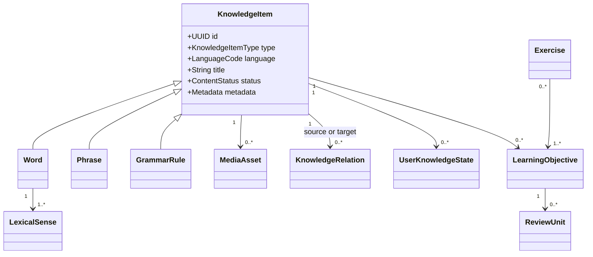
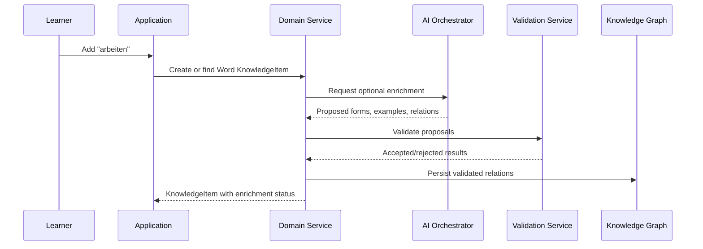

# Core Domain Model

## Purpose

This document defines the core business entities of LinguaBrain AI and their boundaries. It establishes a stable vocabulary for the product, database, API contracts, and implementation.

The model must support language learning now without preventing future learning domains. Therefore, the system's central entity is not a `Word`; it is a `KnowledgeItem`.

## Core decision

> Every semantic unit of knowledge that can be learned is represented as a KnowledgeItem.

A word is one kind of knowledge item. So are phrases, sentences, grammar rules, dialogues, and concepts. Media assets present knowledge, and exercises assess or reinforce it; neither is automatically a KnowledgeItem.

This decision avoids rebuilding the core when the learner wants to study a phrase such as `Guten Morgen`, a grammar topic such as German Dativ, or a technical concept rather than an individual word.

## Domain boundaries

The core domain defines business meaning and invariants. It does not define:

- SwiftUI views, navigation, or presentation state;
- SQL tables or ORM-specific types;
- a particular AI provider or prompt implementation;
- a particular synchronization backend;
- language-specific grammar rules.

Those concerns consume the domain model through explicit interfaces and are specified in related documents.

## Conceptual overview

## Entity: KnowledgeItem

`KnowledgeItem` is the canonical, language-agnostic representation of learning content. It is immutable in identity and mutable through validated revisions.

### Required attributes

| Attribute | Meaning | Notes |
| --- | --- | --- |
| `id` | Globally stable identifier | UUID or equivalent; never reused. |
| `type` | Kind of learnable item | Defined by `KnowledgeItemType`. |
| `language` | Primary content language | BCP 47 tag; `und` is allowed for a language-neutral Concept. Mixed content declares additional languages in typed metadata. |
| `title` | Human-readable canonical label | For a word, normally the lemma. |
| `content` | Canonical structured content | Type-specific schema. |
| `difficulty` | Estimated learning difficulty | Must be distinguishable from CEFR level. |
| `cefr_level` | Optional CEFR mapping | Relevant to language items. |
| `domains` | Domains or contexts | E.g. daily-life, embedded-systems, medicine. |
| `tags` | User/system labels | Not a substitute for structured relations. |
| `source` | Origin/provenance | Manual, imported, dictionary, AI, OCR, etc. |
| `status` | Lifecycle state | Draft/proposed, accepted-private, validated, archived, or rejected. |
| `scope` / `owner` | Visibility and ownership | MVP: bundled `SYSTEM` or learner-owned `USER_PRIVATE`. |
| `created_at` | Creation timestamp | Immutable. |
| `updated_at` | Last approved update timestamp | Updated only through a revision. |
| `metadata` | Extensible typed metadata | Must be versioned and validated. |

### Invariants

- A KnowledgeItem must have one stable `id`, one `type`, and one primary `language`.
- Unvalidated AI content must not be presented as a system-validated fact. A learner may explicitly accept it as private content with provenance/warning preserved.
- `title` and `content` must satisfy the validation rules for their type.
- A soft-deleted or archived item must remain referable by historical learning events.
- Type-specific information belongs in a typed extension, not arbitrary unstructured fields.

## KnowledgeItem types

| Type | Description | MVP status |
| --- | --- | --- |
| `WORD` | A lexical unit represented by a lemma | Required |
| `PHRASE` | A fixed or semi-fixed multiword expression | Required |
| `SENTENCE` | A complete language example or pattern | Required |
| `GRAMMAR_RULE` | A learnable grammar concept or rule | Required |
| `DIALOGUE` | A structured multi-turn interaction | Future |
| `CONCEPT` | A language-independent semantic concept | Level 1/future-ready |
| `ARTICLE` | A longer reading resource | Future |
| `CONVERSATION` | A saved guided conversation | Future |

New types may be added only with a documented schema, lifecycle rules, learning-objective templates, and migration strategy.

## Entity: KnowledgeItemRevision

Every approved or proposed change to canonical content is represented by a `KnowledgeItemRevision`. It records item ID, revision/version, previous revision, structured change, actor/source, validation decision, reason, and timestamp. Historical revisions remain auditable; only an approved revision is projected as current content.

## Entity: Word

`Word` is a KnowledgeItem with lexical properties. The stored canonical form is the lemma, not merely the surface form encountered in a sentence.

### Word-specific attributes

| Attribute | Meaning |
| --- | --- |
| `lemma` | Dictionary/canonical form, e.g. `arbeiten`. |
| `part_of_speech` | Noun, verb, adjective, adverb, preposition, etc. |
| `pronunciation` | Human-readable pronunciation support. |
| `ipa` | International Phonetic Alphabet form where applicable. |
| `frequency_band` | Frequency estimate or rank, with source. |
| `senses` | Structured meanings, scoped by context. |
| `morphology` | Language-package-owned forms and features. |
| `etymology` | Optional explanatory metadata. |

## Entity: LexicalSense

`LexicalSense` is a stable, language-specific meaning of a Word or Phrase. It prevents polysemous forms such as German `Bank` from sharing one undifferentiated translation.

A generated word card may contain multiple LexicalSense records. Each sense owns its
own examples, usage/register notes, collocations, provenance, and review identity.
The word remains the shared lexical parent; senses are not flattened into one long
translation field.

Each sense has a stable ID, definition or gloss, optional domain/register qualifiers, provenance, validation state, and version. Translation relations reference source and target sense IDs when both endpoints are lexical. The MVP may begin with one validated default sense, but it must not invent a global one-word-to-one-word mapping.

### German extension examples

German data is not universal core data. It belongs to the German language package and may include:

- noun article, grammatical gender, plural, and case forms;
- verb infinitive, present, Präteritum, Partizip II, auxiliary, separability, reflexivity, valency, and governed prepositions;
- adjective comparative and superlative forms;
- compound-word decomposition.

## Entity: Phrase

`Phrase` represents a meaningful multiword unit that should be learned as a whole or pattern.

Required properties include the exact text, a literal or structural interpretation where useful, natural translation(s), usage context, formality, and variables for reusable patterns.

Examples:

- `Guten Morgen`
- `eine Entscheidung treffen`
- `Ich hätte gern …`

### Collocations and fixed combinations

A `Phrase` may be classified as a `COLLOCATION` when the combination is conventional,
lexically restricted, or meaningfully different from composing its words independently.
Examples include German `eine Entscheidung treffen` and `Entscheidungen treffen`.
Collocations are first-class learning targets, not only tags on their component words.

Required metadata for a collocation:

- canonical target-language form and natural source-language meaning;
- component KnowledgeItem/Phrase references;
- pattern slots and allowed inflectional variants;
- register, domain, CEFR estimate, and usage notes;
- at least one validated sentence;
- provenance, validation status, and stable identity for review scheduling.

## Entity: Sentence

`Sentence` is a complete, language-specific example. It can support a word, phrase, grammar rule, dialogue, or exercise.

Required properties:

- text;
- language;
- translation(s), where configured;
- difficulty/CEFR estimate;
- source and validation status;
- references to the knowledge items illustrated.

A sentence collection is ordered and sense-scoped. Importers must not collapse multiple
examples into one string: every example receives its own stable identity, source
provenance, source/target text, and validation state. A LexicalSense may reference
many Sentence records, while the same sentence may be reused by a Phrase or Exercise.

### Everyday conversation sentences

A `Sentence` may be classified as `DAILY_CONVERSATION` and must retain its situation,
speaker/role when relevant, register, and whether it is a reusable utterance or a
literal example. Card generation should provide at least one natural daily-life
sentence for approved beginner/intermediate content, with source and target text
stored separately. Dialogue turns may reference the same sentence model so later
conversation exercises do not need a new content format.

## Entity: GrammarRule

`GrammarRule` models a teachable language rule, not a single exercise explanation.

Required properties:

- stable title and language package;
- explanation appropriate to a target learner level;
- rule pattern or constraints;
- examples and exceptions;
- prerequisite and related grammar relations;
- validation/source metadata.

Examples:

- German present-tense verb conjugation;
- German Dativ after `mit`;
- separable verb position in main clauses.

## Entity: MediaAsset

`MediaAsset` provides reusable image, audio, or video resources attached to one or more KnowledgeItems. In Level 1, the learnable target is normally a Concept or Word; the image is its presentation resource.

### Required metadata

- media type and MIME type;
- storage reference and checksum;
- language if speech or text is present;
- caption/transcript where applicable;
- attribution and license;
- accessibility information such as alt text or transcript;
- generation/provider provenance when generated.

The platform must not assume that remote URLs remain available. Cached and user-owned media require a local storage strategy.

### Card-generation media contract

An approved generated card is a content bundle, not text alone. For a spoken target
language, pronunciation audio is required whenever the selected provider/capability
is available and must be persisted with checksum, locale, voice, provider/model,
generation timestamp, and local cache reference. If generation is unavailable, the
card may be approved only through an explicit text-only fallback that records the
missing-media reason. Images remain optional and capability-gated, but use the same
provenance and cache rules.

## Entity: Exercise

`Exercise` is a learning activity derived from one or more knowledge items and learning objectives.

### Required attributes

| Attribute | Meaning |
| --- | --- |
| `exercise_type` | Translation, cloze, recognition, listening, word order, etc. |
| `prompt` | Learner-facing task content. |
| `expected_response` | Structured answer or evaluator specification. |
| `knowledge_item_refs` | Items practiced or used as context. |
| `learning_objective_refs` | Objectives being assessed or reinforced. |
| `difficulty` | Intended difficulty. |
| `hints` | Optional graded help. |
| `generation_provenance` | Template/AI/manual source and version. |
| `expiry_policy` | Whether it can be reused or must be regenerated. |

An exercise is not itself proof of learning. The learner's attempt produces a LearningEvent, which later updates mastery and review state.

## Entity: KnowledgeRelation

`KnowledgeRelation` represents a typed, directed connection between two KnowledgeItems.

### Required attributes

| Attribute | Meaning |
| --- | --- |
| `id` | Stable relation identifier. |
| `source_item_id` | Relation origin. |
| `target_item_id` | Relation destination. |
| `relation_type` | Controlled vocabulary, e.g. `SYNONYM_OF`. |
| `qualifiers` | Stable sense IDs, context, register, grammar, or domain constraints. |
| `confidence` | Confidence from 0.0 to 1.0. |
| `validation_state` | Proposed, validated, rejected, superseded. |
| `provenance` | Manual, lexical source, rule engine, or AI suggestion. |
| `created_at` / `updated_at` | Audit timestamps. |

### Initial relation families

| Family | Examples |
| --- | --- |
| Semantic | `SYNONYM_OF`, `ANTONYM_OF`, `RELATED_TO`, `BELONGS_TO_CONCEPT` |
| Morphological | `DERIVED_FROM`, `HAS_NOUN_FORM`, `HAS_ADJECTIVE_FORM`, `HAS_WORD_FORM` |
| Grammatical | `USES_GRAMMAR`, `GOVERNS_CASE`, `REQUIRES_PREPOSITION`, `EXAMPLE_OF` |
| Usage | `COLLOCATES_WITH`, `APPEARS_IN`, `HAS_REGISTER` |
| Learning-content | `PREREQUISITE_FOR`, `SIMILAR_DIFFICULTY` between KnowledgeItems |
| Translation | `TRANSLATES_TO` with required stable sense/context qualifiers |

Relations are directed even if their meaning is symmetric. Symmetric behavior is implemented by a relation policy, not by assuming every edge is identical.

## Entity: LearningObjective

`LearningObjective` describes a measurable ability related to a KnowledgeItem. It is a reusable domain definition, not a learner's current score or target stage. Learner/mission target stages are separate associations.

Examples for `arbeiten`:

- recognize the German lemma from a definition;
- recall `arbeiten` from Persian `کار کردن`;
- produce the correct present-tense form;
- recognize the word in an audio sentence;
- use the verb correctly in a simple sentence.

The learner-specific mastery of such an objective belongs to `SkillMastery` in the Learning Domain Model.

## Entity: UserKnowledgeState

`UserKnowledgeState` is the item-level aggregate representing one learner's relationship with one KnowledgeItem.

It must be separate from the canonical KnowledgeItem because different learners have different mastery, schedules, notes, and goals.

### Core attributes

- `user_id`;
- `knowledge_item_id`;
- learning status;
- derived item-level mastery summary;
- personal importance or mission relevance;
- last interaction timestamp;
- user annotations and explicit overrides;
- version/update metadata.

Objective-level evidence and scores live in `SkillMastery`; scheduling lives in `ReviewUnit`. This separation avoids conflating item ownership, competence, and memory scheduling.

## Entity: ReviewUnit

A `ReviewUnit` is a learner-specific schedulable retrieval contract for exactly one LearningObjective. It defines direction/modality, evaluator policy, and FSRS state independently from other objectives of the same KnowledgeItem.

For `arbeiten`, German-to-Persian recognition and Persian-to-German recall are separate ReviewUnits. Automatically evaluated exercises derive a rating through a versioned mapping policy; self-graded reveal cards may ask the learner for Again, Hard, Good, or Easy.

## Entity: Deck

A `Deck` is a learner-facing collection or view of KnowledgeItems. It is not the canonical storage location for a word.

Deck types:

- **smart deck:** a stored filter, e.g. all German verbs, A1 items, weak recall objectives, or embedded-systems vocabulary;
- **manual deck:** an explicit learner-created collection;
- **system deck:** a protected view generated by core rules, e.g. due reviews.

An item may appear in many decks without duplication. Adding `arbeiten` to a Verbs deck must not create a second word record.

## Entity: AIContent

`AIContent` stores generated material separately from canonical facts. It can be attached to a KnowledgeItem, Exercise, or explanation request.

Required provenance:

- task type;
- provider and model identifier;
- prompt template/version;
- input-context hash or safe reference;
- generation timestamp;
- validation status and validator;
- quality signals or user feedback;
- content version.

AIContent may be promoted to canonical content only through a validation workflow.

## Entity: LearningEvent

`LearningEvent` is an append-only record of a learner interaction. It is the factual basis for updating review state, mastery, the Digital Twin, and analytics.

Examples:

- card revealed;
- response submitted;
- answer evaluated;
- hint used;
- item postponed;
- user corrected an AI classification;
- session started or completed.

Each event records a timestamp, user, relevant knowledge item/objective, context/exercise reference, response quality, response time where available, schema version, and optional ClientContext reference.

## Value object: ClientContext

`ClientContext` identifies the interaction surface without embedding hardware logic in the learning domain. It includes surface type (`MOBILE_APP`, `DESKTOP_APP`, `DEDICATED_DEVICE`, or future type), client/runtime version, installation ID, and a versioned CapabilitySnapshot.

Capabilities may include display class, text/audio input, microphone, speaker/headset, physical controls, connectivity, and locally available ASR/TTS/AI services. LearningEvents preserve the relevant snapshot so later analysis can distinguish learner performance from surface limitations.

## Ownership and lifecycle

| Entity | Canonical ownership | Lifecycle notes |
| --- | --- | --- |
| KnowledgeItem | Shared language/content store or local learner library | Archive rather than hard-delete when history references it. |
| UserKnowledgeState | Individual learner | Deletable/exportable by the learner subject to active event history policy. |
| LearningEvent | Individual learner | Append-only; may be anonymized or exported. |
| Deck | Individual learner or system | Smart-deck membership is computed; manual membership is explicit. |
| AIContent | Learner/library scope | Requires provenance and validation state. |
| KnowledgeRelation | Shared/language/library scope | Proposals can be rejected without deleting audit information. |

## Creation and enrichment flow

## Domain service responsibilities

Domain services enforce the model's rules. Typical services include:

- **KnowledgeItemService:** create, revise, archive, deduplicate, and validate items;
- **LexicalAnalysisService:** delegate language-specific morphology and normalization to a language package;
- **RelationService:** propose, validate, and query relations;
- **DeckService:** manage smart filters and manual memberships;
- **LearningStateService:** record learner-specific state through valid LearningEvents;
- **ContentValidationService:** validate imported and AI-generated content before promotion.

## Acceptance criteria

The initial domain implementation is acceptable when:

- a word, phrase, sentence, and grammar rule can be stored as distinct KnowledgeItem types;
- a learner-specific review/mastery record does not alter canonical content;
- one word can appear in multiple smart or manual decks without duplication;
- an AI-generated example retains provenance and validation state;
- a relation can be proposed without becoming a trusted graph fact;
- homographs can have stable, separately translated LexicalSenses;
- media and exercises reference KnowledgeItems without becoming KnowledgeItems themselves;
- recognition and recall can have independent learner ReviewUnits and FSRS state;
- historical LearningEvents remain valid after an item is archived;
- German-specific attributes are supplied by a language extension rather than required for every language.

## Open questions

- What trust and sharing policy should apply if private learner content is offered for future cloud promotion?
- When should a target translation expression be promoted into its own Word/Phrase and LexicalSense?
- What is the minimum validated lexical dataset needed to reduce AI dependency for German?
- Which JSON metadata fields need normalization into first-class entities before implementation begins?

## Related documents

- `01_Product_Vision.md` — Product direction and learner segments.
- `02_Learning_Philosophy.md` — Competence and learning principles.
- `03_Non_Functional_Requirements.md` — Data integrity, provenance, and offline constraints.
- `05_Learning_Domain_Model.md` — Mastery, objectives, Digital Twin, and missions.
- `06_Knowledge_Graph_Architecture.md` — Relation semantics and graph queries.
- `12_Database_Schema_and_Persistence.md` — Persistent representation of these entities.

## Revision history

| Version | Date | Description |
| --- | --- | --- |
| 0.2.2 | 2026-07-21 | Replaced the retired Flutter boundary example with the native SwiftUI presentation boundary; domain semantics remain framework-independent. |
| 0.2.1 | 2026-07-11 | Added platform-neutral ClientContext and CapabilitySnapshot value objects. |
| 0.2.0 | 2026-07-11 | Cross-document architecture review; resolved domain, validation, scheduling, privacy, and MVP consistency contracts. |
| 0.1.0 | 2026-07-10 | Initial core domain model specification. |
