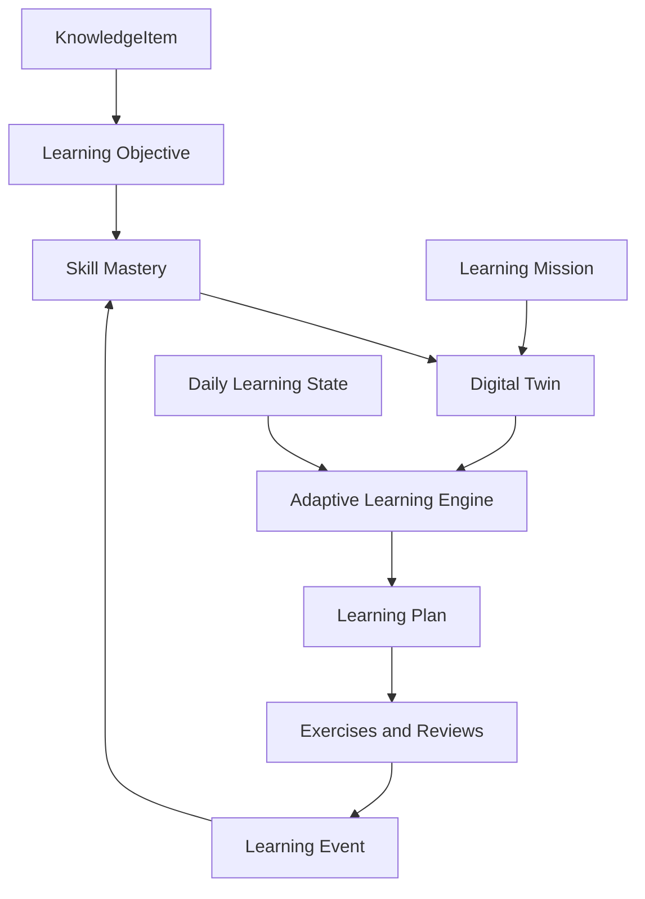
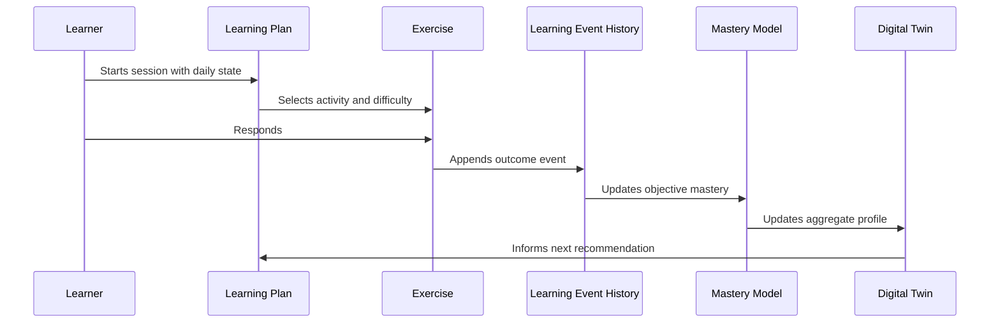

# Learning Domain Model

## Purpose

This document defines how LinguaBrain represents learner competence, learning goals, activity outcomes, and long-term personalization. It extends the Core Domain Model with learner-specific meaning.

The system must answer more than “has the learner seen this item?” It must be able to answer:

> What can this learner reliably recognize, recall, understand, write, and produce—and what should improve next?

## Core principles

1. Competence is multidimensional. Recognition does not prove recall or production.
2. Evidence is event-based. Every mastery update must be traceable to learner activity.
3. The Learning Engine makes final educational decisions deterministically.
4. AI can analyze, generate, and explain, but cannot directly change mastery or scheduling state.
5. A learner's immediate condition changes session design, not the underlying definition of competence.

## Conceptual model



## Learning objective

A **LearningObjective** is a measurable ability associated with a KnowledgeItem. It defines what successful learning looks like; it is not a learner score.

### Required attributes

| Attribute | Meaning |
| --- | --- |
| `id` | Stable objective identifier. |
| `knowledge_item_id` | Item this objective concerns. |
| `operation` | Cognitive operation: recognize, recall, comprehend, apply, or produce. |
| `modality` | Text, audio, speech, visual, or mixed presentation/response. |
| `target_component` | Meaning, lexical form, grammar, pronunciation, or contextual usage. |
| `objective_type` | Specific measurable contract, e.g. recall lemma or apply article. |
| `assessment_policy` | Evidence accepted for mastery updates. |
| `prerequisites` | Optional objective or knowledge prerequisites. |
| `language_package` | Rule source when language-specific. |

### Orthogonal objective dimensions

The taxonomy must not mix a cognitive operation with a modality or content component. Each objective combines dimensions explicitly.

| Dimension | Values/examples |
| --- | --- |
| Operation | `RECOGNIZE`, `RECALL`, `COMPREHEND`, `APPLY`, `PRODUCE` |
| Modality | `TEXT`, `AUDIO`, `SPEECH`, `VISUAL`, `MIXED` |
| Target component | `MEANING`, `LEXICAL_FORM`, `GRAMMAR`, `PRONUNCIATION`, `CONTEXTUAL_USAGE` |
| Context | language pair, direction, register, domain, and task constraints |

Examples: reverse translation is `RECALL + TEXT + LEXICAL_FORM`; dictation is `PRODUCE + AUDIO→TEXT + LEXICAL_FORM`; article cloze is `APPLY + TEXT + GRAMMAR`.

Objective-to-objective prerequisites use a separate `ObjectiveDependency` association with source objective, target objective, dependency type, confidence, and provenance. These associations are not Knowledge Graph edges because LearningObjectives are not KnowledgeItems.

### Objective templates

Language packages define reusable templates. Examples for German:

**Noun**

- recognize the meaning;
- recall the German lemma from Persian;
- recall the article;
- recall/recognize the plural;
- use the noun in a contextual sentence.

**Verb**

- recognize the meaning;
- recall the infinitive;
- choose or produce the correct present-tense form;
- recognize/provide a past form as required by level;
- use required prepositions/cases;
- use the verb in written or spoken context.

**Grammar rule**

- identify the rule in context;
- explain the rule at the target level;
- choose the correct form;
- apply it in writing;
- apply it in production.

## Mastery model

**SkillMastery** is a learner-specific estimate for one LearningObjective. It is derived from events, never manually overwritten without recording a reason. Desired target stages belong to mission/learner requirements, not the reusable objective.

### Attributes

| Attribute | Meaning |
| --- | --- |
| `user_id` | Learner owner. |
| `learning_objective_id` | Objective measured. |
| `score` | Normalized 0–100 estimate. |
| `confidence` | Confidence in the estimate, 0.0–1.0. |
| `stage` | Current progression stage. |
| `evidence_count` | Number of eligible events. |
| `last_evidence_at` | Most recent valid event. |
| `trend` | Improving, stable, or declining. |
| `last_updated_at` | Update time. |

### Progression stages

```text
UNKNOWN → INTRODUCED → RECOGNIZED → RECALLED → APPLIED → AUTOMATIC
```

Stages are descriptive summaries, not a replacement for score and confidence. A learner can be `RECALLED` for a word's meaning but `INTRODUCED` for its plural form.

### Evidence weighting

Mastery updates consider:

- correctness and partial correctness;
- response time relative to task expectations;
- exercise modality and difficulty;
- hint use and answer reveal;
- recency and spacing of successful evidence;
- repeated error patterns;
- evaluator confidence for open-ended or AI-assisted assessment.

The scoring algorithm must be versioned. Historical events are preserved so revised algorithms can recompute derived mastery estimates.

## Learning event

A **LearningEvent** records what happened during learning. It is append-only and is the source of truth for state derivation.

### Required fields

- event identifier and timestamp;
- learner identifier;
- session identifier where applicable;
- KnowledgeItem and LearningObjective references;
- activity/exercise type and version;
- outcome (`correct`, `incorrect`, `partial`, `skipped`, `revealed`, etc.);
- response time when meaningful;
- hints used and answer-reveal state;
- evaluator source and confidence;
- safe response payload/reference when needed for feedback;
- schema version.

No derived score, streak, or AI inference may replace the original event history.

## Error pattern

An **ErrorPattern** is a recurring, actionable interpretation of events. It is not a single wrong answer.

Examples:

- masculine German articles are frequently confused;
- Dativ after `mit` is omitted;
- separable verb prefixes are placed incorrectly;
- listening responses fail when audio speed exceeds a threshold.

### Requirements

- Patterns need evidence references and confidence.
- Learners can inspect and correct system interpretations.
- A pattern may trigger targeted practice but must not permanently label a learner as weak.
- Patterns expire or decay when later evidence shows improvement.

## Learning mission

A **LearningMission** represents a learner goal that influences what is important. It is not a rigid curriculum.

### Examples

- Daily German conversation
- Goethe B2 preparation
- Work in Germany
- Embedded systems German
- German for a medical workplace

### Required attributes

| Attribute | Meaning |
| --- | --- |
| `id`, `user_id` | Mission identity and owner. |
| `name`, `description` | Learner-readable goal. |
| `status` | Draft, active, paused, completed, archived. |
| `target_language` | Language being learned. |
| `target_level` | Optional CEFR or mission-specific level. |
| `target_date` | Optional, never treated as a guarantee. |
| `domain_weights` | Relevance of domains such as work or travel. |
| `objective_dimension_weights` | Priority by operation, modality, or target component, e.g. audio comprehension for an exam. |
| `requirements` | Vocabulary, grammar, and activity requirements. |

Missions guide prioritization. They must not hide due reviews or force irrelevant content into every session.

A `MissionObjectiveTarget` links a mission (or explicit learner goal) to a LearningObjective and desired stage/weight. This allows the same objective to have different targets for different learners and missions.

## Review unit

A `ReviewUnit` binds one learner, one LearningObjective, one retrieval direction/modality, one evaluator/rating policy, and one FSRS state. The MVP schedules ReviewUnits rather than whole KnowledgeItems, so recognition and recall can become due independently.

Automatically scored attempts map correctness, hints, reveal state, and latency to FSRS ratings through a versioned deterministic policy. A user rating is requested only for self-graded reveal cards. The raw evidence and derived rating are both retained.

## Digital Twin

The **Digital Twin** is a privacy-respecting, explainable aggregate model of a learner. It summarizes evidence; it is not an opaque personality profile.

### Digital Twin components

| Component | Examples |
| --- | --- |
| Vocabulary profile | mastery distribution by CEFR, domain, and POS |
| Grammar profile | strengths and error patterns by rule/topic |
| Competence profile | trends by operation, modality, and target component; learner-facing summaries may say reading/listening/writing/speaking |
| Retention profile | forgetting risk, review completion, lapse patterns |
| Learning behavior | preferred session duration, completion patterns, best study times when supported by evidence |
| Preferences | chosen domains, example styles, accessibility settings |
| Mission context | active goals and relative importance |

### Constraints

- The Digital Twin must be reconstructible from primary data and documented derivations.
- It must distinguish user-provided preferences from system-derived inferences.
- Sensitive or weakly supported inferences must not be made or exposed as facts.
- Learners can view, correct, and delete their profile information according to the privacy model.

## Daily Learning State

The **DailyLearningState** represents the learner's momentary check-in and affects today's session only.

### Inputs

| Input | Range/examples |
| --- | --- |
| Available time | 5, 10, 20, 30, 60+ minutes |
| Energy | 1–10 |
| Motivation | optional 1–10 or qualitative state |
| Focus | optional 1–10 |
| Stress | optional 1–10 |
| Preferred mode | light review, new learning, speaking, challenge |

### Mode selection

| Mode | Typical conditions | Session emphasis |
| --- | --- | --- |
| Recovery | low energy/time or high stress | due review, familiar material, short listening/recognition |
| Growth | typical conditions | balanced review, new knowledge, guided practice |
| Challenge | high energy/time | productive skills, longer contexts, writing/speaking, difficult retrieval |

Daily state can reduce cognitive load but cannot erase necessary review state. The learner may override the suggested mode.

## Learning plan

A **LearningPlan** is a proposed, time-bounded sequence of activities for a session or day.

### Inputs

- active LearningMission(s);
- due reviews and FSRS risk;
- SkillMastery and ErrorPatterns;
- Digital Twin summary;
- available knowledge and exercise inventory;
- DailyLearningState;
- user preferences and explicit overrides.

### Output requirements

Every plan must contain:

- estimated duration;
- ordered activities and relevant knowledge items;
- intended skills and mission rationale;
- difficulty/mode;
- a concise learner-readable explanation;
- re-planning behavior if the learner skips or ends early.

Example for 20 minutes, normal energy:

```text
8 min  Due reviews: 10 German verbs with recall risk
5 min  New connected vocabulary: Arbeit word family
4 min  Cloze practice: Dativ after workplace prepositions
3 min  Short listening: workplace dialogue
```

## Update loop



## Acceptance criteria

The initial Learning Domain Model is acceptable when:

- a single word can have separate recall, listening, and grammar objectives;
- two learners can have different mastery and review state for the same canonical item;
- every mastery change can be traced to LearningEvents;
- a mission affects priority without modifying canonical content;
- low energy produces a lower-load plan while keeping due-review logic intact;
- an error pattern can trigger targeted practice and later decay with improvement;
- the Digital Twin can explain its important recommendations using underlying evidence.

## Open questions

- What mastery score/confidence thresholds should map to each progression stage?
- How should human self-assessment influence AI-evaluated speaking/writing evidence?
- Which error patterns belong to a language package versus a generic exercise evaluator?
- How much behavioral inference is useful before it becomes intrusive?
- Should a learner support multiple active missions with conflicting deadlines in the MVP?

## Related documents

- `02_Learning_Philosophy.md` — Learning principles and pedagogical constraints.
- `03_Non_Functional_Requirements.md` — Privacy, auditability, and reliability rules.
- `04_Core_Domain_Model.md` — KnowledgeItem, LearningObjective, and LearningEvent entities.
- `06_Knowledge_Graph_Architecture.md` — Connected knowledge and prerequisites.
- `07_Adaptive_Learning_Engine.md` — Priority calculation and session planning.

## Revision history

| Version | Date | Description |
| --- | --- | --- |
| 0.2.0 | 2026-07-11 | Cross-document architecture review; resolved domain, validation, scheduling, privacy, and MVP consistency contracts. |
| 0.1.0 | 2026-07-10 | Initial Learning Domain Model specification. |
