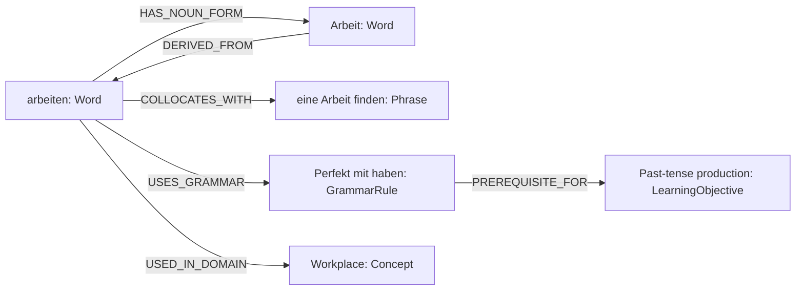
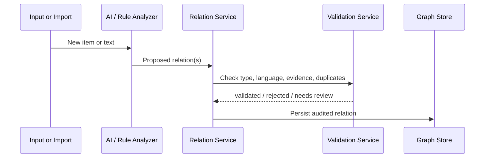

# Knowledge Graph Architecture

## Purpose

The Knowledge Graph connects learning content into a navigable, validated network. It enables LinguaBrain to teach related concepts together, expose grammar and usage dependencies, and avoid treating vocabulary as isolated flashcards.

The graph is a domain capability, not an AI output store. AI can propose nodes and relationships, but validation services determine what becomes a trusted graph fact.

## Goals

- Represent semantic, morphological, grammatical, usage, domain, translation, and learning-prerequisite relationships.
- Support efficient learner-facing queries and Learning Engine decisions.
- Preserve provenance, confidence, validation state, and revision history.
- Work with relational persistence in the MVP and remain portable to a graph database later.
- Allow language packages to define language-specific relationship policies.

## Non-goals

- Building a universal ontology for every language in the MVP.
- Assuming all AI-generated relations are correct.
- Replacing a dictionary, corpus, or grammar authority.
- Showing a large graph visualization during normal review sessions.

## Graph model



### Nodes

Nodes are canonical `KnowledgeItem` records from the Core Domain Model. The graph does not duplicate vocabulary or grammar data in separate node records.

Node categories include:

- words, phrases, sentences, grammar rules, and dialogues;
- concepts and domains;
- media resources where they are learning-relevant;
- LearningObjectives when prerequisite or support relationships are needed.

### Edges

Edges are `KnowledgeRelation` records. Every edge is directed and typed. Symmetric relationships use a relation policy to create or infer the reverse view; they do not rely on an unsafe assumption that all edges are bidirectional.

## Relation taxonomy

| Family | Relation types | Examples |
| --- | --- | --- |
| Semantic | `SYNONYM_OF`, `ANTONYM_OF`, `RELATED_TO`, `BELONGS_TO_CONCEPT` | `schnell` ↔ `rasch` |
| Morphological | `DERIVED_FROM`, `HAS_NOUN_FORM`, `HAS_ADJECTIVE_FORM`, `HAS_WORD_FORM` | `entscheiden` → `Entscheidung` |
| Grammar | `USES_GRAMMAR`, `GOVERNS_CASE`, `REQUIRES_PREPOSITION`, `EXAMPLE_OF` | `warten` → `auf + Akkusativ` |
| Usage | `COLLOCATES_WITH`, `APPEARS_IN`, `USED_IN_DOMAIN`, `HAS_REGISTER` | `Vertrag` → business German |
| Translation | `TRANSLATES_TO` | sense-qualified German ↔ Persian mapping |
| Learning | `PREREQUISITE_FOR`, `SUPPORTS_OBJECTIVE`, `SIMILAR_DIFFICULTY` | verb basics → conjugation |

### Relation policy

Each relation type declares:

- whether it is directed, symmetric, or has an inverse type;
- source and target type constraints;
- whether cycles are allowed;
- required qualifiers, such as sense, case, or language;
- acceptable sources of evidence;
- default confidence and validation requirements.

Example: `SYNONYM_OF` is semantically symmetric but may be context-sensitive. It requires language and sense compatibility; a reverse view may be inferred only after validation.

## Relation record

Every graph relation contains:

| Field | Description |
| --- | --- |
| `id` | Stable relation identifier. |
| `source_item_id`, `target_item_id` | Directed endpoints. |
| `relation_type` | Controlled vocabulary. |
| `qualifiers` | Context, sense, grammatical constraints, level, or domain. |
| `confidence` | Numeric confidence from 0.0 to 1.0. |
| `validation_state` | Proposed, validated, rejected, superseded. |
| `provenance` | User, trusted source, language rule, import, or AI proposal. |
| `evidence_refs` | Safe references to supporting source data. |
| `created_at`, `updated_at` | Audit timestamps. |

No relation with `proposed` status is used as a trusted prerequisite or automatically shown as a fact to a learner.

## Validation pipeline



### Validation requirements

1. Endpoints must exist and satisfy the relation type's allowed node categories.
2. Language and sense qualifiers must be compatible.
3. Duplicate or contradictory relations must be detected.
4. Language-package rules validate morphology and grammar where possible.
5. AI proposals require provenance and confidence; they may require user review for ambiguous or high-impact facts.
6. Rejected proposals remain auditable but do not appear in normal graph queries.

## Word-family engine

The Word-family engine provides a focused graph view for related lexical forms, collocations, and relevant grammar.

For `entscheiden`, a learner may see:

```text
entscheiden (verb)
├── Entscheidung (noun)
├── entscheidend (adjective)
├── eine Entscheidung treffen (phrase)
└── Präposition/usage notes where applicable
```

The engine must rank candidates by:

- validation status and confidence;
- mission/domain relevance;
- CEFR and learner difficulty fit;
- prerequisite readiness;
- novelty and current learning load.

It must not add every related word automatically. Learners receive a small, explainable set of optional recommendations.

## Graph queries

### Learner-facing queries

- “Show related words for this item.”
- “Which grammar is needed here?”
- “What should I learn before this?”
- “Show examples of this phrase in workplace German.”
- “Which words in my weak set belong to this family?”

### Learning Engine queries

- Find due items with related weak objectives.
- Find validated prerequisites missing for a mission requirement.
- Expand a selected topic with CEFR-appropriate, connected candidates.
- Find suitable distractors that are close in level but not semantically identical.
- Build a context set whose vocabulary is mostly known to the learner.

### Query constraints

- Default graph traversal depth is limited, normally 1–2 hops.
- Queries must filter by validation state.
- User-specific mastery and privacy filters are applied outside canonical graph facts.
- Expensive traversals must be paged, cached, or computed asynchronously.

## Prerequisite model

Learning prerequisites are directed and must be conservative. The relation `PREREQUISITE_FOR` means that a learner is likely to benefit from competence in the source before attempting the target—not that learning is impossible without it.

Example:

```text
German present-tense conjugation
  → prerequisite for
producing a basic present-tense sentence
```

The Learning Engine may suggest a prerequisite but must allow learner choice and avoid blocking exploration.

## Context and polysemy

Words can have multiple senses. A graph must not equate all meanings of a surface form.

Example: `Bank` may represent a financial institution or a bench. Sense qualifiers and context relations must distinguish them. Translation relations also require sense/context qualifiers rather than one global word-to-word mapping.

## Storage strategy

### MVP

Use SQLite relational tables for nodes (`knowledge_items`) and edges (`knowledge_relations`) with indexes on:

- `source_item_id`;
- `target_item_id`;
- `relation_type`;
- `validation_state`;
- language/domain qualifiers where queried frequently.

Recursive queries or application-level bounded traversal are sufficient for MVP graph depth.

### Future migration

The domain API must remain independent of SQLite. If query scale or traversal complexity justifies it, a graph-oriented store may be introduced behind the same repository interface. Migration must preserve IDs, provenance, validation state, and history.

## Graph quality metrics

- percentage of learner-visible relations that are validated;
- duplicate/contradiction rate;
- acceptance rate of related-item recommendations;
- learner correction rate for proposed relations;
- time to query common one- and two-hop graph views;
- coverage of required relation types for supported language packages.

## Acceptance criteria

The initial graph capability is acceptable when:

- a word can link to forms, phrases, grammar, concepts, and domains without duplicate node storage;
- a proposed AI relation cannot affect learning decisions until validated;
- the system can return a one-hop word-family view in the target performance budget;
- a relation supports source, confidence, qualifiers, validation state, and audit metadata;
- polysemous words can keep distinct sense-qualified relationships;
- the Learning Engine can request prerequisites and connected recommendations through a provider-independent interface.

## Open questions

- Which trusted lexical data sources can be licensed or used for initial German validation?
- Which relation types must require human review versus rule-based validation?
- How should user-created relations be shared, if at all, in future cloud versions?
- Which graph recommendations are useful enough to surface during a short recovery-mode session?

## Related documents

- `04_Core_Domain_Model.md` — KnowledgeItem and KnowledgeRelation definitions.
- `05_Learning_Domain_Model.md` — Mastery, objectives, and missions.
- `07_Adaptive_Learning_Engine.md` — Prioritization and connected learning plans.
- `09_Language_Independence_Framework.md` — Language-package policies.
- `12_Database_Schema_and_Persistence.md` — Persistent graph schema.

## Revision history

| Version | Date | Description |
| --- | --- | --- |
| 0.1.0 | 2026-07-10 | Initial Knowledge Graph Architecture specification. |
