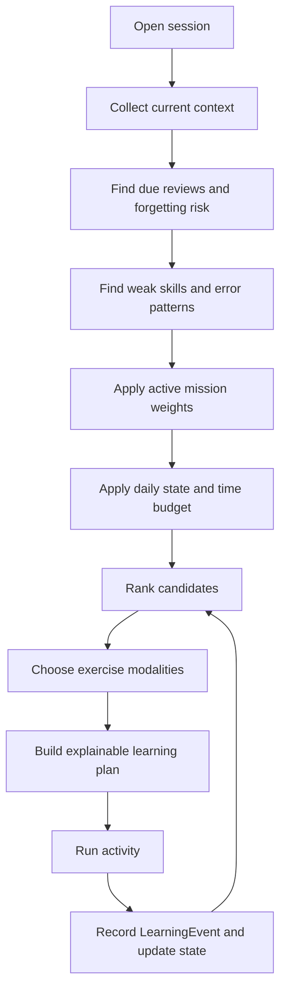

# Adaptive Learning Engine

## Purpose

The Adaptive Learning Engine (ALE) is LinguaBrain's deterministic educational decision-maker. It selects what the learner should practice, which exercise modality is appropriate, how difficult the session should be, and how the plan should change after each learner response.

> AI creates or evaluates content. The Adaptive Learning Engine creates learning.

The engine does not replace FSRS. FSRS supplies review timing and memory-risk signals; ALE combines those signals with goals, skill mastery, connected knowledge, and the learner's current condition.

## Responsibilities

- Build a time-bounded daily or on-demand learning plan.
- Rank due reviews, new content, and targeted practice candidates.
- Select exercise types that address the relevant weak skill.
- Adjust cognitive load using the Daily Learning State.
- Inject controlled novelty without overwhelming the learner.
- Explain the main reasons behind recommendations.
- Re-plan after new evidence, skips, errors, or session interruption.

## Non-responsibilities

- Generating raw content or linguistic facts.
- Directly changing canonical graph relations.
- Replacing user choice with an opaque mandatory curriculum.
- Treating short-term engagement metrics as proof of learning.

## Inputs

| Input | Source | Use |
| --- | --- | --- |
| Due review state | FSRS/review engine | Preserve memory and estimate forgetting risk. |
| Skill mastery | Learning Domain Model | Choose recognition, recall, listening, writing, speaking, or grammar practice. |
| Error patterns | Event analysis | Target recurring, actionable weaknesses. |
| Active missions | Learner goals | Weight relevance by domain, level, and deadline. |
| Knowledge Graph | Validated relations | Find prerequisites and connected candidates. |
| Daily Learning State | Check-in | Adapt duration, modality, and cognitive load. |
| Preferences and overrides | Learner settings | Respect selected modes and accessibility needs. |
| Available content | Local cache/content services | Avoid selecting activities that cannot be delivered offline. |

## Outputs

The engine returns a `LearningPlan` containing:

- planned duration and selected mode;
- an ordered list of activities;
- target KnowledgeItems and LearningObjectives;
- selected exercise formats and difficulty settings;
- estimated duration per activity;
- learner-readable rationale;
- fallback behavior for unavailable AI or media;
- re-planning rules.

## Decision pipeline



## Candidate pools

Before ranking, ALE builds separate candidate pools:

1. **Due reviews:** items with a review obligation or elevated forgetting risk.
2. **Lapsed/weak items:** items with recent failure or declining mastery.
3. **Targeted objectives:** grammar or skill objectives linked to error patterns.
4. **Connected new knowledge:** validated graph neighbors that match mission and readiness.
5. **Mission requirements:** items needed for an active exam, workplace, or daily-life goal.
6. **Learner-requested items:** explicit choices receive priority unless unsafe or impossible.

Candidate pools prevent a new-vocabulary recommendation from silently hiding important reviews.

## Priority score

Each candidate receives an explainable priority score. The exact weights are configurable and versioned; the MVP must log component values.

```text
PriorityScore =
  MemoryPriority
  + SkillWeakness
  + ErrorPatternWeight
  + MissionRelevance
  + GraphReadiness
  + FrequencyAndUsefulness
  + LearnerRequestWeight
  - MasterySaturation
  - CognitiveLoadPenalty
  - RecentRepetitionPenalty
```

### Component rules

| Component | Interpretation |
| --- | --- |
| `MemoryPriority` | One normalized FSRS-derived component combining due/overdue state and retrievability; it is counted once. |
| `SkillWeakness` | Increases when the relevant objective has low mastery or confidence. |
| `ErrorPatternWeight` | Promotes practice that addresses repeated, supported errors. |
| `MissionRelevance` | Weights items aligned with active goals, domains, and target level. |
| `GraphReadiness` | Rewards connected material when prerequisites are reasonably ready. |
| `FrequencyAndUsefulness` | Favors high-value language appropriate to the learner. |
| `MasterySaturation` | Reduces unnecessary practice of demonstrated automatic competence. |
| `CognitiveLoadPenalty` | Reduces unsuitable complexity for today's state. |
| `RecentRepetitionPenalty` | Avoids immediately repeating nearly identical activities without purpose. |

No single score is treated as objective truth. The plan retains component values to support explanations and later tuning.

## Exercise-selection policy

The engine selects a modality based on the objective, not simply the KnowledgeItem type.

| Evidence pattern | Preferred practice |
| --- | --- |
| Recognition strong; recall weak | `L1_TO_L2_RECALL`, mapped by the active LanguagePairProfile |
| Meaning known; form/spelling weak | Dictation, form completion, constrained writing |
| Reading strong; listening weak | Slower audio recognition, short dictation, repeated listening |
| Grammar rule recognized; usage weak | Cloze, word order, sentence builder |
| Production weak; basic knowledge ready | `GUIDED_PRODUCTION`, only when an installed evaluator and release capability permit it |
| New material | Short contextual introduction, recognition, then low-risk retrieval |

The engine must not select open-ended production as the first evidence for an unintroduced beginner item unless the learner explicitly asks for a challenge.

## Difficulty adaptation

Difficulty is adjusted independently for content and task.

### Content adaptation

- CEFR level and sentence complexity;
- lexical novelty and word frequency;
- domain specialization;
- prerequisite readiness.

### Task adaptation

- number and similarity of distractors;
- hints and scaffolding;
- audio speed/repetition;
- answer format;
- required output length;
- amount of context.

The default contextual novelty target is approximately **90% known material and 10% new material**. For MVP verification, the ratio counts normalized content-word lemmas in the target language; function words, punctuation, names, and inflected duplicates are excluded. “Known” means the relevant recognition objective has reached the configured threshold with sufficient confidence. The verifier reports the achieved ratio and allows a ±5 percentage-point tolerance. Recovery sessions may use less novelty.

## Daily Learning State

At session start, the learner may supply:

- available time;
- energy (1–10);
- motivation, focus, and stress where desired;
- preferred mode: light review, balanced/new learning, or challenge. Speaking is capability-gated and post-MVP.

### Session modes

| Mode | Trigger | Typical activity mix |
| --- | --- | --- |
| Recovery | low energy, low time, or high stress | due review, familiar recognition, short audio, minimal new material |
| Growth | normal condition | balanced review, connected new items, guided grammar/exercise |
| Challenge | high energy/time or learner choice | difficult retrieval, writing/speaking, longer context, controlled novelty |

The learner can override a suggested mode. Low energy changes workload and modality; it does not downgrade long-term goals or erase review obligations.

## Time budgeting

The plan must fit the learner's stated time budget. It reserves time in this order:

1. essential due reviews, scaled to available time;
2. high-value weak objectives;
3. mission-related connected knowledge;
4. optional challenge or exploration.

For very short sessions, the plan must favor completion and clear value over breadth. A valid five-minute session may contain only several due reviews and one brief retrieval activity.

## Re-planning

Re-planning is triggered when:

- the learner answers far above or below expected difficulty;
- an error pattern appears;
- an activity is skipped or the answer is revealed;
- the learner changes available time or mode;
- AI/media becomes unavailable;
- the session is interrupted and later resumed.

Re-planning should preserve completed work, avoid abrupt topic switching, and explain material changes when they are visible to the learner.

## Determinism and replay

ALE consumes only persisted, versioned facts and projections; it never waits for or calls a live AI model while scoring a plan. A planning snapshot records algorithm/config version, clock instant, candidate IDs, normalized component values, package versions, capability set, and stable tie-break key. Equal scores are ordered by stable ID after mission/user priority. Low-confidence AI-evaluated evidence is capped or excluded by the versioned evidence policy. Given the same snapshot, ALE must reproduce the same plan.

## Explainability

Each plan exposes a short rationale. Examples:

- “Review these verbs because they are due and recall was slow in your last session.”
- “Practice Dativ in short sentences because this pattern appeared in several recent answers.”
- “These new workplace words are connected to `Arbeit` and support your Work in Germany mission.”

Detailed diagnostics are optional and must avoid exposing sensitive inferences or overwhelming the learner.

## Offline and AI fallback

- Plans must select cached cards, exercises, and media when offline.
- If an AI-generated exercise cannot be created, select a template-based or cached exercise for the same objective.
- If no suitable fallback exists, explain the limitation and preserve the rest of the session.
- AI availability must not alter FSRS scheduling or lose learning events.

## Quality safeguards

- Limit introduction of new items per session and per day according to capacity and history.
- Avoid repetitive exercise formats unless deliberate reinforcement is required.
- Avoid using unvalidated graph relations as mandatory prerequisites.
- Do not optimize merely for task completion; use retention and mastery evidence.
- Respect learner overrides, accessibility needs, and selected boundaries.

## Acceptance criteria

The MVP ALE is acceptable when:

- it creates a plan within the performance target using only local data;
- a due review is prioritized over unrelated new material when time is limited;
- a weak recall objective produces recall-oriented rather than recognition-only practice;
- a low-energy state results in a lower cognitive-load plan;
- an active mission can weight relevant vocabulary without hiding the rationale;
- an unavailable AI provider yields a usable fallback plan;
- every selected activity has a traceable priority explanation;
- plan changes after learner evidence without losing event history.

## Open questions

- What default weights provide useful behavior before enough personal data exists?
- How should the system balance overdue reviews against urgent mission deadlines?
- What is the minimum session length for introducing new content responsibly?
- How should learner self-rated confidence influence scoring without encouraging gaming?
- Which adaptive behavior must be configurable in the first release?

## Related documents

- `02_Learning_Philosophy.md` — Educational principles.
- `05_Learning_Domain_Model.md` — Digital Twin, mastery, missions, and daily state.
- `06_Knowledge_Graph_Architecture.md` — Connected content and prerequisites.
- `08_AI_Orchestration_Layer.md` — Content generation and provider fallback.
- `10_MVP_Definition_and_Roadmap.md` — MVP scope and sequencing.

## Revision history

| Version | Date | Description |
| --- | --- | --- |
| 0.2.0 | 2026-07-11 | Cross-document architecture review; resolved domain, validation, scheduling, privacy, and MVP consistency contracts. |
| 0.1.0 | 2026-07-11 | Initial Adaptive Learning Engine specification. |
