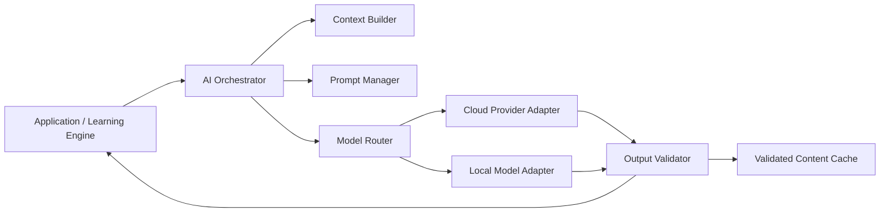

# AI Orchestration Layer

## Purpose

The AI Orchestration Layer provides a provider-independent, safe interface between LinguaBrain and cloud or local language models. It builds controlled context, routes tasks, validates results, controls cost, and records provenance.

> AI proposes, generates, analyzes, and explains. Owning domain services validate and promote content; the Learning Engine decides how validated evidence is used educationally.

## Scope

This layer supports card enrichment, examples, exercises, explanations, corrections, conversations, text analysis, and future OCR pipelines. It does not own FSRS scheduling, mastery updates, canonical graph writes, or direct database mutation by a model.

## Architecture



## Core components

| Component | Responsibility |
| --- | --- |
| Task Registry | Defines supported AI tasks, schemas, limits, and quality requirements. |
| Context Builder | Selects the minimum safe learner/content context needed for a task. |
| Prompt Manager | Stores versioned templates and controlled variables outside application code. |
| Model Router | Selects a compatible provider/model based on capability, privacy, cost, and latency. |
| Provider Adapter | Normalizes OpenAI, Claude, Gemini, Ollama, LM Studio, and future APIs. |
| Validator | Enforces schema, linguistic checks, duplicate checks, and policy constraints. |
| Cache Manager | Reuses validated results and prevents duplicate requests. |
| Usage Meter | Records token/request usage, latency, failures, and estimated cost. |

## Task registry

Each task has an explicit contract.

| Task | Input | Required output |
| --- | --- | --- |
| Card enrichment | lemma, language pair, level, domain | structured meanings, forms, examples, relations proposed |
| Example generation | item + learner context | level-appropriate example and translation |
| Exercise generation | objectives + known context | schema-valid task, answer, hints, item refs |
| Correction | learner response + rubric | corrected result, feedback, confidence |
| Teacher explanation | question + relevant history | scoped explanation at learner level |
| Conversation turn | scenario + vocabulary boundary | next turn and evaluation metadata |

Every task declares max tokens, timeout, cache policy, accepted schema version, validation requirements, and fallback behavior.

## Context policy

Context must be relevant, minimal, and privacy-aware. Typical fields are:

- source/target language and CEFR level;
- active LearningMission and domain;
- selected KnowledgeItems and validated graph relations;
- relevant skill weakness or error pattern;
- Daily Learning State when it affects difficulty;
- user-selected preferences such as example style;
- task-specific output schema.

Raw full learning history, secret values, unrelated private notes, and API keys must never enter model context.

## Prompt management

Prompts are versioned artifacts with a system instruction, variable schema, output contract, safety constraints, and owner. A generated result always records its prompt version.

Prompts must distinguish untrusted user/imported content from instructions. They require structured output where feasible and explicitly prohibit inventing unsupported facts.

## Provider routing

Routing considers:

- required capability and output format;
- user-selected provider/local model;
- privacy constraints;
- latency and token budget;
- availability and recent provider health;
- task quality requirements.

The initial MVP supports Bring Your Own Key cloud providers and OpenAI-compatible local endpoints. The core must not depend on a named provider SDK.

## Validation and promotion

```text
AI output → schema/safety validation → Language Package deterministic checks
          → trusted lexical source when authoritative validation is required
          → owning domain service promotion decision
```

- Invalid output is rejected or retried with a bounded repair request.
- AI facts remain `proposed` until validation succeeds.
- High-impact facts such as conjugation, article, or graph prerequisites require deterministic rule or trusted-source validation. Without it they remain proposed or learner-approved private content.
- AI never writes directly to mastery, review schedules, or canonical graph relations.

Promotion states are explicit:

| State | Meaning/use |
| --- | --- |
| `PROPOSED` | Not yet accepted; cannot drive learning decisions as fact. |
| `ACCEPTED_PRIVATE` | Learner accepted for personal use; provenance/warning retained; never shared as validated system data. |
| `VALIDATED` | Passed required deterministic or authoritative-source gates and may be used as a trusted fact. |
| `REJECTED` | Preserved for audit but excluded from normal use. |

## Caching and cost control

The cache key includes task type, normalized inputs, language pair, level/domain, prompt/model settings, output schema, Language Package/data versions, validator/rubric/safety-policy versions, and a privacy-preserving context fingerprint.

Canonical cache entries contain no learner-specific context and may be shared locally. Any artifact influenced by a learner's mission, error patterns, Daily State, responses, or private content is stored in a user-scoped private cache and is never reused across users.

- Reuse validated content before making a new call.
- Support per-user request/token budgets and configurable daily limits.
- Show the learner provider, request count, estimated usage, and estimated cost when available.
- Prefer local templates, cached content, and local models where they satisfy the task.

## Resilience and fallback

On network failure, timeout, quota exhaustion, or invalid output:

1. return a validated cached result if available;
2. use a deterministic/template-based fallback where supported;
3. preserve user input and explain the limited capability;
4. never block core review or corrupt learner state.

## Security and privacy

- API keys reside only in secure platform storage and are excluded from logs, exports, and normal database fields.
- Provider adapters use secure transport and bounded request sizes.
- Usage logging excludes secret values and unnecessary private text.
- Users can choose local-model operation when supported.
- Generated content retains provider/model, prompt version, timestamp, validation state, and safe input reference.

## Acceptance criteria

- A task can run through a cloud or local provider without changing core Learning Engine code.
- Output that does not meet the schema cannot become canonical learning data.
- A provider outage yields cache/template fallback or a clear non-blocking failure.
- API keys are absent from logs and exports.
- Repeated equivalent requests use validated cache where permitted.
- Each generated artifact is traceable to task, provider/model, prompt version, and validation state.

## Open questions

- Which structured-output standard should adapters normalize to?
- Which German lexical sources can validate AI-generated morphology in the MVP?
- What quality threshold determines whether a low-cost model can serve a task?
- How should user-custom prompts be sandboxed without weakening system safety?

## Related documents

- `03_Non_Functional_Requirements.md` — Security, privacy, offline, and cost constraints.
- `06_Knowledge_Graph_Architecture.md` — Proposed relation validation.
- `07_Adaptive_Learning_Engine.md` — AI-independent educational decisions.
- `09_Language_Independence_Framework.md` — Language-package capabilities.

## Revision history

| Version | Date | Description |
| --- | --- | --- |
| 0.2.0 | 2026-07-11 | Cross-document architecture review; resolved domain, validation, scheduling, privacy, and MVP consistency contracts. |
| 0.1.0 | 2026-07-11 | Initial AI Orchestration Layer specification. |
