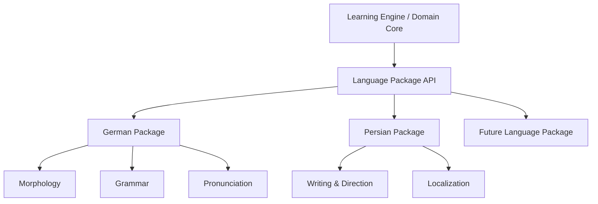

# Language Independence Framework

## Purpose

The Language Independence Framework (LIF) separates universal learning behavior from language-specific rules. German–Persian is the first supported language pair, not a hard-coded assumption in the Learning Engine.

The framework enables a new language to be added through a versioned Language Package that supplies morphology, grammar, pronunciation, writing-system, localization, validation, and exercise capabilities.

## Core rule

> The core understands learning concepts; Language Packages understand languages.

The core may request “normalize this lexical form,” “create objectives for this noun,” or “validate this answer.” It must not contain rules such as German noun gender, Persian right-to-left rendering, or Japanese writing-system behavior.

## Goals

- Add languages without changing core scheduling, mastery, mission, or graph logic.
- Support asymmetric language pairs and multiple learner languages.
- Model language-specific morphology and grammar using typed capabilities.
- Support LTR, RTL, mixed-direction, and complex writing systems.
- Provide validated, versioned language data and rules.
- Allow partial language packages with clearly declared capabilities.

## Non-goals

- Guarantee identical features for every language.
- Force all languages into Germanic grammar categories.
- Treat translation as a one-to-one word mapping.
- Require AI for basic language analysis.
- Deliver every future language in the MVP.

## Architecture



## Language identity

Languages and locale variants use BCP 47 tags where possible.

Examples:

- `de` for generic German;
- `de-DE` for German in Germany;
- `fa` for Persian;
- `fa-IR` for Persian in Iran.

The platform distinguishes:

- interface language;
- learner/native language(s);
- target language(s);
- content language;
- translation language;
- locale for formatting and cultural conventions.

These values must not be collapsed into one global setting.

## Language Package manifest

Each package publishes a manifest with:

| Field | Description |
| --- | --- |
| `package_id` | Stable identifier. |
| `language_tags` | Supported languages/locales. |
| `version` | Semantic package version. |
| `core_api_version` | Compatible Language Package API version. |
| `capabilities` | Implemented analysis, validation, and exercise capabilities. |
| `data_sources` | Dictionaries, corpora, rules, and licenses. |
| `dependencies` | Optional models or data files. |
| `offline_support` | Capabilities available without network access. |
| `quality_status` | Experimental, beta, validated, or deprecated. |

## Capability interface

A package may implement the following capability groups:

### Lexical analysis

- detect and normalize lemma;
- identify part of speech;
- tokenize text;
- detect multiword expressions;
- identify senses and context qualifiers;
- supply frequency and CEFR metadata with provenance.

### Morphology

- analyze a surface form;
- generate inflected forms;
- validate a form against grammatical features;
- expose language-specific features through typed schemas;
- explain transformations at an appropriate learner level.

### Grammar

- define grammar topics and prerequisites;
- analyze sentences using supported rules;
- validate constrained learner answers;
- create language-specific LearningObjective templates;
- identify common error patterns.

### Pronunciation

- provide IPA or language-appropriate phonetic representation;
- define stress and syllable information where supported;
- validate TTS/STT language and voice compatibility;
- supply pronunciation-learning objectives.

### Writing system

- declare direction (`LTR`, `RTL`, or contextual/mixed);
- define normalization and Unicode policies;
- support script variants, diacritics, punctuation, and token boundaries;
- provide keyboard/input hints where appropriate.

### Culture and register

- describe formality, register, region, and cultural context;
- validate culturally appropriate examples;
- distinguish literal from natural translation;
- expose locale-specific conventions without presenting stereotypes as facts.

## Typed language-specific data

Universal fields remain on `KnowledgeItem` and `Word`. Language-specific data is stored in versioned extension schemas.

Example German noun extension:

```json
{
  "schema": "de.noun.v1",
  "gender": "neuter",
  "article": "das",
  "plural": "Häuser",
  "genitive_singular": "Hauses"
}
```

The core treats this as validated language extension data. It does not interpret `gender` or German case rules itself.

## German Package (MVP target)

The initial German package should support:

- lemma and part-of-speech normalization;
- noun article, gender, plural, and essential case forms;
- verb present forms, Präteritum, Partizip II, auxiliary, separability, reflexivity, and governed prepositions/cases;
- adjective comparison forms;
- compound-word and word-family relations where validated;
- German sentence-order and case topics required by MVP exercises;
- pronunciation/IPA data when available from validated sources;
- CEFR and frequency metadata with source attribution.

The package must distinguish a lexical fact from an AI proposal and preserve source/version metadata.

## Persian Package (MVP learner language)

The initial Persian package should support:

- RTL and mixed German–Persian rendering requirements;
- Persian text normalization, including common Unicode variants;
- natural Persian translations and explanations;
- Persian tokenization sufficient for search and exercise evaluation;
- source-language prompts for reverse translation;
- Persian localization of learning instructions and feedback.

Persian is both a learner language and an interface/localization target. These roles remain separately configurable.

## Language Pair configuration

A `LanguagePairProfile` defines behavior between a source/learner language and a target language.

It includes:

- source and target language tags;
- translation direction(s);
- default explanation language;
- transliteration policy;
- ambiguity and sense-handling rules;
- expected scripts and direction behavior;
- pair-specific error patterns;
- exercise formats enabled for the pair.

Language pair behavior is directional. German → Persian recognition and Persian → German production have different objectives and evaluation rules.

## Translation model

Translation is represented as a sense- and context-qualified relationship, not as a global string field.

```text
Source concept/sense
  → contextual meaning
  → natural target expression
```

The translation record may include literal translation, natural translation, register, domain, confidence, provenance, and examples. Multiple valid translations are allowed.

## Learning objectives and exercises

Language Packages supply objective templates and exercise constraints. For example, the German package can define article recall for nouns; a language without grammatical articles must not receive that objective.

The core selects skills and priorities. The package supplies language-valid forms, rubrics, and evaluators.

## AI integration

The AI Orchestrator must include explicit package data in task context:

- language tags and direction;
- package/schema versions;
- learner level and mission;
- required output schema;
- language-specific validation constraints.

AI must not infer the language pair when it is already configured. Generated content is validated by the relevant packages before promotion.

## Package lifecycle

1. Install and validate the manifest.
2. Verify core API compatibility.
3. Register declared capabilities.
4. Run package conformance tests.
5. Activate for supported learner profiles.
6. Apply versioned data migrations when needed.
7. Allow rollback when a package update fails validation.

Removing a package must not delete learner history or canonical content. Unsupported extension data remains preserved and readable after reinstallation.

## Conformance tests

Every package must pass tests for:

- manifest and schema validity;
- Unicode normalization and writing direction;
- representative lexical/morphological cases;
- invalid-form rejection;
- objective-template generation;
- serialization and migration compatibility;
- offline capability claims;
- provenance and license metadata.

German–Persian additionally requires mixed RTL/LTR UI and reverse-translation tests.

## Acceptance criteria

The MVP framework is acceptable when:

- German-specific fields are absent from universal core entities;
- German and Persian packages register independently through the same API;
- a German noun can generate article/plural objectives while unsupported languages are unaffected;
- mixed Persian–German text renders with correct direction metadata;
- translation supports multiple context-qualified meanings;
- package version and data provenance are stored with derived content;
- a future language package can be added without modifying FSRS or mastery logic.

## Open questions

- Which German and Persian datasets meet quality and licensing requirements?
- Should packages ship with the app or be independently downloadable?
- Which package capabilities are mandatory for “supported” versus “experimental” status?
- How should dialects and regional variants inherit or override base-language behavior?
- Which NLP functions should be deterministic libraries versus optional local models?

## Related documents

- `04_Core_Domain_Model.md` — Universal entities and extension boundaries.
- `05_Learning_Domain_Model.md` — Objective templates and skill mastery.
- `06_Knowledge_Graph_Architecture.md` — Language-specific relation policies.
- `08_AI_Orchestration_Layer.md` — Language-aware AI context and validation.
- `14_Frontend_UX_UI.md` — Localization and mixed-direction UI.

## Revision history

| Version | Date | Description |
| --- | --- | --- |
| 0.1.0 | 2026-07-11 | Initial Language Independence Framework specification. |
