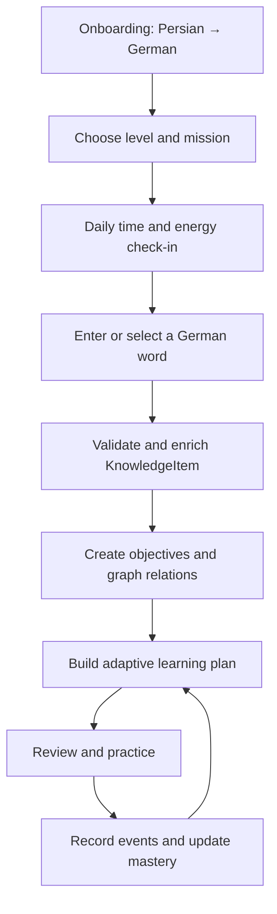

# MVP Definition and Roadmap

## Purpose

This document defines the smallest production-quality release that can validate LinguaBrain's central hypothesis:

> A deterministic Learning Engine using skill-level mastery, connected knowledge, FSRS, and controlled AI enrichment can provide a more relevant learning experience than manually organized flashcards.

The MVP is intentionally narrow. It must prove the learning loop before the project invests in broad language coverage, real-time conversation, social features, or cloud scale.

Per [ADR-012](../decisions/ADR-012-Anki-Core-First-and-APKG-Import-Boundary.md), delivery now begins with an **Anki Core validation release**. This changes implementation order, not the product vision: secure APKG import, durable offline review, and deterministic scheduling must work before AI card generation and final visual approval enter the critical path.

## Anki Core validation gate

The first executable product increment imports `.apkg` as untrusted external data through an adapter, maps supported content into LinguaBrain-owned records, and completes a restart-safe review session with Again, Hard, Good, and Easy. The extracted Anki collection is never used as LinguaBrain's live database.

The detailed scope and acceptance matrix are defined in [Anki Core MVP Specification](supporting/Anki_Core_MVP_Specification.md). AI enrichment, Knowledge Graph expansion, adaptive planning, and final graphic polish resume after this gate passes.

## Target learner

The primary MVP user is a Persian-speaking adult learning German at beginner or intermediate level who wants general or professional vocabulary, has limited daily study time, and is willing to use either a personal AI API key or validated cached content.

## Primary user journey

## MVP scope

### Required product capabilities

1. **Local learner profile**
   - Persian learner language and German target language.
   - CEFR level, active mission, domains, daily target, and preferences.

2. **Daily check-in**
   - Planning always has available-time and energy inputs, resolved from a fresh check-in or named stored defaults.
   - The plan records input source and staleness; the learner may skip the prompt.
   - Preferred mode is optional: recovery, growth, or challenge.

3. **Knowledge-item ingestion**
   - Manual entry of a word or phrase.
   - Secure import of supported `.apkg` decks through a transactional adapter, with preview, provenance, media handling, and deterministic re-import.
   - Duplicate detection and German lemma normalization.
   - Preview and approval before unverified enrichment becomes canonical.

4. **Smart card enrichment**
   - Persian meaning, part of speech, CEFR estimate, pronunciation where available, and level-appropriate example.
   - German noun article/plural and essential verb forms.
   - Provider-independent AI with validation and caching.
   - A bundled seed lexicon and manual minimal-card path work without an AI provider or network.

5. **Automatic collections**
   - All items, nouns, verbs, adjectives, weak items, due reviews, CEFR level, and selected domain.
   - Collections are views; they do not duplicate KnowledgeItems.

6. **Basic Knowledge Graph**
   - Word family, related phrase, grammar relation, and synonym/antonym when validated; domains remain controlled taxonomy values in MVP.
   - One-hop learner-facing related-items view.

7. **Learning objectives and mastery**
   - Required objective contracts include recognizing meaning, recalling lexical form, and applying supported grammar.
   - Listening can use cached audio when available.
   - Mastery changes remain traceable to LearningEvents.

8. **FSRS review scheduling**
   - Scheduling per learner-specific ReviewUnit (one objective/retrieval contract).
   - Again, Hard, Good, and Easy are user-entered for self-graded cards or deterministically derived for auto-evaluated exercises.
   - Persistent review history and offline scheduling.

9. **Adaptive daily plan**
   - Combines due reviews, weak objectives, mission relevance, time, and energy.
   - Provides a concise rationale and offline fallback.

10. **MVP exercises**
    - German → Persian recognition.
    - Persian → German recall.
    - Multiple-choice cloze.
    - Constrained word-form or article practice.

11. **Progress summary**
    - Due/learned counts, mastery by supported skill, weak patterns, mission progress, and recent activity.

12. **Data ownership**
    - Local-first storage, JSON/CSV export for core learner data, secure BYOK storage, and deletion controls.

## Explicit non-goals

- Full real-time AI conversation.
- Automatic pronunciation scoring.
- Complete OCR/PDF ingestion.
- Multi-device cloud sync and accounts.
- Cross-device synchronization between the first-class Apple applications; each application uses an independent local learner store until a post-MVP sync design is accepted.
- Social feeds, leaderboards, marketplace, or shared public decks.
- Multiple target languages.
- Fully general Learning OS support beyond the language-domain contracts.
- Advanced Level 1 image curriculum authoring.
- Dedicated-device hardware, meeting recording, live translation, and device manufacturing.
- Flutter, Dart, Android, and Web application targets. Adding any of them requires a new platform ADR and its own security, accessibility, migration, recovery, and release evidence.

These are postponed, not silently included in MVP estimates.

The shared domain/application contracts remain client-surface neutral even though the shipped MVP clients are native Apple applications. Capability-aware planning must allow a later dedicated device or newly accepted application target without changing learner identity, KnowledgeItems, LearningEvents, ReviewUnits, or FSRS history.

## Technology baseline

| Area | MVP choice |
| --- | --- |
| Client | Native SwiftUI applications for iOS/iPadOS 27 and macOS 27; iPhone is the primary controlled-pilot surface |
| Language and UI framework | Swift 6.4 and SwiftUI |
| Build toolchain | Xcode 27 beta is provisional during development; stable Xcode 27 and final OS SDKs are release gates |
| Package/module layout | Swift Package Manager topology accepted in [ADR-010](../decisions/ADR-010-Swift-Package-and-Module-Layout.md) |
| State, navigation, and dependency composition | Native Observation, typed per-scene navigation, initializer injection, and app composition root accepted in [ADR-011](../decisions/ADR-011-SwiftUI-State-Observation-Navigation-and-Dependency-Composition.md) |
| Local persistence | Native local-store adapter selected by ADR-003, with migrations and repository/transaction abstraction |
| Review algorithm | FSRS implementation behind a scheduler interface |
| AI integration | Provider adapters; BYOK and OpenAI-compatible local endpoint |
| Backend | Not required for local MVP; FastAPI reserved for later sync/services |
| Audio | Cached TTS or validated media; offline playback |
| Testing | Swift Testing/XCTest, repository and integration tests, SwiftUI view/snapshot tests, XCUITest, migration/recovery tests, and AI contract evaluations |

## Accepted pilot platform baseline

[ADR-009](../decisions/ADR-009-Native-Apple-Client-and-Platform-Baseline.md) supersedes the earlier Android/Flutter pilot decision and establishes the native Apple MVP baseline.

- iOS/iPadOS 27 and macOS 27 are first-class, local-only MVP application surfaces.
- iPhone is the primary controlled-pilot surface and the primary source of product-performance and learning-evidence measurements. iPad and macOS remain release-supported companion surfaces, not deferred ports.
- The iPad experience ships from the universal iOS/iPadOS application with adaptive layouts. The macOS application is a native, first-class local companion using the same domain/application contracts.
- Each application maintains an independent local learner store. “Companion” does not imply account, cloud, or cross-device synchronization; supported export/import is the only transfer path until post-MVP sync is separately designed.
- Swift 6.4 and SwiftUI are the implementation baseline. [ADR-010](../decisions/ADR-010-Swift-Package-and-Module-Layout.md) owns the Swift Package Manager topology and framework-dependency boundaries.
- Xcode 27 beta and beta OS SDKs are provisional development inputs. Builds, screenshots, snapshots, performance numbers, and platform behavior observed with beta tooling are non-authoritative until rerun with the stable/GM Xcode 27 toolchain and final iOS/iPadOS/macOS 27 SDKs.
- Pilot enrollment and release require a clean stable-toolchain build plus a complete rerun of automated tests, approved snapshots, accessibility checks, security/privacy checks, migrations, backup/restore, and recovery scenarios on all first-class surfaces.
- Flutter, Dart, Android, and Web are not active MVP targets. A later target requires a new ADR and complete target-specific verification rather than an implied portability claim.

Document 14 owns the adaptive-layout and SwiftUI snapshot matrix. Snapshot fixtures created before the stable Xcode 27 toolchain and before LB-DEC-050 approves licensed bilingual fonts are explicitly provisional and cannot satisfy the final visual release gate.

## Delivery milestones

Execution order is now: M0 → M1 persistence/domain slice → Anki Core import and review gate → remaining M2–M6 intelligence. Review infrastructure needed by Anki Core may be implemented earlier than its original milestone label; stable requirement IDs remain unchanged until Document 15 is formally rebased.

### M0 — Repository and specifications

- Documents 01–14 completed.
- ADR process, coding conventions, and executable acceptance criteria established.
- Deliverable: approved implementation backlog.

### M1 — Domain walking skeleton

- Native Swift/SwiftUI iOS/iPadOS and macOS shells with local databases.
- KnowledgeItem, learner profile, LearningEvent, and repository interfaces.
- One manual German word can be stored and retrieved offline.
- APKG importer port, import proposal, provenance identity, and safe temporary-file boundary.

### Anki Core gate — Import and reliable review

- Secure `.apkg` import with preview, supported text/image/audio, and re-import identity.
- Deck library, due queue, question/answer reveal, and session summary.
- Again, Hard, Good, and Easy connected to the pinned FSRS scheduler.
- Atomic review history, restart durability, and adversarial import tests.
- No AI provider required or invoked.

### M2 — Card and language foundation

- German/Persian package minimum capabilities.
- Manual ingestion, duplicate detection, validation preview, smart card display.
- Provider-independent enrichment with cache.

### M3 — Objective-level review expansion

- Extend the accepted Anki Core scheduler into independent LearningObjectives, retrieval contracts, and mastery evidence.
- Recognition and reverse-recall exercises.
- Complete offline review session survives restart.

### M4 — Adaptive intelligence

- Daily check-in, candidate ranking, session builder, weak-skill targeting.
- Basic Digital Twin summaries and explainable recommendations.

### M5 — Connected learning

- Validated one-hop graph, word-family view, cloze/article/form exercises.
- Mission/domain relevance in plan selection.

### M6 — MVP hardening and pilot

- Accessibility and RTL/LTR QA.
- Export/deletion, secure key storage, performance testing, crash recovery.
- Pilot release and measured learning feedback.

## MVP acceptance scenario

The release must demonstrate this end-to-end path:

1. A Persian-speaking learner selects German A2 and the mission “Work in Germany.”
2. They report 15 minutes and energy 4/10.
3. They add `arbeiten`.
4. The system normalizes it, enriches it, validates essential forms, and presents a preview.
5. The accepted item appears in All Items, Verbs, its validated CEFR metadata, and Work collections without duplication.
6. Recognition, recall, and present-form objectives are created.
7. The daily plan combines due reviews with a short recovery-friendly activity.
8. Responses create LearningEvents, update objective mastery, and schedule future reviews.
9. The learner can close the app, reopen it offline, and continue without lost progress.

The same first-item scenario must also pass with no configured provider: the learner can create a manual minimal card or select bundled validated seed content, then review it offline.

## Success metrics

### Product quality

- 100% durability is an invariant in completed local transaction/restart tests; operational crash-free metrics are tracked separately.
- Core offline interactions meet Document 03 latency targets.
- Zero API keys in database, logs, analytics, or exports.
- AI enrichment records 100% required provenance metadata.

### Pilot learning protocol

- Primary outcome: delayed objective-level recall at pre-registered 7- and 14-day windows.
- Comparator: randomized item-level or within-learner baseline using non-adaptive FSRS review, where ethically and operationally appropriate.
- Secondary outcomes: proposal edit rate, plan acceptance/modification, session completion, and learner-rated relevance/explainability.
- Sample assumptions, minimum detectable effect, success threshold, and stop/go rule are fixed in a pilot protocol before enrollment rather than chosen after results.
- Recall and recognition are analyzed separately; card count and streak length are not learning outcomes.

### Engagement guardrails

- Session completion and return rate may be measured with consent.
- Streak length and card volume are not primary success metrics.
- No dark patterns or punishment for missed days.

## Release gates

The MVP cannot enter pilot until:

- critical user journeys have integration tests;
- migration and backup/restore paths are verified;
- mixed Persian/German layouts pass accessibility review;
- AI failure does not block review;
- generated linguistic facts pass defined validation policy;
- privacy disclosures and local deletion/export behavior are complete.
- platform threat model, database/backup protection, recovery behavior, cloud-consent moment, and redaction tests are approved;
- raw import/intermediate-artifact retention defaults and verified deletion tests are implemented;
- first-run and first-item flows pass with and without AI/network access;
- iPhone, iPad, and macOS first-class surfaces pass their required local-only build, adaptive-layout, accessibility, persistence, migration, and recovery matrices;
- the release candidate is built with stable/GM Xcode 27 and final iOS/iPadOS/macOS 27 SDKs, with all provisional beta-era evidence rerun and approved;
- pilot protocol and stop/go thresholds are preregistered before pilot data collection.

## Post-MVP roadmap

| Phase | Candidate capabilities |
| --- | --- |
| 1.1 | Listening expansion, richer progress insights, additional import/export formats |
| 1.2 | OCR/text/PDF extraction with approval workflow |
| 1.3 | Guided writing and speaking evaluation |
| 2.0 | Account, encrypted sync, multiple devices |
| 2.x | Additional language packages and exam missions |
| Future | Conversation coach, professional plugins, broader Learning OS |

Roadmap candidates require evidence from the MVP and separate specifications.

## Risks and mitigations

| Risk | Mitigation |
| --- | --- |
| Scope expansion | Enforce explicit non-goals and release gates. |
| Incorrect AI content | Structured output, validation, provenance, preview. |
| Over-engineered generality | Implement only German–Persian capabilities needed by MVP interfaces. |
| Weak adaptive data at start | Use transparent defaults and gradually personalize. |
| RTL/LTR usability defects | Include mixed-direction tests from M1 onward. |
| Vendor cost/dependency | BYOK, cache, local endpoint, deterministic fallback. |

## Open questions

LB-DEC-037 is `SUPERSEDED` by LB-DEC-057 and the native Apple baseline in [ADR-009](../decisions/ADR-009-Native-Apple-Client-and-Platform-Baseline.md). Its original wording remains below as a historical source question; current status is governed by the Decision Register.

- Which Flutter platforms are included in the first pilot: Android only or Android plus iOS?
- Which validated German lexical dataset is available under acceptable licensing?
- What pilot size and duration can provide meaningful retention evidence?
- Which FSRS library/version will be adopted and independently tested?

## Related documents

- `03_Non_Functional_Requirements.md` — Release quality constraints.
- `07_Adaptive_Learning_Engine.md` — Plan construction and ranking.
- `09_Language_Independence_Framework.md` — MVP German/Persian packages.
- `11_Technical_Architecture.md` — Implementation boundaries.
- `14_Frontend_UX_UI.md` — MVP screens and journeys.
- `../decisions/ADR-009-Native-Apple-Client-and-Platform-Baseline.md` — Supported Apple surfaces, pilot priority, and stable-toolchain release gate.
- `../decisions/ADR-010-Swift-Package-and-Module-Layout.md` — Swift Package Manager and module topology.
- `../decisions/ADR-011-SwiftUI-State-Observation-Navigation-and-Dependency-Composition.md` — Accepted SwiftUI state, typed navigation, concurrency, and composition decision.

## Revision history

| Version | Date | Description |
| --- | --- | --- |
| 0.4.0 | 2026-08-03 | Added the Anki Core validation release, secure APKG adapter boundary, and import/review-first execution order from ADR-012. |
| 0.3.1 | 2026-08-01 | Linked the accepted ADR-011 native Observation, typed-navigation, and composition baseline. |
| 0.3.0 | 2026-07-21 | Replaced the superseded Android/Flutter pilot with native Swift 6.4/SwiftUI first-class iOS/iPadOS 27 and macOS 27 surfaces, an iPhone-primary pilot, independent local stores, and a stable Xcode 27 release gate. |
| 0.2.2 | 2026-07-20 | Selected an Android-phone-only MVP pilot and linked the canonical Android golden-layout baseline from ADR-008. |
| 0.2.1 | 2026-07-11 | Kept dedicated hardware out of MVP while preserving shared-core extension points. |
| 0.2.0 | 2026-07-11 | Cross-document architecture review; resolved domain, validation, scheduling, privacy, and MVP consistency contracts. |
| 0.1.0 | 2026-07-11 | Initial MVP definition and delivery roadmap. |
