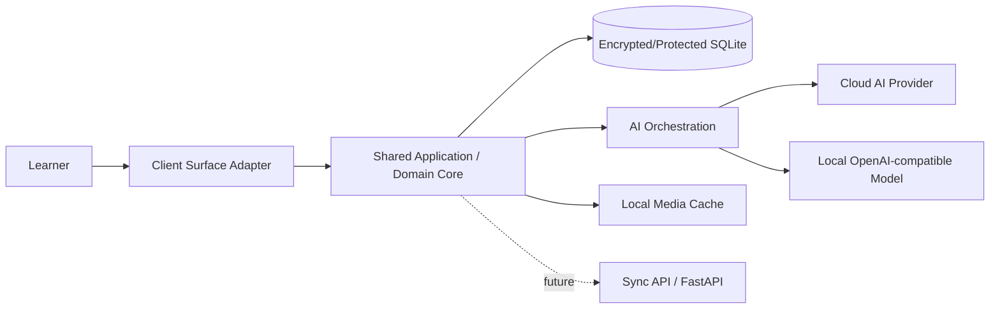
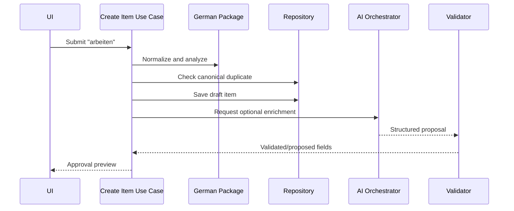
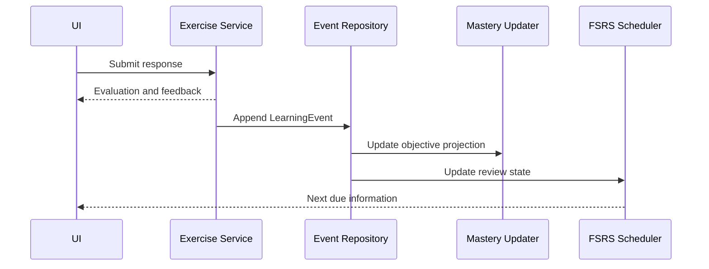

# Technical Architecture

## Purpose

This document maps the product and domain specifications to an implementable software architecture. The MVP is a modular, offline-first Flutter application with local persistence and optional cloud or local AI providers. Domain/application packages remain UI-surface neutral so a later dedicated Linux/embedded client can reuse them.

## Architecture principles

- Domain logic is independent of Flutter, SQLite, and AI SDKs.
- Dependencies point inward toward domain contracts.
- The UI never writes directly to the database.
- AI never mutates canonical content, mastery, or scheduling directly.
- Local writes complete before optional synchronization.
- Modules communicate through typed commands, queries, and domain events.
- Every external dependency is behind an adapter interface.

## System context



Client Surface Adapters include the MVP Flutter mobile UI and future desktop/dedicated-device UIs. Each adapter exposes a CapabilitySnapshot and maps physical/touch controls to the same application commands.

## Layer model

| Layer | Responsibilities | Must not depend on |
| --- | --- | --- |
| Presentation | Screens, widgets, navigation, view state, accessibility | SQLite/AI provider implementations |
| Application | Use cases, transactions, orchestration, authorization | Flutter widgets, concrete infrastructure |
| Domain | Entities, value objects, rules, events, repository interfaces | Frameworks, network, storage |
| Infrastructure | SQLite repositories, secure storage, provider adapters, media | Presentation |

## Bounded modules

### Identity and Preferences

Learner profile, language configuration, missions, daily settings, consent, accessibility, and BYOK configuration references.

### Knowledge

KnowledgeItems, revisions, lexical extensions, duplicate detection, validation status, imports, and smart collections.

### Language Packages

German/Persian normalization, morphology, grammar, objective templates, answer evaluation, and RTL/LTR metadata.

### Knowledge Graph

Relation policies, proposals, validation, bounded traversal, related-item ranking, and prerequisite queries.

### Learning

LearningObjectives, SkillMastery, LearningEvents, ErrorPatterns, Digital Twin summaries, and mission relevance.

### Review

ReviewUnits, FSRS state, due queues, versioned evidence-to-rating policies, review logs, and scheduling invariants. Scheduling is per learner/objective retrieval contract, not per whole KnowledgeItem.

### Planning

Adaptive candidate pools, priority scoring, DailyLearningState, LearningPlan construction, explanation, and re-planning.

### Exercises

Exercise definitions, templates, attempts, evaluators, hints, and objective evidence mapping.

### AI Orchestration

Task registry, prompt/context management, model routing, provider adapters, output validation, cache, and usage metering.

### Media

Images, audio metadata, local cache, playback/download lifecycle, accessibility metadata, and quotas.

### Client Runtime

Client registration, surface type, CapabilitySnapshot, installation identity, platform secure-storage adapter, lifecycle/power signals, and optional audio-capture gateway. Hardware drivers and industrial-device concerns stay outside the shared domain.

## Suggested repository structure

```text
app/
├── lib/
│   ├── bootstrap/
│   ├── presentation/
│   ├── application/
│   ├── domain/
│   │   ├── knowledge/
│   │   ├── learning/
│   │   ├── review/
│   │   ├── planning/
│   │   └── exercises/
│   ├── infrastructure/
│   │   ├── persistence/
│   │   ├── ai/
│   │   ├── language_packages/
│   │   ├── media/
│   │   └── secure_storage/
│   └── shared/
└── test/
    ├── unit/
    ├── integration/
    ├── widget/
    └── fixtures/
```

Final framework and state-management selections require ADRs before implementation.

## Application use cases

Core commands:

- `CreateKnowledgeItem`
- `RequestKnowledgeEnrichment`
- `ApproveContentProposal`
- `RecordExerciseAttempt`
- `RateReview`
- `CreateDailyLearningPlan`
- `UpdateDailyLearningState`
- `ExportLearnerData`

Core queries:

- `GetKnowledgeItem`
- `SearchKnowledge`
- `GetDueReviews`
- `GetRelatedItems`
- `GetLearningPlan`
- `GetProgressSummary`

Commands change state through domain services and transactions. Queries return immutable read models optimized for presentation.

## Domain events

| Event | Typical consumers |
| --- | --- |
| `KnowledgeItemCreated` | objective factory, relation proposer, search index |
| `ContentProposalValidated` | knowledge repository, graph service, cache |
| `LearningEventRecorded` | mastery updater, FSRS scheduler, Digital Twin projector |
| `ReviewScheduled` | due-queue projector, notification service |
| `DailyStateUpdated` | adaptive planner |
| `LearningPlanCreated` | session UI, analytics projector |
| `ErrorPatternDetected` | planner, progress summary |

MVP uses an in-process event dispatcher with transactional persistence where required. Events are versioned for future sync.

## Key interaction: word ingestion



## Key interaction: review attempt



## Persistence and transactions

- SQLite is the local source of truth for MVP learner data.
- Repository interfaces expose domain objects, not SQL rows.
- A completed attempt, LearningEvent, mastery projection, and review update use one atomic transaction or a recoverable outbox pattern.
- Schema migrations are forward-tested and backup-aware.
- Derived projections can be rebuilt from events where documented.

## Concurrency and background work

- UI-bound operations remain asynchronous and cancellable.
- AI, media, indexing, and expensive projections run outside the UI isolate/thread.
- Idempotency keys protect enrichment and event-processing retries.
- Cancellation never discards already committed learner events.

## Configuration

Configuration is layered:

1. safe application defaults;
2. environment/build configuration;
3. learner preferences;
4. session-level DailyLearningState.

Secrets are references into secure platform storage and never ordinary configuration values.

## Error handling

Errors use typed categories: validation, domain conflict, unavailable dependency, timeout, quota, persistence, migration, and unexpected failure.

Presentation translates errors into recoverable actions. Infrastructure details and secrets must not leak into learner-facing messages.

## Testing strategy

| Test type | Focus |
| --- | --- |
| Domain unit | invariants, scoring components, relation policies, mastery updates |
| Contract | repository, language-package, AI provider, evaluator interfaces |
| Integration | SQLite transactions, migrations, full review and ingestion flows |
| Widget/UI | mixed RTL/LTR, accessibility, state restoration, offline states |
| Golden | critical card and exercise layouts |
| AI evaluation | schema compliance, level appropriateness, factual validation |
| Performance | startup, search, planning, graph query, large review history |

Tests use fake clocks, deterministic IDs, seeded randomness, and provider fakes to ensure reproducibility.

## Security boundaries

- Secure storage owns API key material.
- Imported and AI-generated text is untrusted input.
- Provider adapters enforce endpoint allowlists/configuration, timeouts, and size limits.
- Export services explicitly select fields and exclude secrets.
- Logs use structured redaction.

## Future backend

FastAPI may later provide accounts, encrypted sync coordination, provider proxying, and shared validated content. The local application remains functional without it. Backend introduction requires separate API, threat-model, and conflict-resolution specifications.

## Acceptance criteria

- Domain tests run without Flutter, SQLite, or network dependencies.
- One provider adapter can be replaced by another without changing planning logic.
- A full review transaction survives restart without partial state.
- German rules live behind the Language Package interface.
- UI cannot directly mutate persistence or FSRS state.
- Core flows have integration tests with offline and failure cases.

## Required ADRs before coding

- Flutter state management and dependency injection.
- SQLite library/ORM and migration tooling.
- FSRS implementation/version.
- ReviewUnit retrieval contracts and automatic evidence-to-rating mapping.
- Domain event and transactional outbox approach.
- Local database encryption/security strategy.
- Package/module repository layout.

## Related documents

- `10_MVP_Definition_and_Roadmap.md` — Delivery scope.
- `12_Database_Schema_and_Persistence.md` — Storage design.
- `13_AI_Agent_Pipeline.md` — Processing orchestration.
- `14_Frontend_UX_UI.md` — Presentation behavior.

## Revision history

| Version | Date | Description |
| --- | --- | --- |
| 0.2.1 | 2026-07-11 | Added shared-core Client Surface Adapter and capability contract for future dedicated hardware. |
| 0.2.0 | 2026-07-11 | Cross-document architecture review; resolved domain, validation, scheduling, privacy, and MVP consistency contracts. |
| 0.1.0 | 2026-07-11 | Initial Technical Architecture specification. |
