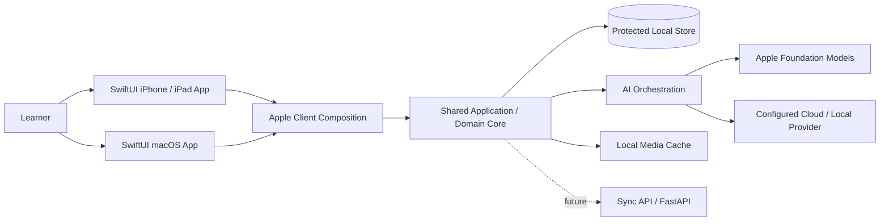
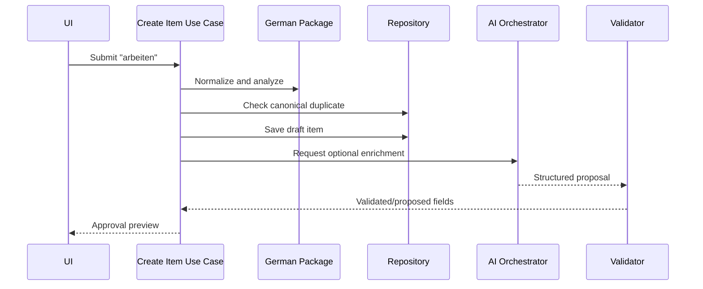
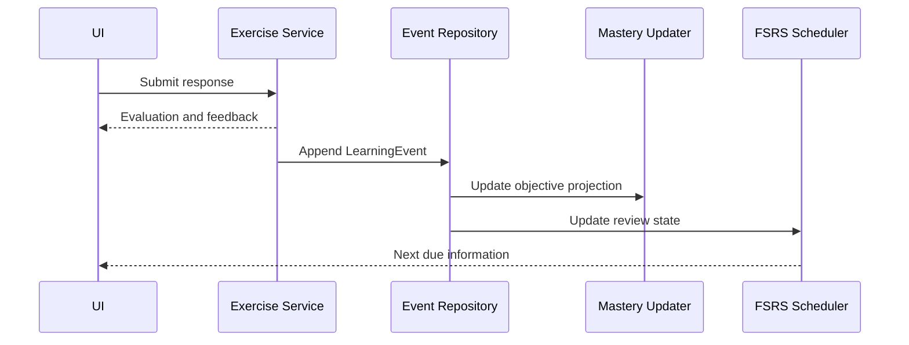

# Technical Architecture

## Purpose

This document maps the product and domain specifications to an implementable native Apple architecture. The MVP uses Swift 6.4, SwiftUI, and OS 27 SDKs for a universal iPhone/iPad app plus a native macOS 27 Golden Gate app. The deterministic learning core remains independent of presentation, storage, and model SDKs even though the production runtime is now intentionally Apple-first.

## Architecture principles

- Domain logic is independent of SwiftUI, concrete persistence frameworks, and AI SDKs.
- Dependencies point inward toward domain contracts.
- The UI never writes directly to the database.
- AI never mutates canonical content, mastery, or scheduling directly.
- Local writes complete before optional synchronization.
- Modules communicate through typed commands, queries, and domain events.
- Every external dependency is behind an adapter interface.
- Swift 6 strict concurrency is enabled; shared mutable infrastructure is actor-isolated and public cross-actor values conform to `Sendable` where appropriate.

## System context



The iPhone, iPad, and Mac scenes expose a versioned `CapabilitySnapshot` and map touch, keyboard, pointer, window, microphone, speaker, and local-model capabilities to the same application commands. Each installation is local-only in the MVP; the diagram's future sync path is not an implied cross-device feature.

## Layer model

| Layer | Responsibilities | Must not depend on |
| --- | --- | --- |
| Presentation | SwiftUI views/scenes, navigation, observable view state, accessibility | Persistence/model provider implementations |
| Application | Use cases, transactions, orchestration, authorization | SwiftUI views and concrete infrastructure |
| Domain | Entities, value objects, rules, events, repository interfaces | Frameworks, network, storage |
| Infrastructure | Local-store repositories, Keychain/security, provider adapters, media | Presentation |

## Bounded modules

### Identity and Preferences

Learner profile, language configuration, missions, daily settings, consent, accessibility, and BYOK configuration references.

### Knowledge

KnowledgeItems, revisions, lexical extensions, duplicate detection, validation status, imports, and smart collections.

### Language Packages

German/Persian normalization, morphology, grammar, objective templates, answer evaluation, and RTL/LTR metadata.

### Knowledge Graph

Relation policies, proposals, validation, bounded traversal, related-item ranking, and prerequisite queries.

### Learning

LearningObjectives, SkillMastery, LearningEvents, ErrorPatterns, Digital Twin summaries, and mission relevance.

### Review

ReviewUnits, FSRS state, due queues, versioned evidence-to-rating policies, review logs, and scheduling invariants. Scheduling is per learner/objective retrieval contract, not per whole KnowledgeItem.

### Planning

Adaptive candidate pools, priority scoring, DailyLearningState, LearningPlan construction, explanation, and re-planning.

### Exercises

Exercise definitions, templates, attempts, evaluators, hints, and objective evidence mapping.

### AI Orchestration

Task registry, prompt/context management, model routing, provider adapters, output validation, cache, and usage metering.

### Media

Images, audio metadata, local cache, playback/download lifecycle, accessibility metadata, and quotas.

### Client Runtime

Client registration, surface type, CapabilitySnapshot, installation identity, platform secure-storage adapter, lifecycle/power signals, and optional audio-capture gateway. Hardware drivers and industrial-device concerns stay outside the shared domain.

## Accepted repository structure

Repository, Swift Package Manager, dependency, CI, and experiment boundaries are governed by [ADR-010](../decisions/ADR-010-Swift-Package-and-Module-Layout.md), which supersedes ADR-001. The following ownership/path map is normative. Directories are created only when their approved milestone begins.

```text
LinguaBrain AI/
├── apps/
│   └── learner/
│       ├── LinguaBrain.xcworkspace/    # Native workspace; generated user state is ignored
│       ├── LinguaBrain.xcodeproj/      # iOS/iPadOS and macOS app targets
│       ├── App/                        # SwiftUI app entry, scenes, navigation, presentation
│       ├── Resources/                  # Localizations, assets, privacy manifests, entitlements
│       ├── Tests/                      # App composition and platform integration tests
│       └── UITests/                    # Critical Apple-platform journeys
├── packages/
│   └── LinguaBrainKit/
│       ├── Package.swift               # One local package, multiple bounded targets
│       ├── Sources/
│       │   ├── LinguaBrainDomain/
│       │   ├── LinguaBrainApplication/
│       │   ├── LinguaBrainPresentation/
│       │   ├── LinguaBrainLanguageDE/
│       │   ├── LinguaBrainLanguageFA/
│       │   ├── LinguaBrainPersistence/
│       │   ├── LinguaBrainReviewFSRS/
│       │   ├── LinguaBrainAI/
│       │   ├── LinguaBrainMedia/
│       │   ├── LinguaBrainPlatformApple/
│       │   └── LinguaBrainTestSupport/
│       └── Tests/
│           ├── LinguaBrainDomainTests/
│           ├── LinguaBrainApplicationTests/
│           ├── LinguaBrainPresentationTests/
│           ├── LinguaBrainLanguageDETests/
│           ├── LinguaBrainLanguageFATests/
│           ├── LinguaBrainPersistenceTests/
│           ├── LinguaBrainReviewFSRSTests/
│           ├── LinguaBrainAITests/
│           ├── LinguaBrainMediaTests/
│           └── LinguaBrainPlatformAppleTests/
├── services/
│   └── sync_api/                       # Post-MVP FastAPI service
├── contracts/                          # Future external API/event schemas
├── experiments/
│   └── vocabulary-mvp/                 # Python/FastAPI/n8n reference experiment
├── tooling/                            # Repository checks and developer commands
├── docs/
├── decisions/
├── diagrams/
├── assets/
├── README.md
├── PROJECT_STATUS.md
├── CHANGELOG.md
├── LICENSE
└── .gitignore
```

`LinguaBrainKit` is one repository-local Swift package with separately compiled targets. `LinguaBrainDomain` and `LinguaBrainApplication` are native Swift targets that do not import SwiftUI, SwiftData/Core Data/SQLite implementations, Foundation Models, Speech, AVFoundation, Security, or CloudKit. Domain owns aggregate repository contracts required by semantics; Application owns use-case gateways for AI, media, secure storage, transactions, events, clocks, and external services. A generic catch-all shared or utils target is prohibited.

`LinguaBrainPresentation` owns reusable SwiftUI feature/view-state code and depends inward on Application/Domain. The app project owns `@main` entry points, scenes/windows, platform navigation composition, entitlements, signing, lifecycle, and adapter wiring. Infrastructure and Language Package targets depend inward on application ports and domain types. Production targets cannot import `experiments/`; future services cannot become a requirement for offline learning.

Allowed dependencies are enforced in `Package.swift` and CI. The app may import Presentation, Application, and concrete adapter targets; Application imports Domain; Presentation imports Application/Domain; Language targets import Domain; Persistence/AI/Review/Media/Platform adapters import only the ports and types they implement. Dependency cycles are prohibited.

SwiftUI state/navigation/dependency composition, persistence tooling, FSRS, event/outbox details, and Apple data protection remain governed by their dedicated ADRs. A future non-Apple dedicated device cannot assume direct SwiftUI/Apple-framework reuse; it must consume versioned contracts through a separately approved runtime or interoperability architecture.

## Application use cases

Core commands:

- `CreateKnowledgeItem`
- `RequestKnowledgeEnrichment`
- `ApproveContentProposal`
- `RecordExerciseAttempt`
- `RateReview`
- `CreateDailyLearningPlan`
- `UpdateDailyLearningState`
- `ExportLearnerData`

Core queries:

- `GetKnowledgeItem`
- `SearchKnowledge`
- `GetDueReviews`
- `GetRelatedItems`
- `GetLearningPlan`
- `GetProgressSummary`

Commands change state through domain services and transactions. Queries return immutable read models optimized for presentation.

## Domain events

| Event | Typical consumers |
| --- | --- |
| `KnowledgeItemCreated` | objective factory, relation proposer, search index |
| `ContentProposalValidated` | knowledge repository, graph service, cache |
| `LearningEventRecorded` | mastery updater, FSRS scheduler, Digital Twin projector |
| `ReviewScheduled` | due-queue projector, notification service |
| `DailyStateUpdated` | adaptive planner |
| `LearningPlanCreated` | session UI, analytics projector |
| `ErrorPatternDetected` | planner, progress summary |

MVP uses an in-process event dispatcher with transactional persistence where required. Events are versioned for future sync.

## Key interaction: word ingestion



## Key interaction: review attempt



## Persistence and transactions

- A protected local store is the source of truth for each MVP installation; ADR-003 selects SwiftData/Core Data/SQLite/GRDB or another adapter.
- Repository interfaces expose domain objects, not SwiftData models, Core Data managed objects, or SQL rows.
- A completed attempt, LearningEvent, mastery projection, and review update use one atomic transaction or a recoverable outbox pattern.
- Schema migrations are forward-tested and backup-aware.
- Derived projections can be rebuilt from events where documented.

## Concurrency and background work

- UI-bound operations run on `MainActor`, remain asynchronous where needed, and are cancellable.
- Persistence, AI, speech/audio, media, indexing, and expensive projections use explicit actors or isolated services rather than blocking `MainActor`.
- Idempotency keys protect enrichment and event-processing retries.
- Cancellation never discards already committed learner events.
- `SpeechAnalyzer`/`SpeechTranscriber` streams and AVFoundation capture are isolated behind application gateways; background-task APIs are used only for platform-appropriate deferred work, never as a promise of continuous execution.

## Configuration

Configuration is layered:

1. safe application defaults;
2. environment/build configuration;
3. learner preferences;
4. session-level DailyLearningState.

Secrets are references into secure platform storage and never ordinary configuration values.

## Error handling

Errors use typed categories: validation, domain conflict, unavailable dependency, timeout, quota, persistence, migration, and unexpected failure.

Presentation translates errors into recoverable actions. Infrastructure details and secrets must not leak into learner-facing messages.

## Testing strategy

| Test type | Focus |
| --- | --- |
| Domain unit | invariants, scoring components, relation policies, mastery updates |
| Contract | repository, language-package, AI provider, evaluator interfaces |
| Integration | Local-store transactions, migrations, full review and ingestion flows |
| SwiftUI view | mixed RTL/LTR, Observation state, accessibility, restoration, offline states |
| Snapshot/UI | provisional visual snapshots plus XCUITest critical flows on iPhone, iPad, and Mac |
| AI evaluation | schema compliance, level appropriateness, factual validation |
| Performance | startup, search, planning, graph query, large review history |

Swift Testing is the default for package unit/contract tests; XCTest/XCUITest remains available for UI automation, launch, performance, and platform integration evidence. Tests use fake clocks, deterministic IDs, seeded randomness, synthetic learner content, and provider fakes.

## Security boundaries

- Secure storage owns API key material.
- Imported and AI-generated text is untrusted input.
- Provider adapters enforce endpoint allowlists/configuration, timeouts, and size limits.
- Export services explicitly select fields and exclude secrets.
- Logs use structured redaction.

## Future backend

FastAPI may later provide accounts, encrypted sync coordination, provider proxying, and shared validated content. The local application remains functional without it. Backend introduction requires separate API, threat-model, and conflict-resolution specifications.

## Acceptance criteria

- Domain tests run with Swift Package Manager without SwiftUI, concrete persistence, Apple model SDK, or network dependencies.
- One provider adapter can be replaced by another without changing planning logic.
- A full review transaction survives restart without partial state.
- German rules live behind the Language Package interface.
- UI cannot directly mutate persistence or FSRS state.
- Core flows have integration tests with offline and failure cases.

## Required ADRs by implementation gate

Before M1 work becomes `READY`:

- SwiftUI Observation/state, navigation, and dependency composition — [accepted in ADR-011](../decisions/ADR-011-SwiftUI-State-Observation-Navigation-and-Dependency-Composition.md).
- Native Swift persistence/query/migration tooling (revised ADR-003).
- Domain event and transactional outbox approach.
- Apple local-store protection, Keychain, backup, and recovery strategy.
- Native Apple platform baseline — [accepted in ADR-009](../decisions/ADR-009-Native-Apple-Client-and-Platform-Baseline.md).
- Swift package/module repository layout — [accepted in ADR-010](../decisions/ADR-010-Swift-Package-and-Module-Layout.md).

Before M3 review work becomes `READY`:

- FSRS implementation/version.
- ReviewUnit retrieval contracts and automatic evidence-to-rating mapping.

## Related documents

- `10_MVP_Definition_and_Roadmap.md` — Delivery scope.
- `12_Database_Schema_and_Persistence.md` — Storage design.
- `13_AI_Agent_Pipeline.md` — Processing orchestration.
- `14_Frontend_UX_UI.md` — Presentation behavior.
- `../decisions/DECISION_REGISTER.md` — Decision ownership, status, and latest safe gates.
- `../decisions/ADR-009-Native-Apple-Client-and-Platform-Baseline.md` — Accepted Apple OS 27 targets and visual baseline.
- `../decisions/ADR-010-Swift-Package-and-Module-Layout.md` — Accepted Swift/Xcode/SwiftPM topology and dependency boundaries.
- `../decisions/ADR-011-SwiftUI-State-Observation-Navigation-and-Dependency-Composition.md` — Accepted Observation, typed navigation, dependency injection, and composition-root boundaries.

## Revision history

| Version | Date | Description |
| --- | --- | --- |
| 0.3.1 | 2026-08-01 | Adopted ADR-011 for native Observation, typed per-scene navigation, initializer injection, and composition-root boundaries. |
| 0.3.0 | 2026-07-21 | Replaced the Flutter/Dart architecture with native Swift 6.4, SwiftUI OS 27 app targets, SwiftPM modules, Apple capability adapters, and native testing/concurrency boundaries. |
| 0.2.3 | 2026-07-19 | Adopted ADR-001's modular monorepo topology, dependency rules, and non-production prototype classification. |
| 0.2.2 | 2026-07-15 | Aligned required ADRs with their M1 and M3 implementation gates and linked the Decision Register. |
| 0.2.1 | 2026-07-11 | Added shared-core Client Surface Adapter and capability contract for future dedicated hardware. |
| 0.2.0 | 2026-07-11 | Cross-document architecture review; resolved domain, validation, scheduling, privacy, and MVP consistency contracts. |
| 0.1.0 | 2026-07-11 | Initial Technical Architecture specification. |
