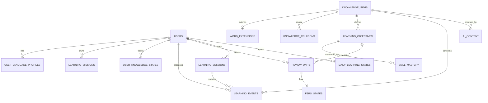

# Database Schema and Persistence

## Purpose

This document defines the MVP local persistence model, integrity rules, indexing, migrations, backup/export behavior, and future synchronization readiness for the native Apple clients.

Each iPhone, iPad, or Mac installation has a local source of truth behind domain repository and transaction protocols. The relational/table vocabulary below is the normative logical contract. ADR-003 decides whether its first physical adapter uses SwiftData/Core Data, direct SQLite, GRDB, or another native Swift stack. No SwiftUI view or `ModelContext` may become the domain repository boundary.

Cross-device synchronization is not part of the MVP. The same schema and stable IDs on several Apple devices do not imply automatic continuity; CloudKit adoption requires a later sync, conflict, privacy, migration, and recovery decision.

## Principles

- Stable UUIDs are generated by the application, not database row order.
- Canonical content is separate from learner-specific state.
- LearningEvents and review logs are append-only facts.
- AI content always retains provenance and validation state.
- Soft deletion preserves historical references.
- JSON is reserved for genuinely extensible/versioned payloads, not core query fields.
- Foreign keys, transactions, and schema migrations are mandatory.

## Entity relationship overview

## Common conventions

- IDs: lowercase UUID text or native supported UUID representation.
- Timestamps: UTC ISO-8601 or integer epoch with one project-wide convention.
- Booleans: native Boolean values mapped consistently by the selected store.
- Enums: constrained text values plus application enum validation.
- `created_at` is immutable; `updated_at` changes on approved revision.
- Each mutable aggregate includes a `version` for optimistic concurrency.
- Equivalent referential-integrity checks are enforced by the selected store and domain transaction layer; direct SQLite adapters enable foreign keys on every connection.

## Core tables

### `users`

| Column | Notes |
| --- | --- |
| `id` PK | Local learner UUID. |
| `display_name` | Optional. |
| `interface_language` | BCP 47 tag. |
| `created_at`, `updated_at` | Audit timestamps. |
| `settings_json` | Versioned non-secret preferences only. |

API keys are not stored here; only secure-storage references may be persisted.

### `user_language_profiles`

Contains learner/native and target language roles, CEFR level, active state, and package version references. Unique constraint prevents duplicate active role/language combinations per user.

### `client_installations` and `capability_snapshots`

Client installations store stable installation ID, user, surface type, runtime/platform version, registration time, and last-seen metadata. Immutable capability snapshots store versioned input/output/local-service capabilities and are referenced by sessions, plans, and events. No hardware serial number is required in domain data.

### `knowledge_items`

| Column | Notes |
| --- | --- |
| `id` PK | Canonical stable ID. |
| `type` | WORD, PHRASE, SENTENCE, GRAMMAR_RULE, etc. |
| `language_tag` | Primary content language. |
| `canonical_key` | Normalized deduplication key scoped by language/type. |
| `title`, `content_json` | Human label and versioned typed content. |
| `cefr_level`, `difficulty` | Separately nullable. |
| `status` | DRAFT/PROPOSED, ACCEPTED_PRIVATE, VALIDATED, ARCHIVED, REJECTED. |
| `scope` | `SYSTEM` or `USER_PRIVATE` in MVP. |
| `owner_user_id` | Required for `USER_PRIVATE`; null for bundled system content. |
| `source_type`, `source_ref` | Provenance. |
| `created_at`, `updated_at`, `version` | Audit/concurrency. |

Unique index: `(scope, owner_user_id, type, language_tag, canonical_key)` for active canonical items. This identifies a lexeme/content item; meanings are stored as stable LexicalSenses.

### `knowledge_item_revisions`

Append-only revisions store item ID, revision number, previous revision, changed payload, change reason, actor/source, validation decision, and timestamp. Exactly one approved revision is projected as the current item state.

### `content_proposals` and `validation_decisions`

Proposals store target aggregate, proposed patch/payload, source/task provenance, confidence, status, and idempotency key. Validation decisions record each gate, validator/policy version, evidence, result, and timestamp. The owning domain service records final promotion or rejection.

### `word_extensions`

One-to-one with WORD items. Stores lemma, part of speech, IPA, pronunciation, frequency metadata, and `language_data_json` with schema/package version. Frequently queried German fields may later be normalized after profiling.

### `lexical_senses` and `translations`

`lexical_senses` stores stable sense ID, parent word/phrase ID, definition/gloss, domain/register qualifiers, provenance, validation state, and version. Unique sense keys are scoped to the parent item and source/version.

`translations` links a required source sense ID to a target sense ID or a versioned target expression when no target lexeme exists. It stores direction, natural/literal form, context/register, confidence, provenance, and validation state. FTS indexes only validated translation text.

### `knowledge_relations`

Stores source/target IDs, relation type, qualifiers JSON, confidence, validation state, provenance, evidence reference, timestamps, and version.

Indexes:

- `(source_item_id, relation_type, validation_state)`;
- `(target_item_id, relation_type, validation_state)`;
- `(relation_type, validation_state)`.

Duplicate relation policy uses endpoints, type, and normalized qualifiers.

### `learning_objectives`

Stores KnowledgeItem reference, operation, modality, target component, objective type, assessment-policy version, language-package version, and active status. Desired stages are stored in mission/learner target associations.

### `objective_dependencies` and `mission_objective_targets`

Objective dependencies store prerequisite/support associations between LearningObjectives outside the Knowledge Graph. Mission targets link user/mission/objective to desired stage, weight, and rationale.

### `user_knowledge_states`

Stores user/item relationship, overall learning status, mission importance override, personal notes, last interaction, and version. Unique `(user_id, knowledge_item_id)`.

### `skill_mastery`

Unique `(user_id, learning_objective_id)`. Stores score, confidence, stage, evidence count, trend, last evidence timestamp, and algorithm version. This is a rebuildable projection where event coverage permits.

### `learning_events`

Append-only event table with event ID, schema version, user/session/item/objective and optional ReviewUnit references, event type, outcome, response time, hint/reveal flags, evaluator source/confidence, client installation/capability snapshot references, safe payload JSON, and timestamp.

No UPDATE or DELETE occurs in normal application flow. Corrections create new events.

### `review_units` and `fsrs_states`

Each `review_unit` belongs to one user and exactly one LearningObjective and defines direction/modality, evaluator policy, active state, and version. Unique identity includes `(user_id, learning_objective_id, retrieval_contract_key)`.

Each active ReviewUnit has one `fsrs_state` storing state, stability, difficulty, due time, last review, repetitions, lapses, and scheduler version. Recognition and recall for the same KnowledgeItem schedule independently.

### `review_logs`

Append-only scheduler inputs/results: ReviewUnit, rating, rating source (`USER` or `DERIVED`), mapping-policy version, state before/after, due before/after, elapsed/scheduled days, FSRS version, and LearningEvent reference.

### `learning_sessions`

Stores start/end timestamps, planned/actual duration, mode, plan ID, client installation/capability snapshot references, completion state, and summary projection.

### `learning_plans` and `learning_plan_activities`

Plans store user, planning snapshot/version, time budget, daily-state source, rationale, status, and timestamps. Ordered activities store objective/review-unit references, exercise intent, capability requirements, estimated duration, priority components, and completion state.

### `daily_learning_states`

Unique per user and check-in timestamp/date policy. Stores time budget, energy, optional motivation/focus/stress, preferred mode, source, and creation time.

### `learning_missions`

Stores goal, target language/level/date, status, domain/objective-dimension weights, requirements JSON, and version.

### `error_patterns`

Stores user, pattern type, language package, confidence, evidence count/references, status, first/last observed time, decay/update policy, and version.

### `decks` and `deck_items`

Decks store owner, type (SMART/MANUAL/SYSTEM), name, and filter JSON for smart decks. `deck_items` is used only for manual membership. Smart membership is computed and never duplicates KnowledgeItems.

### `exercises` and `exercise_attempts`

Exercises store type, schema version, prompt/answer/rubric JSON, objective/item references, difficulty, provenance, validation state, and reuse policy. Attempts reference LearningEvents and retain evaluator metadata.

### `ai_content`

Stores owner/scope, task type, target reference, provider/model, prompt/schema/package/validator versions, safe context fingerprint, generated payload, validation status, quality signals, cache key, timestamps, and expiry/reuse policy. Learner-influenced content is always `USER_PRIVATE`.

### `media_assets`

Stores checksum, MIME type, local path/reference, remote source, size, language, transcript/alt text, license, provenance, cache state, and last access time.

### `outbox_events`

Transactional domain event/outbox records enable reliable in-process projections and future sync. Stores event ID/type/version, aggregate reference, payload, created time, processed time, retry count, and error classification.

### `pipeline_jobs` and `pipeline_stage_attempts`

Jobs store owner, source checksum/reference, language pair, current state, configuration/schema versions, approval state, retention deadline, and final accepted IDs. Stage attempts store stage/version, idempotency key, status, input/output references, attempts, provider/package versions, timestamps, and classified errors.

## Transactions

The following are atomic:

- create draft KnowledgeItem plus initial revision/outbox event;
- approve content proposal plus validated fields/relations;
- save exercise attempt, LearningEvent, derived/entered rating, review log, ReviewUnit FSRS update, and mastery projection;
- archive item while preserving referential history.

Long AI/network work never holds a database transaction open.

## Search

The MVP requires indexed search for titles, lemmas, translations, and approved textual content. ADR-003 selects the physical search adapter (for example SQLite FTS or a native index). Search indexing consumes domain events. Persian normalization and German canonicalization occur before indexing; raw and normalized forms may both be retained.

## Migrations

- Every schema change has a monotonically ordered migration.
- Migrations run atomically when the selected store permits and use a recoverable staged procedure otherwise.
- A pre-migration backup is required for destructive/transformative changes.
- CI tests upgrade from representative previous database versions.
- Application startup refuses unsafe downgrade and provides recovery guidance.
- Language extension payloads carry independent schema versions and migrators.

## Backup, export, and deletion

### Backup

- Consistent local database snapshot plus referenced user-owned media manifest.
- Backup integrity and schema version are verifiable before restore.

### Export

- JSON is the lossless canonical export.
- CSV supports vocabulary and review summaries.
- Export excludes secrets and may optionally exclude private response payloads.

### Deletion

- The MVP is a single-profile local database with explicit `SYSTEM` and `USER_PRIVATE` scopes. Manual entries, personalized AI content, imports, examples, and media are private by default.
- User-requested full deletion removes all `USER_PRIVATE` content and learner data, FTS entries, cached/private media, selected backups, pipeline artifacts, outbox records, and secure-storage secrets; bundled `SYSTEM` seed content may remain.
- A verified deletion test confirms no private rows, files, index entries, or secrets remain.
- Normal content removal uses archive/soft-delete when event history references an item.
- Future cloud deletion requires separate verified propagation rules.

## Security

- API key material stays in Keychain and never in the learner store.
- Store-file protection, encryption, Keychain accessibility, iOS/iPadOS Data Protection, macOS App Sandbox, backups, recovery, and lost-key behavior require ADR-007 based on the Apple-platform threat model.
- Logs never include raw secrets or unrestricted response payloads.
- Parameterized queries are mandatory for SQL-backed adapters; equivalent typed/predicate-safe APIs are mandatory for other adapters.
- Imported JSON is schema-validated with size/depth limits.

## Future synchronization

Stable UUIDs, append-only events, versions, tombstones, and the outbox enable future delta sync. SwiftData/CloudKit convenience does not override these domain conflict rules. LearningEvents are never silently discarded; user edits outrank AI enrichment, and conflict resolution remains domain-specific and auditable.

## Acceptance criteria

- Core foreign keys and uniqueness constraints reject invalid references/duplicates.
- A completed review is transactionally durable after restart.
- AI provenance is queryable for every generated artifact.
- Smart decks do not create duplicate KnowledgeItems.
- Event projections can be rebuilt in a test fixture.
- Migration tests cover at least the previous supported schema.
- Export contains no API keys or secret references.

## Open questions

The first source question below is preserved verbatim for traceability. LB-DEC-041 is superseded by LB-DEC-059, which asks the equivalent native Swift persistence/query/migration question and is owned by the revised ADR-003.

- Which Flutter SQLite library and migration framework best satisfy transaction/testing needs?
- Is SQLCipher justified for MVP platforms, and how will key recovery work?
- Which deterministic evidence-to-rating thresholds should the ReviewUnit ADR adopt for each MVP exercise type?
- Which response payloads are necessary for feedback while minimizing sensitive storage?

## Related documents

- `04_Core_Domain_Model.md` — Canonical entities.
- `05_Learning_Domain_Model.md` — Events and mastery projections.
- `06_Knowledge_Graph_Architecture.md` — Relation queries and indexes.
- `11_Technical_Architecture.md` — Repository and transaction boundaries.

## Revision history

| Version | Date | Description |
| --- | --- | --- |
| 0.3.0 | 2026-07-21 | Recast the schema as a native Apple local-store contract, deferred SwiftData/SQLite selection to ADR-003, and added Apple protection and no-implied-sync boundaries. |
| 0.2.1 | 2026-07-11 | Added client installation and immutable capability-snapshot persistence contracts. |
| 0.2.0 | 2026-07-11 | Cross-document architecture review; resolved domain, validation, scheduling, privacy, and MVP consistency contracts. |
| 0.1.0 | 2026-07-11 | Initial Database Schema and Persistence specification. |
