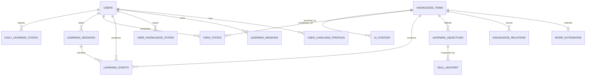

# Database Schema and Persistence

## Purpose

This document defines the MVP local persistence model, integrity rules, indexing, migrations, backup/export behavior, and future synchronization readiness.

SQLite is the local source of truth. Domain repositories isolate the application from SQL and preserve a future path to PostgreSQL or another storage implementation.

## Principles

- Stable UUIDs are generated by the application, not database row order.
- Canonical content is separate from learner-specific state.
- LearningEvents and review logs are append-only facts.
- AI content always retains provenance and validation state.
- Soft deletion preserves historical references.
- JSON is reserved for genuinely extensible/versioned payloads, not core query fields.
- Foreign keys, transactions, and schema migrations are mandatory.

## Entity relationship overview

## Common conventions

- IDs: lowercase UUID text or native supported UUID representation.
- Timestamps: UTC ISO-8601 or integer epoch with one project-wide convention.
- Booleans: constrained integer values in SQLite.
- Enums: constrained text values plus application enum validation.
- `created_at` is immutable; `updated_at` changes on approved revision.
- Each mutable aggregate includes a `version` for optimistic concurrency.
- Foreign keys are enabled on every connection.

## Core tables

### `users`

| Column | Notes |
| --- | --- |
| `id` PK | Local learner UUID. |
| `display_name` | Optional. |
| `interface_language` | BCP 47 tag. |
| `created_at`, `updated_at` | Audit timestamps. |
| `settings_json` | Versioned non-secret preferences only. |

API keys are not stored here; only secure-storage references may be persisted.

### `user_language_profiles`

Contains learner/native and target language roles, CEFR level, active state, and package version references. Unique constraint prevents duplicate active role/language combinations per user.

### `knowledge_items`

| Column | Notes |
| --- | --- |
| `id` PK | Canonical stable ID. |
| `type` | WORD, PHRASE, SENTENCE, GRAMMAR_RULE, etc. |
| `language_tag` | Primary content language. |
| `canonical_key` | Normalized deduplication key scoped by language/type. |
| `title`, `content_json` | Human label and versioned typed content. |
| `cefr_level`, `difficulty` | Separately nullable. |
| `status` | DRAFT, VALIDATED, ARCHIVED, REJECTED. |
| `source_type`, `source_ref` | Provenance. |
| `created_at`, `updated_at`, `version` | Audit/concurrency. |

Unique index: `(type, language_tag, canonical_key)` for active canonical items, with sense-aware exceptions handled through policy.

### `word_extensions`

One-to-one with WORD items. Stores lemma, part of speech, IPA, pronunciation, frequency metadata, and `language_data_json` with schema/package version. Frequently queried German fields may later be normalized after profiling.

### `knowledge_relations`

Stores source/target IDs, relation type, qualifiers JSON, confidence, validation state, provenance, evidence reference, timestamps, and version.

Indexes:

- `(source_item_id, relation_type, validation_state)`;
- `(target_item_id, relation_type, validation_state)`;
- `(relation_type, validation_state)`.

Duplicate relation policy uses endpoints, type, and normalized qualifiers.

### `learning_objectives`

Stores KnowledgeItem reference, skill type, objective type, target stage, assessment-policy version, language-package version, and active status.

### `user_knowledge_states`

Stores user/item relationship, overall learning status, mission importance override, personal notes, last interaction, and version. Unique `(user_id, knowledge_item_id)`.

### `skill_mastery`

Unique `(user_id, learning_objective_id)`. Stores score, confidence, stage, evidence count, trend, last evidence timestamp, and algorithm version. This is a rebuildable projection where event coverage permits.

### `learning_events`

Append-only event table with event ID, schema version, user/session/item/objective references, event type, outcome, response time, hint/reveal flags, evaluator source/confidence, safe payload JSON, and timestamp.

No UPDATE or DELETE occurs in normal application flow. Corrections create new events.

### `fsrs_states`

Unique `(user_id, knowledge_item_id, objective_scope)` as defined by the selected FSRS ADR. Stores state, stability, difficulty, due time, last review, repetitions, lapses, and scheduler version.

### `review_logs`

Append-only scheduler inputs/results: rating, state before/after, due before/after, elapsed days, scheduled days, FSRS version, and LearningEvent reference.

### `learning_sessions`

Stores start/end timestamps, planned/actual duration, mode, plan ID, completion state, and summary projection.

### `daily_learning_states`

Unique per user and check-in timestamp/date policy. Stores time budget, energy, optional motivation/focus/stress, preferred mode, source, and creation time.

### `learning_missions`

Stores goal, target language/level/date, status, domain/skill weights, requirements JSON, and version.

### `error_patterns`

Stores user, pattern type, language package, confidence, evidence count/references, status, first/last observed time, decay/update policy, and version.

### `decks` and `deck_items`

Decks store owner, type (SMART/MANUAL/SYSTEM), name, and filter JSON for smart decks. `deck_items` is used only for manual membership. Smart membership is computed and never duplicates KnowledgeItems.

### `exercises` and `exercise_attempts`

Exercises store type, schema version, prompt/answer/rubric JSON, objective/item references, difficulty, provenance, validation state, and reuse policy. Attempts reference LearningEvents and retain evaluator metadata.

### `ai_content`

Stores task type, target reference, provider/model, prompt/schema versions, safe context hash, generated payload, validation status, quality signals, cache key, timestamps, and expiry/reuse policy.

### `media_assets`

Stores checksum, MIME type, local path/reference, remote source, size, language, transcript/alt text, license, provenance, cache state, and last access time.

### `outbox_events`

Transactional domain event/outbox records enable reliable in-process projections and future sync. Stores event ID/type/version, aggregate reference, payload, created time, processed time, retry count, and error classification.

## Transactions

The following are atomic:

- create draft KnowledgeItem plus initial revision/outbox event;
- approve content proposal plus validated fields/relations;
- save exercise attempt, LearningEvent, review log, FSRS update, and mastery projection;
- archive item while preserving referential history.

Long AI/network work never holds a database transaction open.

## Search

MVP uses SQLite FTS for titles, lemmas, translations, and approved textual content. Search indexing consumes domain events. Persian normalization and German canonicalization occur before indexing; raw and normalized forms may both be retained.

## Migrations

- Every schema change has a monotonically ordered migration.
- Migrations run inside a transaction when SQLite permits.
- A pre-migration backup is required for destructive/transformative changes.
- CI tests upgrade from representative previous database versions.
- Application startup refuses unsafe downgrade and provides recovery guidance.
- Language extension payloads carry independent schema versions and migrators.

## Backup, export, and deletion

### Backup

- Consistent local database snapshot plus referenced user-owned media manifest.
- Backup integrity and schema version are verifiable before restore.

### Export

- JSON is the lossless canonical export.
- CSV supports vocabulary and review summaries.
- Export excludes secrets and may optionally exclude private response payloads.

### Deletion

- User-requested full deletion removes local user-scoped data and secure-storage secrets.
- Normal content removal uses archive/soft-delete when event history references an item.
- Future cloud deletion requires separate verified propagation rules.

## Security

- API key material stays in platform secure storage.
- Database protection/encryption choice requires an ADR based on platform threat model.
- Logs never include raw secrets or unrestricted response payloads.
- Parameterized queries are mandatory.
- Imported JSON is schema-validated with size/depth limits.

## Future synchronization

Stable UUIDs, append-only events, versions, tombstones, and the outbox enable delta sync. LearningEvents are never silently discarded. User edits outrank AI enrichment; conflict resolution is domain-specific and auditable.

## Acceptance criteria

- Core foreign keys and uniqueness constraints reject invalid references/duplicates.
- A completed review is transactionally durable after restart.
- AI provenance is queryable for every generated artifact.
- Smart decks do not create duplicate KnowledgeItems.
- Event projections can be rebuilt in a test fixture.
- Migration tests cover at least the previous supported schema.
- Export contains no API keys or secret references.

## Open questions

- Which Flutter SQLite library and migration framework best satisfy transaction/testing needs?
- Is SQLCipher justified for MVP platforms, and how will key recovery work?
- Should FSRS scheduling be per KnowledgeItem or per LearningObjective for the first release?
- Which response payloads are necessary for feedback while minimizing sensitive storage?

## Related documents

- `04_Core_Domain_Model.md` — Canonical entities.
- `05_Learning_Domain_Model.md` — Events and mastery projections.
- `06_Knowledge_Graph_Architecture.md` — Relation queries and indexes.
- `11_Technical_Architecture.md` — Repository and transaction boundaries.

## Revision history

| Version | Date | Description |
| --- | --- | --- |
| 0.1.0 | 2026-07-11 | Initial Database Schema and Persistence specification. |
