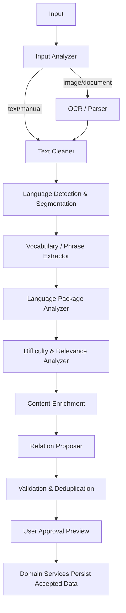
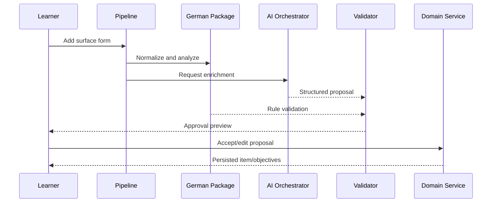

# AI Agent Pipeline

## Purpose

This document defines the processing pipeline that converts manual input, text, images, and future documents into validated learning proposals. “Agent” means a bounded processing role with a typed contract; it does not imply an autonomous system with unrestricted access.

Agents never write directly to canonical learning data. The application orchestrates stages, validates outputs, records provenance, and requests learner approval where required.

## Design principles

- One bounded responsibility per stage.
- Typed, versioned input and output schemas.
- Idempotent execution and safe retries.
- Untrusted input remains clearly separated from system instructions.
- Human approval before ambiguous imported/generated knowledge is accepted.
- Deterministic/rule-based processing before AI where practical.
- Full traceability from source artifact to accepted KnowledgeItem.

## Supported pipeline entry points

| Input | MVP | Processing path |
| --- | --- | --- |
| Manual word/phrase | Required | normalization → analysis → enrichment → validation → preview |
| Pasted text | Limited/next | clean → segment → extract → learner filter → preview |
| Image | Post-MVP | preprocess → OCR → clean → extract → preview |
| PDF/document | Post-MVP | parse/OCR → segment → extract → preview |
| URL/article | Future | fetch with consent/policy → extract → preview |

## Pipeline overview

## Pipeline job model

A `PipelineJob` records:

- job ID, owner, input type, source reference/checksum;
- requested task and language pair;
- current stage and status;
- stage attempts, timestamps, and errors;
- prompt/model/package/schema versions;
- output proposal references;
- approval state and final accepted entity IDs.

Statuses: `QUEUED`, `RUNNING`, `WAITING_FOR_APPROVAL`, `COMPLETED`, `PARTIAL`, `FAILED`, `CANCELLED`.

## Stage contracts

### Input Analyzer

Validates file/type/size, computes checksum, detects likely input kind, and chooses the allowed pipeline. It rejects unsupported or dangerous inputs before expensive processing.

### OCR / Document Parser

Extracts text blocks and layout metadata. OCR output contains confidence by block/token and never becomes canonical text automatically. Image preprocessing is deterministic and preserves the original asset reference.

Candidate providers include PaddleOCR or platform services, selected later by ADR and licensing/performance evaluation.

### Text Cleaner

Normalizes Unicode, removes clear OCR noise, preserves paragraph/sentence boundaries, and records transformations. It cannot silently rewrite uncertain language content.

### Language Detection and Segmentation

Detects language per segment, separates German/Persian mixed text, identifies sentences/tokens, and delegates normalization to Language Packages.

### Vocabulary and Phrase Extractor

Produces candidate lexical items, phrases, and context sentences. Each candidate records surface form, proposed lemma, source span, confidence, and occurrence count.

### Learner Filter

Compares candidates with canonical items and learner state:

- known/mastered;
- currently learning;
- new but relevant;
- duplicate/variant;
- outside configured level/domain.

It recommends candidates; it does not decide that a learner “knows” an item solely because it appeared previously.

### Language Package Analyzer

Supplies part of speech, morphology, grammar metadata, objective templates, and deterministic validation supported by German/Persian packages.

### Difficulty and Relevance Analyzer

Estimates CEFR/difficulty, frequency usefulness, mission relevance, prerequisite readiness, and novelty. Scores retain sources and algorithm/model versions.

### Content Enrichment

Requests meanings, natural Persian translations, level-appropriate examples, usage notes, and optional related forms through the AI Orchestrator. Output is structured and remains proposed.

### Relation Proposer

Creates proposed word-family, semantic, grammar, usage, translation, and domain edges with confidence and evidence. It cannot mark relations validated.

### Validation and Deduplication

Checks schemas, canonical duplicates, language rules, contradictory forms, unsafe content, provenance, and required confidence. Results are accepted, rejected, or sent to learner review.

### Approval Preview

Shows source context, normalized item, proposed fields, uncertainty, duplicates, and expected learning objectives. The learner can accept, edit, reject, or defer each candidate and batch action.

## Event-driven orchestration

Stages communicate through durable job/stage records and typed events, not direct agent-to-agent mutation.

Examples:

- `InputAccepted`
- `TextExtracted`
- `CandidatesExtracted`
- `AnalysisCompleted`
- `ContentProposed`
- `ValidationCompleted`
- `ApprovalRequested`
- `ProposalAccepted`

The MVP may execute manual-word stages synchronously where latency permits, while retaining the same contracts.

## Idempotency and retry

- Job and stage idempotency keys use source checksum, task, configuration, and schema versions.
- Completed stages are reused unless explicitly invalidated.
- Transient network/provider failures use bounded exponential backoff.
- Schema or validation failures do not retry indefinitely.
- Cancellation preserves accepted data and removes no user content.
- Partial jobs expose successful and failed candidates separately.

## Human-in-the-loop policy

Approval is required when:

- confidence is below the task threshold;
- OCR text is uncertain;
- multiple lemmas/senses are plausible;
- a proposed fact conflicts with validated data;
- a batch import would add new items;
- licensing/source attribution needs confirmation.

Low-risk validated cache reuse may be auto-applied according to learner settings, with provenance visible.

## Security and privacy

- Input documents are untrusted and subject to type/size limits.
- Embedded text cannot override system instructions.
- External URLs are not fetched without explicit feature authorization.
- Raw source content is sent to cloud providers only with disclosure and consent.
- Secrets are excluded from job payloads/logs.
- Raw imported sources and intermediate artifacts default to deletion after successful approval or within 24 hours, whichever comes first, unless the learner explicitly chooses to retain the original. Failed/cancelled jobs follow the same 24-hour maximum; retention and deletion are auditable.

## Quality evaluation

Pipeline test sets include:

- German words in inflected forms;
- mixed Persian/German sentences;
- separable verbs and compound nouns;
- low-quality OCR samples;
- ambiguous senses;
- duplicate imports;
- adversarial prompt-like text inside documents.

Metrics include extraction precision/recall, normalization accuracy, validation rejection rate, learner edit rate, stage latency, cost, and recovery success.

## Manual word MVP sequence

## Acceptance criteria

- Repeating the same job does not duplicate accepted KnowledgeItems.
- Every proposal is traceable to source, stage, model/package, and schema version.
- An agent cannot directly update mastery, FSRS, or canonical graph facts.
- Invalid AI output is rejected before approval/persistence.
- Learners can inspect and edit uncertain proposals.
- Network failure preserves input and supports retry or deterministic fallback.
- Manual word ingestion completes end-to-end in MVP.

## Open questions

- Which OCR engine provides acceptable German/Persian mixed-text results and licensing?
- What batch size keeps approval understandable?
- Should future enterprise deployments permit an administrator-configured retention window beyond the private MVP default?
- Which pipeline stages can safely run fully on-device?

## Related documents

- `08_AI_Orchestration_Layer.md` — AI task execution and validation.
- `09_Language_Independence_Framework.md` — Analysis capabilities.
- `11_Technical_Architecture.md` — Events and module boundaries.
- `12_Database_Schema_and_Persistence.md` — Jobs, provenance, and outbox persistence.

## Revision history

| Version | Date | Description |
| --- | --- | --- |
| 0.2.0 | 2026-07-11 | Cross-document architecture review; resolved domain, validation, scheduling, privacy, and MVP consistency contracts. |
| 0.1.0 | 2026-07-11 | Initial AI Agent Pipeline specification. |
