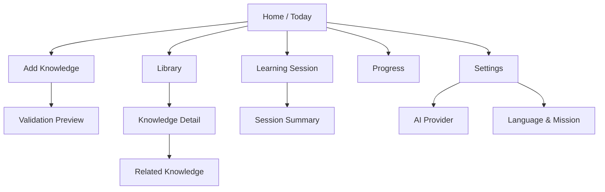

# Frontend UX/UI

## Purpose

This document defines the MVP user experience, information architecture, primary screens, interaction states, accessibility requirements, and presentation contracts for LinguaBrain.

The interface should feel like a calm personal learning coach. It exposes control and explanations without requiring learners to manage database structures, AI prompts, or duplicate decks.

## UX principles

- Start with the next useful action.
- Keep manual organization optional.
- Explain recommendations briefly and on demand.
- Separate proposed AI content from validated/accepted content.
- Treat Persian–German mixed direction as a first-class requirement.
- Preserve learner progress during offline and failure states.
- Prefer sustainable sessions over pressure, streak anxiety, or excessive gamification.

## Accepted MVP platform and golden baseline

[ADR-009](../decisions/ADR-009-Native-Apple-Client-and-Platform-Baseline.md) supersedes the Android/Flutter pilot and makes iOS/iPadOS 27 and macOS 27 first-class, local-only MVP surfaces. iPhone is the primary controlled-pilot and evidence surface; iPad and macOS are release-supported companion surfaces with independent local learner stores. The UI is implemented in Swift 6.4 and SwiftUI. Flutter, Dart, Android, and Web are not active MVP targets.

Xcode 27 beta and the beta OS SDKs are provisional development inputs. The canonical SwiftUI snapshot fixture is:

| Property | Baseline |
| --- | --- |
| Target behavior | Native SwiftUI on iOS 27; deterministic regression evidence, not a substitute for device testing |
| Device and orientation | iPhone 17 Pro simulator, portrait; exact runtime, build, and rendered metrics are pinned only after GM |
| Interface | Persian (`fa`), RTL |
| German content | `de-DE`, explicit LTR/bidi isolation |
| Appearance and text | Light appearance, default Dynamic Type size (`large`) |
| Test inputs | Fixed clock, synthetic data, deterministic safe-area/environment values, disabled animations |
| Fonts | Bundled and explicitly loaded after LB-DEC-050 approves files and licenses |
| Toolchain | Swift 6.4 with Xcode 27 beta; provisional until the stable/GM toolchain and final SDKs are available |

The canonical image is not the supported-layout boundary. M1 establishes the native view/snapshot harness for the shell, onboarding, and first-item flow; each later critical screen passes the applicable matrix in its owning milestone:

| Surface or dimension | Required coverage |
| --- | --- |
| iPhone | Compact width at a small supported window, the canonical reference window, a large phone window, and landscape |
| iPad | Compact and regular horizontal size classes, relevant vertical size classes, portrait/landscape, Split View, and representative resizable-window widths |
| macOS | Minimum supported, reference, and large resizable windows; window restoration is tested separately |
| Text | Default through accessibility Dynamic Type categories without app-defined caps; essential actions and answers must remain usable |
| Appearance and language | Light/dark, Persian RTL, German LTR, and mixed bidi content |
| State | Loading, empty, offline, error, proposal warning, long content, and restored-session states |
| Accessibility | VoiceOver on every first-class surface; XCUITest and simulator/device checks remain separate from pixel comparison |

iPad layouts respond to available space and size classes rather than device names. macOS layouts additionally verify keyboard focus, pointer/hover and context behavior, menu commands, documented shortcuts, resizable windows, and window restoration. iPad keyboard and pointer behavior are tested where supported. Snapshot tests do not replace VoiceOver, keyboard, pointer, localization, integration, or physical-device evidence.

All snapshots generated with Xcode 27 beta or beta SDKs are provisional. Authoritative bilingual snapshots are not accepted until LB-DEC-050 closes and are not release evidence until regenerated and reviewed under stable/GM Xcode 27 with final iOS/iPadOS/macOS 27 SDKs.

## Information architecture



Primary iPhone navigation:

1. Today
2. Library
3. Add
4. Progress
5. Settings

Review/session UI is a focused flow outside normal tab navigation.

On iPad, the same information architecture may adapt to a sidebar and split view at regular width while preserving a compact-width path equivalent to iPhone. On macOS, a native sidebar, toolbar, menus, commands, keyboard shortcuts, and multiple/resizable window behavior expose the same application commands without imitating a phone tab bar.

## Onboarding

### Step 1 — Language

- Interface/explanation language: Persian.
- Target language: German.
- Mixed-direction preview confirms readability.

### Step 2 — Current level

- Complete beginner, A1, A2, B1, B2, or “Not sure.”
- Placement assessment is post-MVP; “Not sure” uses conservative defaults.

### Step 3 — Mission

- Daily conversation, Work in Germany, Goethe exam, travel, study, or custom goal.
- Optional professional domain.

### Step 4 — Learning preferences

- Typical daily time.
- Translation visibility, audio behavior, font size, and accessibility preferences.
- AI setup can be skipped; core review remains usable.

Onboarding data is editable later and never locks the learner into one path.

## Daily check-in

The Today screen asks for a lightweight state before generating the plan:

- available time: 5, 10, 20, 30, 60+ minutes;
- energy: simple 1–10 control or five-step labels;
- optional mode: light review, balanced/new learning, or challenge. Speaking is shown only after that capability ships.

The UI immediately shows how the choice affects the plan. The learner may skip the prompt; planning then uses named stored defaults and displays that source. The plan persists whether inputs are fresh or defaulted and how stale they are.

## Today dashboard

Required content:

- greeting and active mission;
- due review count without alarmist language;
- recommended plan duration and mode;
- 3–5 planned activity blocks;
- concise “Why this plan?” explanation;
- Start button and Edit plan action;
- offline/AI availability indicator only when relevant.

The dashboard must not overwhelm the learner with all analytics before a session.

## Add Knowledge flow

MVP entry supports a word or phrase.

```text
Enter German item → Normalize/check duplicate → Enrich if available → Preview → Accept/edit → Added
```

### Preview screen

Shows:

- original and normalized form;
- Persian meaning and sense/context;
- part of speech and German-specific forms;
- CEFR/difficulty and example;
- proposed relations and smart collections;
- confidence/validation warnings;
- provenance summary.

Actions: Accept, Edit, Reject, Save draft. When authoritative validation is absent, acceptance creates `ACCEPTED_PRIVATE` content with a visible provenance/warning; AI uncertainty is never disguised as system validation.

Without AI/network access, the learner can create a minimal manual card (lemma/phrase, Persian meaning, type if known) or select bundled validated seed content. Optional enrichment remains queued or can be requested later.

## Smart card

### Front

- Target prompt based on current objective: German word, Persian meaning, audio, or contextual blank.
- Optional hint, not an immediate answer.

### Back/feedback

- Correct answer and natural Persian explanation.
- Relevant form: article/plural for nouns; essential verb forms for verbs.
- One level-appropriate example.
- Short error explanation when applicable.
- For self-graded reveal cards: Again, Hard, Good, Easy. Automatically evaluated exercises show feedback while the versioned policy derives the rating without asking twice.

Secondary details and graph relations are expandable to keep the review focused.

## Exercise patterns

### Recognition

German item → choose or reveal Persian meaning. Used for introduction/recovery, not as the only evidence of mastery.

### Reverse recall

Persian prompt → type or select German form. Acceptable alternatives are evaluated using language-package rules.

### Cloze

Context sentence with one target blank and plausible, level-matched distractors. Feedback identifies the relevant grammar or meaning.

### Article/form practice

Constrained input for noun article/plural or verb form. It records evidence for the specific objective rather than the whole word.

### Future listening/speaking

Audio player, replay, speed control, transcript reveal, recording permission, and clear evaluator confidence are required before release.

## Learning session

The session header shows progress by time/activity, not a punitive countdown. Learners can pause, end early, or skip an unsuitable item.

After each answer:

- show immediate, proportionate feedback;
- record result before advancing;
- avoid long explanations unless requested;
- adapt upcoming difficulty without abrupt unexplained changes.

If the app closes, the next launch offers to resume from the last safely committed point.

## Session summary

Show:

- actual time;
- reviews and new items completed;
- skills practiced;
- one or two meaningful improvements/errors;
- next review preview;
- optional plan feedback (“Too easy,” “Right level,” “Too hard”).

Avoid presenting a single percentage as total language ability.

## Library

Library views:

- All knowledge;
- Due reviews;
- Weak objectives;
- nouns, verbs, adjectives;
- CEFR level;
- mission/domain;
- manual collections.

Search supports German and Persian normalized forms. Filters are composable, and smart collections are labeled as dynamic.

## Knowledge detail

Contains canonical content, learner mastery by skill, next review, examples, forms, source/provenance, personal notes, relations, and edit/archive controls.

The relation view begins with a small ranked list. Full graph visualization is optional/future and must be accessible through a list alternative.

## Progress

MVP progress includes:

- mastery by supported skill;
- due/learning/strong objective counts;
- mission coverage;
- recent retention/lapse trend;
- recurring error patterns with suggested action;
- study time and session consistency.

Every insight should be actionable and explainable. Streaks are secondary and non-punitive.

## Settings

### Learning

Languages, level, mission, domains, typical time, difficulty preferences, translation/example options, and review behavior.

### AI provider

Provider/local endpoint, model, secure key entry, connection test, usage/cost summary, privacy disclosure, and remove-key action. Secrets are never displayed after saving.

### Data and privacy

Export, backup/restore, delete local learner data, telemetry consent, media cache size, and clear explanation of cloud data transfer.

### Accessibility

Font scale, high contrast, dark mode, reduced motion, dyslexia-friendly option where validated, audio speed, and screen-reader preferences.

## RTL/LTR requirements

- Page direction follows interface language; individual German content uses LTR spans.
- Persian translations use RTL spans even inside German cards.
- Punctuation, parentheses, numerals, and input cursor behavior are tested in mixed strings.
- Text fields set the expected input direction but allow pasted mixed text.
- Do not manually reverse strings; rely on Unicode bidi-aware layout with explicit isolation where needed.

## Accessibility requirements

- All actions have accessibility labels, values, hints where necessary, and logical focus order for VoiceOver on iPhone, iPad, and macOS.
- Touch targets meet platform guidance.
- Color is never the only indicator of correctness or validation state.
- Dynamic Type on iPhone and iPad does not truncate, overlap, or hide essential answers/actions, including accessibility categories; the application does not impose a text-size cap.
- Keyboard navigation, visible focus, pointer behavior, menus, commands, and shortcuts are first-class macOS acceptance requirements and are verified on iPad where the input hardware is supported.
- Audio content has transcript or text equivalent.
- Animations honor reduced-motion settings.

## Offline and error states

| State | UX behavior |
| --- | --- |
| Offline | Continue review/search; mark AI/sync actions unavailable or queued. |
| AI timeout | Preserve input, offer retry/cache/manual entry, do not block navigation. |
| Invalid proposal | Explain validation issue and allow edit/reject. |
| Database/migration issue | Protect data, provide recovery path, avoid misleading success state. |
| Empty plan | Explain why and offer library/add/review options. |
| No content | Guided first-item flow with example. |

## Design system foundations

Reusable components include:

- primary/secondary/destructive buttons;
- KnowledgeCard and ExerciseCard;
- validation/provenance badge;
- SkillBadge and mastery indicator;
- DailyState selector;
- PlanActivity tile;
- audio controls;
- German/Persian bilingual text block;
- empty/error/offline state panels;
- confirmation and edit sheets.

Tokens cover typography for Persian and German, spacing, elevation, semantic colors, motion, and responsive breakpoints.

## Responsive strategy

- iPhone is the primary controlled-pilot and UX-evidence surface.
- iPad is a first-class MVP surface. Compact widths follow the iPhone hierarchy; regular widths use adaptive SwiftUI navigation, sidebars, inspectors, and split views where they improve comprehension.
- macOS is a first-class local companion. It uses native window, sidebar, toolbar, menu, keyboard, focus, pointer, and restoration conventions rather than a stretched mobile layout.
- Layout decisions use available SwiftUI environment values, size classes where applicable, and window size rather than hard-coded device-name checks.
- Learning content width remains readable rather than stretching across large screens.

## Client-surface profiles

The shared UX state and application commands are independent of the rendering surface. Each client profile declares display class, touch/keyboard/physical controls, microphone, speaker/headset, connectivity, and locally available services.

- Native iPhone, iPad, and macOS profiles are first-class MVP surfaces; iPhone remains the primary pilot reference.
- Each Apple application uses an independent local learner store. A companion surface does not imply cloud or cross-device synchronization; export/import is the only supported transfer path until post-MVP sync is accepted.
- A future dedicated device may expose a reduced focus-first navigation (Learn, Translate, Note) while using the same plans, ReviewUnits, events, and learner data.
- Unsupported activities are hidden or replaced before session start; the UI never offers recording, playback, typing, or local inference that the active CapabilitySnapshot cannot provide.
- Recording-capable surfaces require explicit start action, unmistakable active indicator, stop/delete controls, and consent guidance. Detailed device interaction and industrial design belong to separate post-MVP specifications.
- Flutter, Dart, Android, and Web client profiles are future candidates only and require a new platform ADR plus target-specific UX, accessibility, security, persistence, and recovery evidence.

## Analytics and usability testing

With consent, capture completion/failure of flows without raw private learning content. Key usability studies test onboarding comprehension, add-item approval, reverse recall, plan explanation, mixed-direction readability, and API-provider setup.

## Acceptance criteria

- A learner completes onboarding and first item without understanding decks or AI prompts.
- Daily time/energy visibly changes the recommended plan.
- German and Persian mixed content passes RTL/LTR and screen-reader tests.
- Review results persist before advancing.
- AI failure does not block offline review.
- Unverified content is clearly distinguishable and editable.
- Every recommendation exposes a concise rationale.
- Critical screens support dynamic text and non-color status cues.
- Critical flows pass the required iPhone, iPad size-class/window, and macOS resizable-window matrices.
- VoiceOver can complete onboarding, first-item approval, review, plan explanation, export, and deletion on every first-class surface.
- macOS critical flows are operable with keyboard navigation and commands; pointer/context behavior and window restoration are verified.
- All beta-era snapshots are regenerated and approved with stable/GM Xcode 27 and final OS SDKs before release.

## Open questions

LB-DEC-053 remains `DECIDED`, with its native Apple snapshot baseline now governed by [ADR-009](../decisions/ADR-009-Native-Apple-Client-and-Platform-Baseline.md); ADR-008 is preserved only as superseded history. Its original wording remains below as a historical source question.

- Should MVP navigation use four tabs plus a central Add action or five equal destinations?
- Which Persian/German font pairing offers best cross-platform readability and licensing?
- How much FSRS detail should be visible to advanced users?
- Should the daily check-in appear every day or only when state is missing/stale?
- Which first platform defines the golden layout baseline?

## Related documents

- `07_Adaptive_Learning_Engine.md` — Plan behavior and explanations.
- `10_MVP_Definition_and_Roadmap.md` — Required MVP journeys.
- `11_Technical_Architecture.md` — Presentation/application boundaries.
- `13_AI_Agent_Pipeline.md` — Approval preview and import states.
- `../decisions/ADR-009-Native-Apple-Client-and-Platform-Baseline.md` — First-class surfaces, pilot priority, and stable-toolchain release gate.
- `../decisions/ADR-010-Swift-Package-and-Module-Layout.md` — Shared Swift package and app-target boundaries.
- `../decisions/ADR-011-SwiftUI-State-Observation-Navigation-and-Dependency-Composition.md` — Accepted SwiftUI Observation, typed navigation, scene lifetime, and dependency-composition decision.

## Revision history

| Version | Date | Description |
| --- | --- | --- |
| 0.3.1 | 2026-08-01 | Linked the accepted ADR-011 scene-owned Observation and typed-navigation architecture. |
| 0.3.0 | 2026-07-21 | Replaced the superseded Android/Flutter baseline with native SwiftUI first-class iPhone, iPad, and macOS adaptive UX, accessibility/input matrices, provisional beta snapshots, and a stable Xcode 27 release gate. |
| 0.2.2 | 2026-07-20 | Adopted the Android-phone pilot and deterministic golden-layout fixture/matrix from ADR-008 while retaining a portable shared UI boundary. |
| 0.2.1 | 2026-07-11 | Added capability-driven client-surface profiles without changing the mobile MVP. |
| 0.2.0 | 2026-07-11 | Cross-document architecture review; resolved domain, validation, scheduling, privacy, and MVP consistency contracts. |
| 0.1.0 | 2026-07-11 | Initial Frontend UX/UI specification. |
