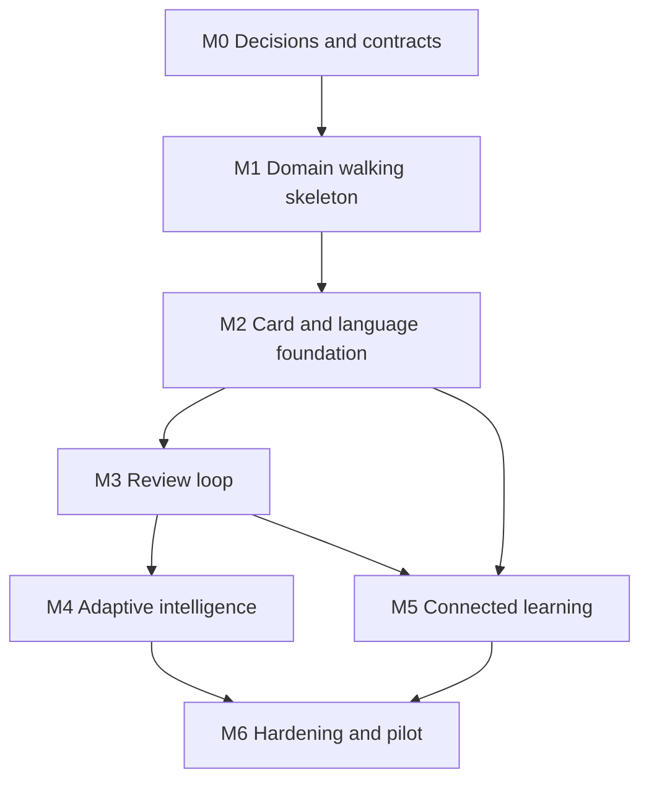

# Implementation Backlog and Requirements Traceability

## Purpose

This document converts the reviewed product and architecture specifications into an executable implementation backlog. It connects each MVP requirement to:

- its authoritative source documents;
- a delivery milestone;
- one or more work items;
- explicit dependencies;
- acceptance evidence and automated-test levels;
- the release gate that prevents incomplete work from being treated as done.

It is the bridge between Documents 01–14 and Git issues, code, tests, and pilot evidence. It does not replace the source specifications or an accepted Architecture Decision Record (ADR).

## Scope

The backlog covers the local-first German–Persian MVP defined in [Document 10](10_MVP_Definition_and_Roadmap.md), from implementation preparation through the controlled pilot.

Included:

- native Swift 6.4/SwiftUI applications for iOS/iPadOS 27 and macOS 27, with iPhone as the primary controlled-pilot surface;
- shared domain and application logic that is client-surface neutral;
- native local persistence behind repository/transaction protocols and offline operation;
- German/Persian Language Packages;
- manual word and phrase ingestion with optional AI enrichment;
- objective-level review using ReviewUnits and FSRS;
- deterministic adaptive planning;
- basic validated Knowledge Graph relations;
- MVP exercises, accessibility, privacy, export, deletion, recovery, and pilot verification.

Explicitly excluded from the MVP backlog:

- Level 1 image curriculum authoring;
- full OCR, PDF, article, and batch-document ingestion;
- speaking evaluation and open-ended conversation;
- accounts and cloud synchronization;
- cross-device synchronization between the first-class local Apple applications;
- downloadable third-party Language Packages;
- social features, marketplace, public decks, and leaderboards;
- dedicated-device hardware, meeting recording, live translation, and manufacturing.
- Flutter, Dart, Android, and Web application targets unless a future platform ADR adds them with complete target-specific evidence.

The shared core must retain the extension points already defined for these post-MVP capabilities. [ADR-009](../decisions/ADR-009-Native-Apple-Client-and-Platform-Baseline.md) establishes the native Apple platform baseline, first-class local-only surfaces, iPhone-primary pilot, and stable Xcode 27 release gate. [ADR-010](../decisions/ADR-010-Swift-Package-and-Module-Layout.md) supersedes the production topology in ADR-001 while preserving its decision to keep the Python prototype at `experiments/vocabulary-mvp/` as reference-only experimental code outside production packages, releases, schemas, and default CI. ADR-001 and ADR-008 remain immutable historical records of superseded choices.

## Source of truth and precedence

Implementation must follow this order of authority:

1. accepted legal, privacy, and platform obligations;
2. an accepted ADR together with its corresponding updated specification;
3. approved baseline versions of Documents 01–15;
4. this backlog and its linked Git issue;
5. implementation notes and developer convenience.

An ADR must not silently contradict a specification. When a decision changes a contract, the affected document, this traceability matrix, `PROJECT_STATUS.md`, and `CHANGELOG.md` are updated in the same change set.

## Traceability model


No P0 implementation work may enter `DONE` without a complete chain from source requirement to verification evidence.

## Identifier conventions

| Artifact | Format | Example | Meaning |
| --- | --- | --- | --- |
| Product/MVP requirement | `LB-REQ-NNN` | `LB-REQ-011` | Stable requirement identity in this document |
| Work item | `LB-WI-MN-NN` | `LB-WI-M3-04` | Implementable milestone-scoped backlog item |
| Architecture decision | `ADR-NNN` | `ADR-003` | Decision record in `decisions/` |
| Verification artifact | `LB-TST-TYPE-NNN` | `LB-TST-E2E-003` | Named test, evaluation, or pilot evidence |
| Risk | `LB-RISK-NNN` | `LB-RISK-004` | Tracked delivery/product risk |

Identifiers are never reused after publication. Superseded artifacts retain their original identifiers and link to their replacements.

## Backlog states

| State | Meaning |
| --- | --- |
| `PROPOSED` | Defined but not yet ready for implementation |
| `READY` | Definition of Ready is satisfied and dependencies are available |
| `IN_PROGRESS` | Actively being implemented; one owner is accountable |
| `BLOCKED` | Cannot progress without a named decision or dependency |
| `IN_REVIEW` | Implementation is complete and evidence is under review |
| `DONE` | Definition of Done and all acceptance evidence are satisfied |
| `DEFERRED` | Intentionally removed from the current release but retained visibly |
| `CANCELLED` | No longer required; reason and superseding decision are recorded |

## Priority model

| Priority | Definition |
| --- | --- |
| `P0` | Required for the current milestone exit or MVP release gate |
| `P1` | Important for a coherent MVP but may move within the milestone if its dependent gate remains protected |
| `P2` | Valuable enhancement that can be deferred without invalidating the MVP hypothesis |

Priority does not override dependencies, privacy, safety, data integrity, or learning validity.

## Definition of Ready

A work item may move to `READY` only when:

- its requirement and source-document links are present;
- its scope and explicit non-goals are clear;
- all blocking ADRs are accepted;
- dependencies and target milestone are named;
- acceptance criteria are observable and testable;
- required test fixtures, data licenses, provider fakes, or design states are available or separately scheduled;
- privacy, accessibility, localization, migration, and offline impacts have been considered;
- the item is small enough to review without combining unrelated architectural changes.

## Definition of Done

A work item may move to `DONE` only when:

- implementation respects domain and layer boundaries;
- acceptance criteria pass with linked evidence;
- required unit, contract, integration, migration, UI, security, performance, or AI-evaluation tests pass;
- offline and failure behavior is verified where relevant;
- no secret, local database, generated artifact, or excluded project is staged;
- affected specifications, ADRs, diagrams, and API contracts are updated;
- `PROJECT_STATUS.md` and `CHANGELOG.md` are updated in the same commit;
- code review finds no unresolved P0/P1 correctness or privacy issue;
- rollback, migration, or recovery behavior is documented when persistent data changes.

## MVP requirement catalog

| ID | Requirement | Primary sources | Target |
| --- | --- | --- | --- |
| `LB-REQ-001` | Ship a German–Persian MVP while keeping core learning logic free of language-specific and client-surface assumptions. | [DOC-01](01_Product_Vision.md), [DOC-03](03_Non_Functional_Requirements.md), [DOC-09](09_Language_Independence_Framework.md), [DOC-11](11_Technical_Architecture.md) | M1–M2 |
| `LB-REQ-002` | Onboarding captures language pair, current level/default, mission, optional domain, and editable learning preferences without requiring AI setup. | [DOC-01](01_Product_Vision.md), [DOC-05](05_Learning_Domain_Model.md), [DOC-14](14_Frontend_UX_UI.md) | M1–M2 |
| `LB-REQ-003` | Core browsing, search, planning, review, event recording, mastery updates, and cached/template exercises work offline; the first item can be created without AI. | [DOC-03](03_Non_Functional_Requirements.md), [DOC-10](10_MVP_Definition_and_Roadmap.md), [DOC-14](14_Frontend_UX_UI.md) | M1–M4 |
| `LB-REQ-004` | KnowledgeItems use stable IDs, typed/versioned content, auditable revisions, ownership/scope, and stable LexicalSense identity. Word, Phrase, Sentence, and GrammarRule remain distinct; MediaAsset and Exercise are separate aggregates; archive and learner-state changes cannot invalidate history or mutate canonical content. | [DOC-04](04_Core_Domain_Model.md), [DOC-12](12_Database_Schema_and_Persistence.md) | M1–M2 |
| `LB-REQ-005` | German and Persian behavior is provided through first-party, versioned Language Packages with BCP 47 identity, explicit interface/learner/target/content/translation/locale roles, normalization, morphology, grammar, evaluation, objective templates, and RTL/LTR metadata. | [DOC-04](04_Core_Domain_Model.md), [DOC-09](09_Language_Independence_Framework.md) | M1–M2 |
| `LB-REQ-006` | A learner can manually add a German word or phrase, normalize it, detect duplicates, preview it, accept/edit/reject it, and retain the accepted result offline. | [DOC-10](10_MVP_Definition_and_Roadmap.md), [DOC-13](13_AI_Agent_Pipeline.md), [DOC-14](14_Frontend_UX_UI.md) | M1–M2 |
| `LB-REQ-007` | Optional AI enrichment is provider-independent, schema-constrained, versioned, privacy-aware, cached safely, fully provenance-tracked, budget-limited, usage-visible, and unable to promote its own output. | [DOC-03](03_Non_Functional_Requirements.md), [DOC-08](08_AI_Orchestration_Layer.md), [DOC-13](13_AI_Agent_Pipeline.md) | M2 |
| `LB-REQ-008` | Smart collections expose part of speech, CEFR, mission/domain, due, and weak-objective views without duplicating canonical KnowledgeItems. | [DOC-01](01_Product_Vision.md), [DOC-04](04_Core_Domain_Model.md), [DOC-12](12_Database_Schema_and_Persistence.md), [DOC-14](14_Frontend_UX_UI.md) | M2–M3 |
| `LB-REQ-009` | LearningObjectives separate operation, modality, and target component; recognition and recall remain independently measurable. | [DOC-02](02_Learning_Philosophy.md), [DOC-05](05_Learning_Domain_Model.md) | M2–M3 |
| `LB-REQ-010` | LearningEvents are append-only, auditable evidence; SkillMastery, ErrorPatterns, and Digital Twin summaries are versioned, explainable, rebuildable, inspectable, correctable, and deletable projections. Archiving content cannot break historical evidence. | [DOC-03](03_Non_Functional_Requirements.md), [DOC-05](05_Learning_Domain_Model.md), [DOC-12](12_Database_Schema_and_Persistence.md) | M3–M4 |
| `LB-REQ-011` | Each learner/objective/retrieval contract has an independent ReviewUnit and FSRS state; automatically evaluated evidence and self-ratings follow a versioned mapping policy. | [DOC-02](02_Learning_Philosophy.md), [DOC-04](04_Core_Domain_Model.md), [DOC-05](05_Learning_Domain_Model.md) | M3 |
| `LB-REQ-012` | MVP exercises provide recognition, Persian-to-German recall, translation, cloze, and article/form evidence against the intended objective. Exposure/reveal alone cannot advance mastery; feedback names the relevant component/rule and offers correction; automatically evaluated exercises cannot request a second self-rating. | [DOC-02](02_Learning_Philosophy.md), [DOC-07](07_Adaptive_Learning_Engine.md), [DOC-10](10_MVP_Definition_and_Roadmap.md), [DOC-14](14_Frontend_UX_UI.md) | M3–M5 |
| `LB-REQ-013` | Daily time, energy, motivation/mode, source, and staleness constrain a session; check-in is skippable and named defaults do not erase due state. | [DOC-05](05_Learning_Domain_Model.md), [DOC-07](07_Adaptive_Learning_Engine.md), [DOC-14](14_Frontend_UX_UI.md) | M4 |
| `LB-REQ-014` | Adaptive planning is local, deterministic, versioned, replayable, capability-aware, stable under tie-breaking, and preserves completed work during re-planning. | [DOC-03](03_Non_Functional_Requirements.md), [DOC-07](07_Adaptive_Learning_Engine.md), [DOC-11](11_Technical_Architecture.md) | M4 |
| `LB-REQ-015` | Plans prioritize due risk, weak objectives, mission relevance, connected readiness, and controlled novelty while explaining recommendations and preserving learner agency. Contextual content targets 90% known and 10% new normalized target-language content lemmas, with the documented ±5 percentage-point tolerance. | [DOC-02](02_Learning_Philosophy.md), [DOC-05](05_Learning_Domain_Model.md), [DOC-07](07_Adaptive_Learning_Engine.md) | M4–M5 |
| `LB-REQ-016` | Knowledge Graph relations are typed, directed, qualified, provenance-tracked, and validation-gated; MVP queries are bounded and related items remain optional. | [DOC-04](04_Core_Domain_Model.md), [DOC-06](06_Knowledge_Graph_Architecture.md) | M5 |
| `LB-REQ-017` | BYOK secrets use platform secure storage; cloud transfer, telemetry, imported content, logs, caches, and untrusted AI/OCR input follow explicit security and consent boundaries. | [DOC-03](03_Non_Functional_Requirements.md), [DOC-08](08_AI_Orchestration_Layer.md), [DOC-13](13_AI_Agent_Pipeline.md), [DOC-14](14_Frontend_UX_UI.md) | M2–M6 |
| `LB-REQ-018` | Backup, restore, lossless export, archive, and verified full deletion protect historical integrity while removing all user-private rows, files, indexes, caches, backups, and secrets when requested. | [DOC-03](03_Non_Functional_Requirements.md), [DOC-12](12_Database_Schema_and_Persistence.md), [DOC-14](14_Frontend_UX_UI.md) | M6 |
| `LB-REQ-019` | Mixed Persian RTL and German LTR content supports scalable text, screen readers, non-color cues, logical focus, reduced motion, and relevant keyboard/touch guidance. | [DOC-03](03_Non_Functional_Requirements.md), [DOC-09](09_Language_Independence_Framework.md), [DOC-14](14_Frontend_UX_UI.md) | M1–M6 |
| `LB-REQ-020` | Local operations meet documented latency/capacity targets; AI acknowledgement is timely and provider p50/p95 is reported; review history is retained with a documented archival/compression policy; all flows remain recoverable under interruption, provider failure, migration failure, and database corruption. | [DOC-03](03_Non_Functional_Requirements.md), [DOC-11](11_Technical_Architecture.md), [DOC-12](12_Database_Schema_and_Persistence.md) | M1–M6 |
| `LB-REQ-021` | Privacy-conscious diagnostics cover failures, cache behavior, AI usage/cost, and key performance flows without storing secrets or unrestricted private content. | [DOC-03](03_Non_Functional_Requirements.md), [DOC-08](08_AI_Orchestration_Layer.md), [DOC-14](14_Frontend_UX_UI.md) | M2–M6 |
| `LB-REQ-022` | The pilot evaluates objective-level delayed recall at pre-registered 7-day and 14-day windows with a comparator and fixed stop/go thresholds. | [DOC-10](10_MVP_Definition_and_Roadmap.md) | M6 |
| `LB-REQ-023` | Every client declares a versioned CapabilitySnapshot; unsupported activities are filtered before planning/rendering; relevant LearningEvents retain their ClientContext/snapshot reference, preserving a future dedicated-device path without changing learner history. | [DOC-03](03_Non_Functional_Requirements.md), [DOC-04](04_Core_Domain_Model.md), [DOC-07](07_Adaptive_Learning_Engine.md), [DOC-14](14_Frontend_UX_UI.md) | M1–M4 |
| `LB-REQ-024` | The MVP smart-card contract includes Persian meaning/sense, part of speech, CEFR/difficulty, pronunciation when available, a level-appropriate example, noun article/plural, essential verb forms, provenance, and validation state. | [DOC-01](01_Product_Vision.md), [DOC-10](10_MVP_Definition_and_Roadmap.md), [DOC-14](14_Frontend_UX_UI.md) | M2 |
| `LB-REQ-025` | Baseline media support stores validated/cached pronunciation audio where available and provides offline playback, replay, speed control, and a text/transcript equivalent; broader listening and speaking remain post-MVP. | [DOC-03](03_Non_Functional_Requirements.md), [DOC-10](10_MVP_Definition_and_Roadmap.md), [DOC-14](14_Frontend_UX_UI.md) | M2–M3 |
| `LB-REQ-026` | The learner-facing progress summary shows due/learning/strong objective counts, mastery by supported skill, weak/error patterns, mission coverage/progress, recent retention/lapse trend, study time, and recent activity without collapsing ability into one score. | [DOC-05](05_Learning_Domain_Model.md), [DOC-10](10_MVP_Definition_and_Roadmap.md), [DOC-14](14_Frontend_UX_UI.md) | M4 |

## Source-clause index

The file links above identify the governing documents. This index records the exact source headings used for change-impact analysis and Git issues.

| Requirement | Source clauses |
| --- | --- |
| `LB-REQ-001` | DOC-01 § Product principles / MVP boundaries; DOC-03 § Maintainability and extensibility / Client-surface portability; DOC-09 § Core rule / Architecture; DOC-11 § Architecture principles |
| `LB-REQ-002` | DOC-01 § Core experience; DOC-05 § Learning mission / Daily Learning State; DOC-14 § Onboarding |
| `LB-REQ-003` | DOC-03 § Architectural baseline / Reliability and resilience; DOC-10 § MVP scope; DOC-14 § Add Knowledge flow / Offline and error states |
| `LB-REQ-004` | DOC-04 § Core decision / KnowledgeItem types / Ownership and lifecycle / Acceptance criteria; DOC-12 § Principles / Core tables |
| `LB-REQ-005` | DOC-04 § Domain boundaries; DOC-09 § Language identity / Capability interface / German Package / Persian Package / Language Pair configuration |
| `LB-REQ-006` | DOC-10 § MVP scope / MVP acceptance scenario; DOC-13 § Manual word MVP sequence; DOC-14 § Add Knowledge flow |
| `LB-REQ-007` | DOC-03 § AI reliability, safety, and cost control; DOC-08 § Task registry / Validation and promotion / Caching and cost control; DOC-13 § Validation and Deduplication / Human-in-the-loop policy |
| `LB-REQ-008` | DOC-01 § Differentiators; DOC-04 § Entity: Deck; DOC-12 § decks and deck_items; DOC-14 § Library |
| `LB-REQ-009` | DOC-02 § Learning progression / Consequences for product design; DOC-05 § Learning objective |
| `LB-REQ-010` | DOC-03 § Data integrity; DOC-05 § Mastery model / Learning event / Error pattern / Digital Twin; DOC-12 § learning_events / skill_mastery / error_patterns |
| `LB-REQ-011` | DOC-02 § Learning progression; DOC-04 § Entity: ReviewUnit; DOC-05 § Review unit |
| `LB-REQ-012` | DOC-02 § Learning progression / Acceptance criteria; DOC-07 § Exercise-selection policy; DOC-10 § MVP exercises; DOC-14 § Exercise patterns / Learning session |
| `LB-REQ-013` | DOC-05 § Daily Learning State; DOC-07 § Daily Learning State / Time budgeting; DOC-14 § Daily check-in |
| `LB-REQ-014` | DOC-03 § Client-surface portability; DOC-07 § Decision pipeline / Re-planning / Determinism and replay; DOC-11 § Client Runtime |
| `LB-REQ-015` | DOC-02 § Design principles / Consequences for product design; DOC-05 § Learning mission / Learning plan; DOC-07 § Candidate pools / Priority score / Quality safeguards |
| `LB-REQ-016` | DOC-04 § Entity: KnowledgeRelation; DOC-06 § Graph model / Relation taxonomy / Validation pipeline / Graph queries |
| `LB-REQ-017` | DOC-03 § Security / Privacy and data ownership; DOC-08 § Security and privacy; DOC-13 § Security and privacy; DOC-14 § AI provider / Data and privacy |
| `LB-REQ-018` | DOC-03 § Export and deletion; DOC-12 § Backup, export, and deletion; DOC-14 § Data and privacy |
| `LB-REQ-019` | DOC-03 § Accessibility and localization; DOC-09 § Persian Package; DOC-14 § RTL/LTR requirements / Accessibility requirements |
| `LB-REQ-020` | DOC-03 § Performance / Reliability and resilience / Capacity targets; DOC-11 § Persistence and transactions / Testing strategy; DOC-12 § Migrations / Backup, export, and deletion |
| `LB-REQ-021` | DOC-03 § Observability / Cost controls; DOC-08 § Caching and cost control; DOC-14 § Analytics and usability testing |
| `LB-REQ-022` | DOC-10 § Pilot learning protocol / Release gates |
| `LB-REQ-023` | DOC-03 § Client-surface portability; DOC-04 § Value object: ClientContext / Entity: LearningEvent; DOC-07 § Inputs / Quality safeguards; DOC-14 § Client-surface profiles |
| `LB-REQ-024` | DOC-01 § Core experience; DOC-10 § Smart card enrichment; DOC-14 § Preview screen / Smart card |
| `LB-REQ-025` | DOC-03 § Offline-first behavior / Accessibility and localization; DOC-10 § MVP scope / Technology baseline; DOC-14 § Accessibility / Future listening/speaking |
| `LB-REQ-026` | DOC-05 § Digital Twin / Learning plan; DOC-10 § Progress summary; DOC-14 § Progress / Session summary |

## Delivery dependency graph



M4 and the graph-specific portion of M5 can proceed in parallel only after M3 produces stable objective/event contracts and M2 produces stable validation/language contracts.

## Specification readiness gates

Follow-up specifications are delivered at the latest safe gate, not all during M0:

| Document | Required before | Backlog owner |
| --- | --- | --- |
| Document 16 — Application and Domain Contracts | M1 implementation | `LB-WI-M0-11` |
| Document 18 — German–Persian Language Package | M2 implementation | `LB-WI-M2-01` |
| Document 17 — Review Engine, FSRS, and ReviewUnit | M3 implementation | `LB-WI-M3-09` |
| Document 19 — Security, Privacy, and Threat Model | M6 hardening; minimum protection/backup ADR remains an M0 gate | `LB-WI-M6-01` |
| Document 20 — Verification Strategy and Pilot Protocol | Any pilot enrollment | `LB-WI-M6-09` |

## M0 — Implementation preparation backlog

| Work item | Pri. | State | Deliverable and acceptance evidence | Dependencies |
| --- | --- | --- | --- | --- |
| `LB-WI-M0-01` | P0 | `DONE` | Publish Document 15 with requirement catalog, milestone backlog, test IDs, traceability, and governance; Markdown/link checks pass. | Documents 01–14 |
| `LB-WI-M0-02` | P0 | `DONE` | Publish the initial Decision Register with all 53 source questions and six initial supplements, then maintain later supplemental decisions; the register currently contains 61 stable IDs with class, status, owner, due gate, and required artifact. | `LB-WI-M0-01` |
| `LB-WI-M0-03` | P0 | `DONE` | Accepted historical [ADR-001](../decisions/ADR-001-Repository-Package-and-Module-Layout.md); its production package topology is superseded by ADR-010, while the accepted `experiments/vocabulary-mvp/` reference-only classification remains in force. | Decision Register; superseded by ADR-010 for production topology |
| `LB-WI-M0-04` | P0 | `CANCELLED` | The planned Flutter state-management/dependency-injection ADR was cancelled by the native Apple pivot in ADR-009. Its replacement is completed by `LB-WI-M0-15` and accepted ADR-011. | [ADR-009](../decisions/ADR-009-Native-Apple-Client-and-Platform-Baseline.md), [ADR-011](../decisions/ADR-011-SwiftUI-State-Observation-Navigation-and-Dependency-Composition.md) |
| `LB-WI-M0-05` | P0 | `PROPOSED` | Accept revised ADR-003 for the native Swift persistence/query/migration stack; compare SwiftData, Core Data, direct SQLite, GRDB, and viable alternatives, then demonstrate actor/concurrency, transaction, repository-contract, migration, restart, and testability requirements. | ADR-009, ADR-010, LB-DEC-059, threat/storage constraints |
| `LB-WI-M0-06` | P1 | `DONE` | Accepted [ADR-004](../decisions/ADR-004-FSRS-Implementation-and-Version.md): FSRS-6.0 with canonical 21 parameters, persisted version/state, reproducible reference vectors, and an explicit upgrade policy. | Review requirements |
| `LB-WI-M0-07` | P1 | `PROPOSED` | Prepare and accept, before M3 review implementation, the ADR for ReviewUnit retrieval contracts and automatic evidence-to-rating mapping; raw evidence and derived rating remain auditable. | `LB-WI-M0-06` |
| `LB-WI-M0-08` | P0 | `PROPOSED` | Accept ADR for in-process domain events and transactional outbox behavior, including idempotency and replay. | Persistence ADR |
| `LB-WI-M0-09` | P0 | `PROPOSED` | Accept ADR for Apple data protection, Keychain/secure-storage keys, database and backup protection, recovery, and lost-key behavior on iOS/iPadOS and macOS. | ADR-009, persistence ADR |
| `LB-WI-M0-10` | P1 | `PROPOSED` | Add canonical System Context, Module Architecture, Domain ERD, Review Sequence, ALE Flow, and AI Pipeline diagrams linked from source documents. | Relevant ADRs |
| `LB-WI-M0-11` | P0 | `PROPOSED` | Publish Document 16 with commands, queries, DTOs, domain events, typed errors, repositories, and transaction boundaries required by M1. | ADR-010 module layout, ADR-011 composition, persistence ADR |
| `LB-WI-M0-12` | P0 | `PROPOSED` | Resolve the font/license baseline and remaining M1 blocking decisions; convert approved specifications to a versioned baseline and create native Apple M1 Git issues. | `LB-WI-M0-02`–`05`, `LB-WI-M0-08`–`11`, `LB-WI-M0-13`–`15`; M3 ADRs `06`–`07` may remain scheduled |
| `LB-WI-M0-13` | P0 | `DONE` | Accepted [ADR-009](../decisions/ADR-009-Native-Apple-Client-and-Platform-Baseline.md); iOS/iPadOS 27 and macOS 27 are first-class local-only surfaces, iPhone is the primary pilot, Swift 6.4/SwiftUI is selected, beta evidence is provisional, and stable Xcode 27/final SDKs gate release. | Decision Register |
| `LB-WI-M0-14` | P0 | `DONE` | Accepted [ADR-010](../decisions/ADR-010-Swift-Package-and-Module-Layout.md); Swift Package Manager topology, dependency directions, app-target ownership, CI scope, and experiment boundaries are explicit. | `LB-WI-M0-13` |
| `LB-WI-M0-15` | P0 | `DONE` | Accepted [ADR-011](../decisions/ADR-011-SwiftUI-State-Observation-Navigation-and-Dependency-Composition.md) for native Observation, `@MainActor` feature models, typed per-scene navigation, initializer injection, an app composition root, cancellation, and deterministic fake composition. | `LB-WI-M0-13`, `LB-WI-M0-14` |

**M0 exit criterion:** The M1 backlog is approved; every M1 item is `READY`; blocking architectural choices are accepted ADRs; canonical contracts are versioned; and the specification baseline is tagged.

`LB-WI-M0-06` and `LB-WI-M0-07` are registered early to protect review architecture, but their hard gates are M3. They do not block the M1 baseline when ownership, dependencies, and target gates remain explicit in the Decision Register.

## M1 — Domain walking skeleton backlog

In milestone backlog tables, numeric entries in the **Requirements** column are shorthand for the corresponding stable `LB-REQ-NNN` identifiers.

| Work item | Pri. | State | Requirements | Deliverable and acceptance evidence | Dependencies |
| --- | --- | --- | --- | --- | --- |
| `LB-WI-M1-01` | P0 | `CANCELLED` | 001, 019, 023 | The historical Flutter/Android application-shell work item was cancelled by ADR-009 and replaced by `LB-WI-M1-10`. | ADR-009 |
| `LB-WI-M1-02` | P0 | `PROPOSED` | 001, 004, 010 | Create framework-independent Swift domain/application package targets, typed result/error contracts, and the initial append-only LearningEvent envelope/repository port. Domain tests run without SwiftUI, SQLite, or network. | `LB-WI-M1-10`, DOC-16 |
| `LB-WI-M1-03` | P0 | `PROPOSED` | 004, 020 | Implement schema-version metadata, ordered migration runner, referential-integrity enforcement, transaction wrapper, and repository adapters using the stack selected by ADR-003. `LB-TST-MIG-001` passes. | Persistence ADR |
| `LB-WI-M1-04` | P0 | `PROPOSED` | 004, 006 | Implement KnowledgeItem, distinct typed Word/Phrase/Sentence/GrammarRule minimum schemas, revision, stable IDs, ownership/scope, archive state, and repository contract. MediaAsset/Exercise remain separate; learner state cannot mutate canonical content; archive preserves event references. `LB-TST-DOM-001` passes. | `LB-WI-M1-02`, `LB-WI-M1-03` |
| `LB-WI-M1-05` | P0 | `PROPOSED` | 002, 005, 023 | Implement single local learner profile, explicit BCP 47 language roles, German–Persian LanguagePairProfile, mission/preferences, editable onboarding command/query and reference screen, client installation, and immutable capability snapshots. | `LB-WI-M1-03` |
| `LB-WI-M1-06` | P0 | `PROPOSED` | 003, 006 | Implement manual minimal word/phrase command and query path with no AI/provider dependency. `LB-TST-E2E-001` passes. | `LB-WI-M1-04`, `LB-WI-M1-05` |
| `LB-WI-M1-07` | P0 | `PROPOSED` | 003, 020 | Persist locally before UI success, restore safely after restart, and expose recoverable persistence errors. `LB-TST-E2E-002` passes. | `LB-WI-M1-06` |
| `LB-WI-M1-08` | P1 | `PROPOSED` | 019 | Establish bilingual typography tokens, explicit bidi isolation components, accessibility labels, Dynamic Type behavior, focus/input conventions, and non-color state indicators for M1 screens. | ADR-009, LB-DEC-050 |
| `LB-WI-M1-09` | P0 | `PROPOSED` | 001–004, 006, 019, 020, 023 | Add CI-quality Swift Testing/XCTest unit, repository-contract, integration, SwiftUI view/snapshot, XCUITest smoke, and restart fixtures for the walking skeleton; document the first supported schema. Beta-toolchain snapshots remain provisional. | `LB-WI-M1-02` through `LB-WI-M1-08`, `LB-WI-M1-10` |
| `LB-WI-M1-10` | P0 | `PROPOSED` | 001, 019, 023 | Pin Swift 6.4 and the provisional Xcode 27 beta toolchain; create the universal iOS/iPadOS 27 target and macOS 27 target, shared SwiftUI presentation/composition targets, routing and localization foundations, and fake ClientContext/CapabilitySnapshot. Native build and SwiftUI view smoke tests pass; release artifacts remain blocked until rerun with stable Xcode 27 and final SDKs. | M0 exit, ADR-009, ADR-010, ADR-011 |

**M1 exit criterion:** On iPhone, iPad, and macOS, a manually entered German word can be stored in that application's independent local store, the app can close, and the same item can be retrieved offline through domain/application interfaces without direct UI-to-database access.

## M2 — Card and language foundation backlog

| Work item | Pri. | State | Requirements | Deliverable and acceptance evidence | Dependencies |
| --- | --- | --- | --- | --- | --- |
| `LB-WI-M2-01` | P0 | `PROPOSED` | 005, 019 | Publish and approve Document 18 with Language Package interface, BCP 47 role model, manifests, capability declaration, schema versions, conformance plan, and dataset/license policy. | M1, dataset decisions |
| `LB-WI-M2-02` | P0 | `PROPOSED` | 004, 005, 006 | Implement the approved Language Package ports, German/Persian Unicode normalization, lemma/surface handling, LexicalSense identity, translations, and canonical duplicate policy. Ambiguous-sense fixtures pass. | `LB-WI-M2-01` |
| `LB-WI-M2-03` | P0 | `PROPOSED` | 005, 009, 024 | Implement MVP German noun/verb/adjective metadata, Persian localization, objective templates, CEFR/difficulty, pronunciation metadata, level-appropriate examples, noun article/plural, and essential verb forms behind Language Package ports. | Licensed sources, `LB-WI-M2-01` |
| `LB-WI-M2-04` | P0 | `PROPOSED` | 007, 017, 021 | Implement AI task registry, context builder, prompt/schema registry, provider ports, local/OpenAI-compatible adapter, timeout/cancellation, and usage ledger. Contract fakes pass. | Secure-storage baseline |
| `LB-WI-M2-05` | P0 | `PROPOSED` | 007 | Implement structured proposals, schema/rule/source validation, `PROPOSED` → `ACCEPTED_PRIVATE`/`VALIDATED` promotion, provenance, and rejection reasons. `LB-TST-AI-001` passes. | `LB-WI-M2-02` through `LB-WI-M2-04` |
| `LB-WI-M2-06` | P0 | `PROPOSED` | 006, 007 | Implement manual/enriched Add Knowledge pipeline with idempotency, duplicate check, save draft, preview, accept/edit/reject, fallback, and retry. `LB-TST-E2E-003` and `LB-TST-E2E-004` pass. | `LB-WI-M2-02`, `LB-WI-M2-05` |
| `LB-WI-M2-07` | P0 | `PROPOSED` | 007, 017, 021 | Implement private/canonical cache scopes and version-complete cache keys; verify invalidation and cross-user isolation. `LB-TST-AI-002` passes. | `LB-WI-M2-04`, `LB-WI-M2-05` |
| `LB-WI-M2-08` | P0 | `PROPOSED` | 003, 008, 024 | Implement the complete smart-card/preview contract, item detail, offline German/Persian search, and computed collections for type, CEFR, mission/domain, due/weak, and validation state without duplicate KnowledgeItems. `LB-TST-E2E-006` passes. | `LB-WI-M2-02`, `LB-WI-M2-03`, `LB-WI-M2-06` |
| `LB-WI-M2-09` | P0 | `PROPOSED` | 003, 005, 006 | Bundle a small licensed validated seed set and verify first-item flows with no network/key as well as optional enrichment later. | Dataset/license decision |
| `LB-WI-M2-10` | P0 | `PROPOSED` | 005, 007, 017 | Run Language Package conformance, AI schema/factual evaluation, injection fixtures, license/provenance audit, and offline fallback suite. | M2 implementation items |
| `LB-WI-M2-11` | P0 | `PROPOSED` | 007, 017, 021 | Implement AI provider settings: secure key entry/removal, endpoint/model choice, disclosure and consent, connection test, configurable daily/monthly request or token budgets, and provider/request/token/cost usage view. `LB-TST-AI-003` passes. | `LB-WI-M2-04`, secure-storage baseline |
| `LB-WI-M2-12` | P1 | `PROPOSED` | 025 | Implement MediaAsset-backed validated/cached pronunciation audio with offline playback, replay, speed control, cache lifecycle, and text/transcript equivalent. `LB-TST-MEDIA-001` passes. | Media repository, licensed/generated audio policy |

**M2 exit criterion:** `arbeiten` can be normalized, enriched or entered manually, validation-previewed, accepted without duplication, shown through the complete German/Persian smart-card contract, found offline, and reopened offline; provider budgets/settings work, and the same first-item journey passes with no configured AI provider. Cached pronunciation playback passes when media is available.

## M3 — Review loop backlog

| Work item | Pri. | State | Requirements | Deliverable and acceptance evidence | Dependencies |
| --- | --- | --- | --- | --- | --- |
| `LB-WI-M3-01` | P0 | `PROPOSED` | 009 | Implement LearningObjective taxonomy, typed target components, objective templates, dependencies, and mission targets without representing objectives as KnowledgeItems. | M2 Language Packages, approved DOC-17 |
| `LB-WI-M3-02` | P0 | `PROPOSED` | 011 | Implement ReviewUnit identity, retrieval/evaluator contract versions, lifecycle, and independent FSRS state per learner/objective. | ReviewUnit/FSRS ADRs, approved DOC-17 |
| `LB-WI-M3-03` | P0 | `PROPOSED` | 011 | Integrate selected FSRS adapter with fake clock, reference vectors, deterministic serialization, and version/upgrade metadata. | `LB-WI-M3-02` |
| `LB-WI-M3-04` | P0 | `PROPOSED` | 012 | Implement German-to-Persian recognition and Persian-to-German active-recall exercises using Language Package answer evaluation. | `LB-WI-M3-01`, `LB-WI-M3-02` |
| `LB-WI-M3-05` | P0 | `PROPOSED` | 010, 011, 012, 023 | Record raw exercise evidence, hints/reveal, evaluator confidence, ClientContext snapshot reference, entered self-rating only for reveal cards or derived rating only for automatic exercises, immutable LearningEvent, review log, mastery projection, and next FSRS state atomically. Exposure/reveal alone cannot advance mastery. | Event/outbox ADR, `LB-WI-M3-03`, `LB-WI-M3-04` |
| `LB-WI-M3-06` | P0 | `PROPOSED` | 008, 010 | Implement objective-level due/weak/learning/strong projections and review queue; multiple views never duplicate canonical content. | `LB-WI-M3-05` |
| `LB-WI-M3-07` | P0 | `PROPOSED` | 003, 012, 020 | Implement focused review flow, component/rule-specific immediate feedback, corrective opportunity, pause/resume, last-safe-point recovery, and AI-independent offline operation. `LB-TST-E2E-005` passes. | `LB-WI-M3-05`, `LB-WI-M3-06` |
| `LB-WI-M3-08` | P0 | `PROPOSED` | 004, 009–012, 020, 023 | Prove eligible-retrieval progression, recognition/recall schedule independence, no self-rating for automatic evaluation, canonical/history invariants, ClientContext retention, transaction rollback, restart durability, projection rebuild, and FSRS reproducibility. `LB-TST-REV-001`, `LB-TST-LRN-001`, and `LB-TST-DOM-001` pass. | All M3 items |
| `LB-WI-M3-09` | P0 | `PROPOSED` | 009, 011, 012 | Publish and approve Document 17 with ReviewUnit, FSRS, evidence/rating, eligible-retrieval, feedback, fake-clock, and upgrade contracts before M3 implementation items become `READY`. | FSRS and ReviewUnit ADRs |

**M3 exit criterion:** Recognition and recall for one item have independent ReviewUnits and reproducible FSRS schedules; exposure/reveal alone cannot advance mastery; feedback targets the relevant component; automatic exercises do not ask for self-rating; and a completed offline review is atomically durable after restart.

## M4 — Adaptive intelligence backlog

| Work item | Pri. | State | Requirements | Deliverable and acceptance evidence | Dependencies |
| --- | --- | --- | --- | --- | --- |
| `LB-WI-M4-01` | P0 | `PROPOSED` | 013 | Implement optional DailyLearningState check-in, named defaults, source/staleness, override, and persistence without changing due state. | M3 events/review |
| `LB-WI-M4-02` | P0 | `PROPOSED` | 014, 023 | Persist versioned planning snapshots containing clock, candidates, normalized priority components, stable tie-break key, algorithm/config/policy versions, Language Package/data versions, mission, daily state, and CapabilitySnapshot. | `LB-WI-M4-01` |
| `LB-WI-M4-03` | P0 | `PROPOSED` | 014, 015 | Implement distinct candidate pools, priority components, stable tie-breaking, time budgeting, due-first guardrail, and objective-appropriate exercise selection. | `LB-WI-M4-02` |
| `LB-WI-M4-04` | P0 | `PROPOSED` | 014, 023 | Filter unsupported activities before planning/rendering and preserve completed activities during skip, error, interruption, or capability-loss re-planning. | `LB-WI-M4-03` |
| `LB-WI-M4-05` | P0 | `PROPOSED` | 010, 015 | Build evidence-linked Today/plan explanations, learner plan edits/feedback, and rebuildable Digital Twin summaries that separate preference from inference and let learners inspect, correct, or delete profile/inference data. | `LB-WI-M4-03` |
| `LB-WI-M4-06` | P1 | `PROPOSED` | 010, 015 | Detect recurring component-level ErrorPatterns with confidence, evidence references, correction, and decay/expiry behavior. | Stable LearningEvents |
| `LB-WI-M4-07` | P0 | `PROPOSED` | 003, 013–015, 020, 023 | Verify deterministic replay, five-minute low-energy planning, weak-recall targeting, no-AI fallback, interruption recovery, and capability matrices. `LB-TST-PLAN-001` passes. | All M4 items |
| `LB-WI-M4-08` | P0 | `PROPOSED` | 010, 026 | Implement actionable progress read models and UI for due/learning/strong objectives, supported-skill mastery, weak/error patterns, mission coverage, retention/lapse trend, study time, and recent activity without one total-language score. `LB-TST-WGT-001` passes. | `LB-WI-M4-05`, stable projections |

**M4 exit criterion:** The same fully versioned inputs, clock, and capability snapshot produce the same explainable plan; a 15-minute energy-4 session is recovery-friendly; no AI/media outage changes FSRS state; and the learner can inspect an actionable progress/Digital Twin summary and correct or delete profile inferences.

## M5 — Connected learning backlog

| Work item | Pri. | State | Requirements | Deliverable and acceptance evidence | Dependencies |
| --- | --- | --- | --- | --- | --- |
| `LB-WI-M5-01` | P0 | `PROPOSED` | 016 | Implement typed/directed relation schemas, qualifiers, confidence, provenance, proposal state, validation policy, uniqueness, and audit history. | M2 validation contracts |
| `LB-WI-M5-02` | P0 | `PROPOSED` | 004, 016 | Implement stable LexicalSense-aware translation, derivation, word-family, related phrase, usage, grammar, synonym, and antonym relation policies without duplicating lexical truth. Domain remains a controlled taxonomy qualifier/filter, not a graph node. | `LB-WI-M5-01` |
| `LB-WI-M5-03` | P0 | `PROPOSED` | 016 | Implement bounded one-hop queries ranked by validation, mission relevance, CEFR/readiness, and learner state; proposed relations are excluded from ALE facts. | `LB-WI-M5-01`, M3 projections |
| `LB-WI-M5-04` | P1 | `PROPOSED` | 006, 016 | Add accessible related-item/word-family list and optional Add action; no related item is automatically added. | `LB-WI-M5-03` |
| `LB-WI-M5-05` | P0 | `PROPOSED` | 012 | Implement cloze, noun article/plural, and verb-form exercises with component-specific evidence and plausible level-matched distractors. | M3 exercise contracts, M2 packages |
| `LB-WI-M5-06` | P0 | `PROPOSED` | 015 | Apply mission/domain relevance and target 90% known/10% new normalized target-language content lemmas with a ±5 percentage-point tolerance. | `LB-WI-M5-03`, ALE contracts |
| `LB-WI-M5-07` | P0 | `PROPOSED` | 004, 012, 015, 016, 020 | Verify ambiguous senses, proposed/validated isolation, graph query latency, optional expansion, mission ranking, novelty measurement, and exercise evidence. `LB-TST-GRAPH-001` passes. | All M5 items |

**M5 exit criterion:** Validated one-hop relations and word families can inform optional recommendations and mission-aware exercises; unvalidated relations never affect canonical facts or the plan.

## M6 — MVP hardening and pilot backlog

| Work item | Pri. | State | Requirements | Deliverable and acceptance evidence | Dependencies |
| --- | --- | --- | --- | --- | --- |
| `LB-WI-M6-01` | P0 | `PROPOSED` | 017 | Publish Document 19 threat model and implement secure BYOK storage/removal, endpoint disclosure, consent, redacted logs, limits, dependency review, and untrusted-input controls. | Platform and protection ADRs |
| `LB-WI-M6-02` | P0 | `PROPOSED` | 018 | Implement verified backup/restore, canonical JSON export, vocabulary/review CSV export, archive, and full private-data deletion across DB, FTS, files, caches, backups, jobs, outbox, and secure storage. | Stable schema |
| `LB-WI-M6-03` | P0 | `PROPOSED` | 020 | Test ordered migrations from every supported previous schema, pre-migration backup, unsafe-downgrade refusal, corruption detection, and recovery guidance. | Migrations and backup |
| `LB-WI-M6-04` | P0 | `PROPOSED` | 019 | Complete mixed RTL/LTR, VoiceOver, Dynamic Type, focus order, touch targets, contrast, reduced motion, and non-color-state QA on iPhone/iPad; complete VoiceOver, keyboard, pointer, menu/command, focus, window-resize, and restoration QA on macOS. | Stable native Apple UI |
| `LB-WI-M6-05` | P0 | `PROPOSED` | 020 | Benchmark documented local latency/capacity targets on a named iPhone primary-pilot device and record companion iPad/macOS results with a fixed 10k-item/50k-event fixture; verify AI acknowledgement ≤250 ms, report provider p50/p95 separately, and test indefinite review-history retention under the approved archival/compression policy. `LB-TST-PERF-001`, `LB-TST-PERF-002`, and `LB-TST-DATA-001` pass. | Stable MVP flows |
| `LB-WI-M6-06` | P0 | `PROPOSED` | 003, 020 | Run network/provider outage, cancellation, app interruption, disk/migration failure, empty-plan, and restart recovery scenarios. | Stable MVP flows |
| `LB-WI-M6-07` | P0 | `PROPOSED` | 017, 021 | Verify secrets never enter DB/log/export/analytics, telemetry is opt-in, cloud transfer is disclosed, retention/deletion is auditable, and diagnostics remain useful. | Security/privacy implementation |
| `LB-WI-M6-08` | P0 | `PROPOSED` | 007, 021 | Run AI evaluation for schema validity, morphology/translation accuracy, CEFR/domain appropriateness, proposal edit/rejection, cache behavior, cost, and fallback quality. | Stable AI pipeline |
| `LB-WI-M6-09` | P0 | `PROPOSED` | 022 | Publish Document 20 and pre-register pilot sample, comparator, 7/14-day outcomes, minimum detectable effect, success threshold, and stop/go rule before enrollment. | Product/learning review |
| `LB-WI-M6-10` | P0 | `PROPOSED` | 001–026 | Install stable/GM Xcode 27 and final iOS/iPadOS/macOS 27 SDKs; clean-build all first-class targets, regenerate and approve provisional snapshots, rerun the full release-gate suite with and without network/AI, complete pilot-readiness review, and create the signed/tagged MVP release candidate. | All prior M6 items; stable Xcode 27 and final SDK availability |

**M6 exit criterion:** Every release gate passes, the pilot protocol is pre-registered, and the release candidate is recoverable, private, accessible, offline-capable, and evidence-ready.

## Verification catalog

### Test types

| Prefix | Evidence type | Primary purpose |
| --- | --- | --- |
| `UNIT` | Domain unit test | Invariants, scoring, policies, projections |
| `DOM` | Domain-boundary test | Aggregate identity, canonical/learner separation, archive/history rules |
| `LRN` | Learning-validity test | Eligible retrieval, feedback, mastery progression, learner agency |
| `CON` | Contract test | Repository, provider, Language Package, evaluator ports |
| `INT` | Integration test | Local-store transactions, complete use cases, indexing/outbox |
| `DATA` | Data-lifecycle test | Retention, archival/compression, projection rebuild, historical integrity |
| `MIG` | Migration/recovery test | Upgrade, backup, restore, downgrade, corruption handling |
| `WGT` | SwiftUI view/snapshot test | UI state, adaptive/bidi layout, restoration, error/offline presentation |
| `MEDIA` | Media test | Cache, offline playback, controls, lifecycle, accessible equivalent |
| `E2E` | End-to-end scenario | User journey across presentation/application/infrastructure |
| `REV` | Review/scheduler test | ReviewUnit, FSRS, rating mapping, atomicity, replay |
| `PLAN` | Planning golden/property test | Determinism, ranking, constraints, novelty, capabilities |
| `GRAPH` | Graph policy/query test | Validation isolation, sense identity, ranking, performance |
| `AI` | AI contract/evaluation | Schema, facts, prompt isolation, caching, cost, fallback |
| `SEC` | Security/privacy test | Secrets, consent, input handling, export/deletion |
| `A11Y` | Accessibility/localization test | RTL/LTR, screen reader, focus, text scaling, non-color cues |
| `PERF` | Performance/capacity test | Latency, memory/storage scale, large histories/graphs |
| `PILOT` | Learning-evidence protocol | Delayed recall and product-learning outcome |

### Named release evidence

| Test ID | Scenario | Pass condition |
| --- | --- | --- |
| `LB-TST-E2E-001` | Manual first item, no AI | A German word/phrase is created and retrieved offline with no provider configuration. |
| `LB-TST-E2E-002` | Restart durability | A locally committed item survives process termination/restart without partial state. |
| `LB-TST-E2E-003` | Enriched first item | `arbeiten` is normalized, proposed, validation-previewed, accepted, classified, and available offline. |
| `LB-TST-E2E-004` | AI/network failure | Input is preserved; manual/cache/rule fallback remains usable and navigation is not blocked. |
| `LB-TST-E2E-005` | Offline review session | Recognition and recall attempts complete offline and resume from the last safe point. |
| `LB-TST-E2E-006` | Offline browse/search | Accepted items, smart collections, and normalized German/Persian search remain available without network or AI. |
| `LB-TST-DOM-001` | Domain and history invariants | KnowledgeItem types remain distinct; MediaAsset/Exercise stay separate; learner mastery cannot mutate canonical content; archive preserves historical LearningEvents. |
| `LB-TST-CON-001` | Language identity/package contract | BCP 47 identity and interface/learner/target/content/translation/locale roles remain distinct and German/Persian packages satisfy the same port. |
| `LB-TST-CON-002` | Exercise evaluator contract | Each exercise maps evidence to the intended objective/component; acceptable alternatives and derived ratings are versioned. |
| `LB-TST-INT-001` | Knowledge views and deduplication | Smart collections and search expose one canonical item across views and preserve LexicalSense-aware identity. |
| `LB-TST-INT-002` | Event projection rebuild | SkillMastery, ErrorPatterns, Digital Twin, progress read models, and review projections rebuild from versioned LearningEvents. |
| `LB-TST-UNIT-001` | Objective taxonomy | Operation, modality, and target component remain orthogonal and recognition/recall objectives remain distinct. |
| `LB-TST-LRN-001` | Eligible retrieval and feedback | Repeated exposure/reveal cannot advance mastery; successful eligible retrieval can; feedback identifies the rule/component and provides correction; automatic exercises do not ask for self-rating. |
| `LB-TST-MIG-001` | Initial schema and upgrade | Foreign keys, migrations, transaction rollback, previous-schema upgrade, and backup/restore pass. |
| `LB-TST-AI-001` | Proposal safety | Malformed, unsupported, or adversarial output cannot become validated/canonical content. |
| `LB-TST-AI-002` | Cache isolation | Package/schema/prompt/validator changes invalidate correctly and user-private content never crosses scope. |
| `LB-TST-AI-003` | Provider budget and usage controls | Secure provider setup/removal, disclosure, connection test, daily/monthly budget enforcement, usage/cost view, and non-leaking diagnostics pass. |
| `LB-TST-REV-001` | Review independence | Recognition and recall have separate ReviewUnits/FSRS states; evidence/rating/history survive restart and replay. |
| `LB-TST-PLAN-001` | Deterministic planning | Identical snapshot produces identical plan/explanation; daily state/capabilities produce policy-bounded changes. |
| `LB-TST-PLAN-002` | Mission and novelty policy | Due guardrails, mission relevance, weak-objective selection, and 90/10 normalized-lemma novelty with ±5 percentage-point tolerance pass. |
| `LB-TST-GRAPH-001` | Connected learning | Validated sense-aware one-hop relations rank correctly; proposals are excluded; additions require learner action. |
| `LB-TST-MEDIA-001` | Baseline offline audio | Validated/cached pronunciation media plays, replays, changes speed, respects cache lifecycle, and has a text/transcript equivalent offline. |
| `LB-TST-WGT-001` | Progress summary | Required objective, skill, weakness, mission, retention, time, and activity views are actionable and never collapse into one ability score. |
| `LB-TST-WGT-002` | Onboarding and language roles | Onboarding works without AI, remains editable, and renders explicit Persian/German roles and mixed direction correctly. |
| `LB-TST-WGT-003` | Smart-card contract | Meaning/sense, POS, CEFR, example, noun/verb fields, pronunciation availability, provenance, and validation state render correctly. |
| `LB-TST-WGT-004` | Daily check-in and plan effect | Fresh, skipped, defaulted, and stale daily-state inputs are labeled and produce visible policy-bounded plan changes without erasing due work. |
| `LB-TST-SEC-001` | Secret absence | No API key or secret reference appears in database, logs, analytics, screenshots, backups, or exports. |
| `LB-TST-SEC-002` | Verified deletion | User-private DB rows, FTS entries, files, caches, selected backups, jobs, outbox records, and secure-storage keys are absent. |
| `LB-TST-A11Y-001` | Mixed-language accessibility | Persian/German mixed content passes bidi, text-scale, focus, semantics, screen-reader, contrast, and non-color-cue checks. |
| `LB-TST-PERF-001` | Local performance baseline | Document 03 latency/capacity targets pass on a named device with fixed 10k-item/50k-event fixture. |
| `LB-TST-PERF-002` | AI responsiveness reporting | Acknowledgement appears within 250 ms after local validation and provider completion reports p50/p95 separately without claiming a provider-independent completion SLO. |
| `LB-TST-GRAPH-002` | Graph scale and latency | Bounded one-hop queries satisfy Document 03 graph latency at the MVP relation-capacity fixture. |
| `LB-TST-DATA-001` | Review-history retention | Indefinite logical review history remains auditable and rebuildable through the approved archival/compression policy at capacity fixtures. |
| `LB-TST-PILOT-001` | Pre-registered learning pilot | 7/14-day recall, comparator, sample assumptions, threshold, and stop/go rule are fixed before enrollment. |

## Requirements traceability matrix

| Requirement | Primary work items | Verification evidence | Release gate |
| --- | --- | --- | --- |
| `LB-REQ-001` | `LB-WI-M1-10`, `LB-WI-M1-02`, `LB-WI-M2-01` | `LB-TST-CON-001`, `LB-TST-E2E-001` | M1/M2 |
| `LB-REQ-002` | `LB-WI-M1-05`, `LB-WI-M1-08`, `LB-WI-M2-09` | `LB-TST-WGT-002`, `LB-TST-E2E-001` | M2 |
| `LB-REQ-003` | `LB-WI-M1-06`, `LB-WI-M1-07`, `LB-WI-M2-08`, `LB-WI-M3-07`, `LB-WI-M4-07` | `LB-TST-E2E-001`, `LB-TST-E2E-002`, `LB-TST-E2E-004`, `LB-TST-E2E-005`, `LB-TST-E2E-006` | M1–M4 |
| `LB-REQ-004` | `LB-WI-M1-03`, `LB-WI-M1-04`, `LB-WI-M2-02`, `LB-WI-M3-08` | `LB-TST-DOM-001`, `LB-TST-MIG-001`, `LB-TST-INT-001` | M2/M3 |
| `LB-REQ-005` | `LB-WI-M1-05`, `LB-WI-M2-01`, `LB-WI-M2-02`, `LB-WI-M2-03`, `LB-WI-M2-10` | `LB-TST-CON-001` | M2 |
| `LB-REQ-006` | `LB-WI-M1-06`, `LB-WI-M2-02`, `LB-WI-M2-06` | `LB-TST-E2E-001`, `LB-TST-E2E-003`, `LB-TST-E2E-004` | M2 |
| `LB-REQ-007` | `LB-WI-M2-04`, `LB-WI-M2-05`, `LB-WI-M2-07`, `LB-WI-M2-10`, `LB-WI-M2-11` | `LB-TST-AI-001`, `LB-TST-AI-002`, `LB-TST-AI-003` | M2 |
| `LB-REQ-008` | `LB-WI-M2-08`, `LB-WI-M3-06` | `LB-TST-INT-001`, `LB-TST-E2E-006` | M3 |
| `LB-REQ-009` | `LB-WI-M2-03`, `LB-WI-M3-01`, `LB-WI-M3-04`, `LB-WI-M3-09` | `LB-TST-UNIT-001`, `LB-TST-CON-002` | M3 |
| `LB-REQ-010` | `LB-WI-M1-02`, `LB-WI-M3-05`, `LB-WI-M3-06`, `LB-WI-M4-05`, `LB-WI-M4-06`, `LB-WI-M4-08` | `LB-TST-INT-002`, `LB-TST-DOM-001`, `LB-TST-WGT-001` | M4 |
| `LB-REQ-011` | `LB-WI-M0-06`, `LB-WI-M0-07`, `LB-WI-M3-02`, `LB-WI-M3-03`, `LB-WI-M3-05`, `LB-WI-M3-08` | `LB-TST-REV-001` | M3 |
| `LB-REQ-012` | `LB-WI-M3-04`, `LB-WI-M3-05`, `LB-WI-M3-07`, `LB-WI-M3-08`, `LB-WI-M3-09`, `LB-WI-M5-05` | `LB-TST-CON-002`, `LB-TST-LRN-001`, `LB-TST-REV-001` | M5 |
| `LB-REQ-013` | `LB-WI-M4-01`, `LB-WI-M4-07` | `LB-TST-PLAN-001`, `LB-TST-WGT-004` | M4 |
| `LB-REQ-014` | `LB-WI-M4-02`, `LB-WI-M4-03`, `LB-WI-M4-04`, `LB-WI-M4-07` | `LB-TST-PLAN-001` | M4 |
| `LB-REQ-015` | `LB-WI-M4-03`, `LB-WI-M4-05`, `LB-WI-M5-06` | `LB-TST-PLAN-001`, `LB-TST-PLAN-002` | M5 |
| `LB-REQ-016` | `LB-WI-M5-01`, `LB-WI-M5-02`, `LB-WI-M5-03`, `LB-WI-M5-04`, `LB-WI-M5-05`, `LB-WI-M5-06`, `LB-WI-M5-07` | `LB-TST-GRAPH-001`, `LB-TST-GRAPH-002` | M5 |
| `LB-REQ-017` | `LB-WI-M2-04`, `LB-WI-M2-07`, `LB-WI-M2-11`, `LB-WI-M6-01`, `LB-WI-M6-07` | `LB-TST-SEC-001`, `LB-TST-AI-001`, `LB-TST-AI-003` | M6 |
| `LB-REQ-018` | `LB-WI-M6-02`, `LB-WI-M6-03` | `LB-TST-MIG-001`, `LB-TST-SEC-002` | M6 |
| `LB-REQ-019` | `LB-WI-M1-10`, `LB-WI-M1-08`, `LB-WI-M2-01`, `LB-WI-M6-04` | `LB-TST-A11Y-001` | M6 |
| `LB-REQ-020` | `LB-WI-M1-03`, `LB-WI-M1-07`, `LB-WI-M3-07`, `LB-WI-M6-03`, `LB-WI-M6-05`, `LB-WI-M6-06` | `LB-TST-MIG-001`, `LB-TST-E2E-002`, `LB-TST-E2E-004`, `LB-TST-PERF-001`, `LB-TST-PERF-002`, `LB-TST-DATA-001` | M6 |
| `LB-REQ-021` | `LB-WI-M2-04`, `LB-WI-M2-07`, `LB-WI-M2-11`, `LB-WI-M6-07`, `LB-WI-M6-08` | `LB-TST-AI-002`, `LB-TST-AI-003`, `LB-TST-SEC-001` | M6 |
| `LB-REQ-022` | `LB-WI-M6-09`, `LB-WI-M6-10` | `LB-TST-PILOT-001` | Pilot |
| `LB-REQ-023` | `LB-WI-M1-10`, `LB-WI-M1-05`, `LB-WI-M3-05`, `LB-WI-M3-08`, `LB-WI-M4-02`, `LB-WI-M4-04`, `LB-WI-M4-07` | `LB-TST-REV-001`, `LB-TST-PLAN-001` | M4 |
| `LB-REQ-024` | `LB-WI-M2-03`, `LB-WI-M2-08` | `LB-TST-WGT-003`, `LB-TST-E2E-003` | M2 |
| `LB-REQ-025` | `LB-WI-M2-12`, `LB-WI-M3-04` | `LB-TST-MEDIA-001` | M3 |
| `LB-REQ-026` | `LB-WI-M4-05`, `LB-WI-M4-08` | `LB-TST-WGT-001`, `LB-TST-INT-002` | M4 |

Every requirement has at least one mapped work item and one verification path. Work-item issue creation must preserve these links; accountable people are assigned when the corresponding Git issue moves to `READY`.

## Blocking decision gates

The [Decision Register](../decisions/DECISION_REGISTER.md) owns final status and decision-artifact links. This table defines the latest acceptable decision point.

| Decision | Required by | Blocking outcome |
| --- | --- | --- |
| Native Swift package/module layout and experiment classification — resolved by [ADR-010](../decisions/ADR-010-Swift-Package-and-Module-Layout.md) | M1 start | Resolved; Swift package paths, dependency rules, application ownership, CI scope, and experiment boundaries are defined |
| Native Apple client/platform baseline — resolved by [ADR-009](../decisions/ADR-009-Native-Apple-Client-and-Platform-Baseline.md) | M1 start | Resolved; first-class local iPhone/iPad/macOS surfaces, iPhone-primary pilot, provisional beta evidence, and stable Xcode 27 release gate are defined |
| SwiftUI state observation, navigation, and dependency composition — resolved by [ADR-011](../decisions/ADR-011-SwiftUI-State-Observation-Navigation-and-Dependency-Composition.md) | M1 start | Resolved; native Observation, typed scene navigation, initializer injection, cancellation, and composition-root boundaries are defined |
| Native Swift persistence/query/migration stack | M1 start | Persistence walking skeleton cannot begin safely |
| Database protection and recovery baseline | Before private data in M1 | Threat model and backup behavior remain incomplete |
| German/Persian lexical datasets and licenses | M2 start | Seed content and authoritative validation cannot ship |
| Language Package minimum capability contract | M2 start | German rules may leak into core |
| AI structured-output/provider contract and validation minimum | M2 enrichment | Proposal pipeline cannot be verified |
| Model-routing quality threshold and fallback rule | M2 enrichment | Router may choose a model that cannot satisfy task quality |
| FSRS implementation/version | M3 start | Review state and test vectors are unstable |
| Evidence-to-rating mapping | M3 review completion | Automatic review scheduling is not auditable |
| Initial ALE weights and overdue/mission guardrails | M4 start | Deterministic plan policy is undefined |
| Minimum session length and new-content introduction policy | M4 start | Short sessions may introduce content inconsistently or overload due review |
| Trusted-source/human-validation rules by relation type | M5 start | Graph proposals cannot safely affect learning |
| Pilot sample, comparator, effect, and stop/go rule | Before M6 enrollment | Pilot evidence would be vulnerable to post-hoc criteria |

## Suggested Git issue structure

Each implementation issue uses this minimum body:

```markdown
## Work item
LB-WI-MN-NN

## Requirements
- LB-REQ-NNN

## Source specifications
- DOC-NN — section name

## Scope

## Explicit non-goals

## Dependencies / ADRs

## Acceptance criteria
- [ ] Observable result

## Verification
- LB-TST-TYPE-NNN or named new evidence

## Data, privacy, accessibility, migration, and offline impact

## Documentation updates
- [ ] PROJECT_STATUS.md
- [ ] CHANGELOG.md
```

### Suggested labels

| Dimension | Labels |
| --- | --- |
| Type | `type:architecture`, `type:feature`, `type:test`, `type:docs`, `type:research`, `type:security` |
| Area | `area:identity`, `area:knowledge`, `area:language`, `area:review`, `area:planning`, `area:graph`, `area:ai`, `area:storage`, `area:ui`, `area:privacy` |
| Priority | `priority:P0`, `priority:P1`, `priority:P2` |
| Milestone | `milestone:M0` through `milestone:M6`, `post-mvp` |
| State signal | `blocked`, `needs-decision`, `needs-design`, `needs-evidence` |

One issue has one primary work-item ID. A pull request may close multiple small work items only when each retains independent acceptance evidence.

## Proposed next execution batch

The next batch is architecture and contract work, not production feature coding:

1. accept revised ADR-003 for the native Swift persistence/query/migration stack;
2. define the minimum database protection/backup baseline;
3. accept the domain-event/transactional-outbox ADR;
4. publish Document 16 application/domain contracts;
5. add System Context, Module Architecture, and initial Domain ERD canonical diagrams;
6. review and approve M1 issues, then tag the specification baseline.

The FSRS and evidence-mapping ADRs must be completed before M3; Language Package/data decisions before M2; full security/pilot specifications before their respective release gates.

## Change-control rules

- A new MVP feature first receives or updates an `LB-REQ` entry; it is not added only as a work item.
- A removed requirement remains visible with `DEFERRED` or `CANCELLED` status and a reason.
- A milestone change updates the dependency graph, work-item table, traceability matrix, and `PROJECT_STATUS.md`.
- A changed persistent contract includes migration and recovery work.
- A changed learner-evidence or scheduling policy is versioned and includes deterministic replay tests.
- AI prompt/model changes do not alter deterministic learning policy and require cache/provenance compatibility review.
- Post-MVP device work consumes ClientSurface/CapabilitySnapshot contracts; it does not fork KnowledgeItems, LearningEvents, ReviewUnits, mastery, or learner identity.

## Backlog health checks

Run these checks at least at every milestone review:

- no active MVP requirement lacks a work item;
- no P0 work item lacks acceptance evidence;
- no `READY` item has an unresolved blocking decision;
- no completed persistent-data change lacks migration/recovery coverage;
- no AI or import path bypasses proposal validation and learner approval policy;
- no UI path writes directly to the physical store, FSRS, mastery, or canonical graph state;
- no unsupported client capability reaches an activity or recording control;
- no secret or user-private raw content appears in logs, exports, fixtures, or shared cache;
- no checked box in `PROJECT_STATUS.md` lacks a commit/evidence trail.

## Related documents

- [Project Status and Delivery Checklist](../PROJECT_STATUS.md)
- [Product Vision](01_Product_Vision.md)
- [Learning Philosophy](02_Learning_Philosophy.md)
- [Non-Functional Requirements](03_Non_Functional_Requirements.md)
- [Core Domain Model](04_Core_Domain_Model.md)
- [Learning Domain Model](05_Learning_Domain_Model.md)
- [Knowledge Graph Architecture](06_Knowledge_Graph_Architecture.md)
- [Adaptive Learning Engine](07_Adaptive_Learning_Engine.md)
- [AI Orchestration Layer](08_AI_Orchestration_Layer.md)
- [Language Independence Framework](09_Language_Independence_Framework.md)
- [MVP Definition and Roadmap](10_MVP_Definition_and_Roadmap.md)
- [Technical Architecture](11_Technical_Architecture.md)
- [Database Schema and Persistence](12_Database_Schema_and_Persistence.md)
- [AI Agent Pipeline](13_AI_Agent_Pipeline.md)
- [Frontend UX/UI](14_Frontend_UX_UI.md)
- [Decision Register](../decisions/DECISION_REGISTER.md)
- [ADR-009 — Native Apple Client and Platform Baseline](../decisions/ADR-009-Native-Apple-Client-and-Platform-Baseline.md)
- [ADR-010 — Swift Package and Module Layout](../decisions/ADR-010-Swift-Package-and-Module-Layout.md)
- [ADR-011](../decisions/ADR-011-SwiftUI-State-Observation-Navigation-and-Dependency-Composition.md) — accepted SwiftUI state, navigation, and dependency-composition decision
- [ADR-001 — Repository, Package, and Module Layout (superseded history)](../decisions/ADR-001-Repository-Package-and-Module-Layout.md)
- [ADR-008 — Initial Pilot and Golden Layout Platform (superseded history)](../decisions/ADR-008-Initial-Pilot-and-Golden-Layout-Platform.md)
- [ADR index](../decisions/README.md)
- [Diagram index](../diagrams/README.md)

## Revision history

| Version | Date | Description |
| --- | --- | --- |
| 0.2.2 | 2026-08-16 | Updated Decision Register traceability from the initial 59-ID checkpoint to the current maintained set of 61 stable IDs. |
| 0.2.1 | 2026-08-01 | Accepted ADR-011, completed LB-WI-M0-15, and advanced the execution batch to ADR-003 persistence selection. |
| 0.2.0 | 2026-07-21 | Pivoted governance and traceability to the accepted native Apple baseline and Swift package topology, cancelled Flutter/Android work, added ADR-011 and native-shell work items, and introduced the stable Xcode 27 release gate. |
| 0.1.3 | 2026-07-20 | Accepted ADR-008, resolved the platform/golden gate, made LB-WI-M0-04 READY, and advanced the execution queue to ADR-002. |
| 0.1.2 | 2026-07-19 | Accepted ADR-001, closed LB-WI-M0-03, classified and relocated the vocabulary prototype, and advanced the execution queue. |
| 0.1.1 | 2026-07-15 | Linked the completed Decision Register, closed work item LB-WI-M0-02, aligned ADR timing with M1/M3 gates, and advanced the proposed execution batch to the first architecture decisions. |
| 0.1.0 | 2026-07-15 | Initial implementation backlog, requirement catalog, milestone work items, verification catalog, and traceability matrix. |
