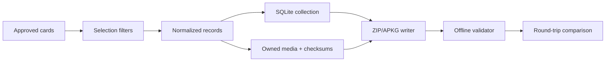

# APKG Export

Feature 003 exports approved learner cards to a bounded, atomic Anki package.

## Flow

The export target is isolated as `LinguaBrainAnkiExport`. It depends on domain/application/media/persistence ports but never mutates canonical learner state. The app integration only supplies selection and a `FileDocument` destination.

## Safety boundary

- Only approved bundles are eligible.
- Temporary workspaces are removed on success and failure.
- Destination replacement is atomic.
- Media is copied only through the owned-media resolver.
- Package validation is offline and reports text-only fallback when media is missing.

## Known release boundary

Package-level export and round-trip tests pass. Physical device UI export/share verification and performance measurement on a 500-card real learner dataset remain release activities.
