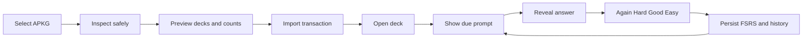

# Anki Core MVP Specification

## Objective

Deliver a small, reliable, offline flashcard product that imports learner-owned
Anki decks and completes a durable spaced-repetition review loop. This is the
foundation gate for later LinguaBrain intelligence, not a commitment to clone
all Anki features.

## Supported first journey

## Functional requirements

### Import

- `ANKI-IMP-001`: Select one `.apkg` through the native document picker.
- `ANKI-IMP-002`: Detect unsupported, corrupt, encrypted, or oversized packages
  before changing the learner store.
- `ANKI-IMP-003`: Preview deck names, note/card counts, media count, and warnings.
- `ANKI-IMP-004`: Import notes, cards, templates needed for rendering, tags, deck
  hierarchy, supported images, and supported audio.
- `ANKI-IMP-005`: Preserve source package and external note/card identifiers for
  provenance and deterministic re-import.
- `ANKI-IMP-006`: Default to fresh LinguaBrain scheduling; progress import is off.
- `ANKI-IMP-007`: Cancel or fail atomically with no partial learner records.
- `ANKI-IMP-008`: Re-import according to an explicit add/update/keep-local report.

### Library and rendering

- `ANKI-LIB-001`: List imported decks, child decks, card counts, and due counts.
- `ANKI-LIB-002`: Search supported text fields and filter due/new/suspended cards.
- `ANKI-REN-001`: Render question and answer separately from a sanitized snapshot.
- `ANKI-REN-002`: Display supported local image and audio media offline.
- `ANKI-REN-003`: Use a readable fallback when a template feature is unsupported.
- `ANKI-REN-004`: Preserve German LTR and Persian RTL content explicitly.

### Review

- `ANKI-REV-001`: Build a stable due queue from persisted ReviewUnits.
- `ANKI-REV-002`: Reveal does not count as success or advance mastery.
- `ANKI-REV-003`: Enable ratings only after reveal.
- `ANKI-REV-004`: Again, Hard, Good, and Easy map to four explicit scheduler inputs.
- `ANKI-REV-005`: Commit rating, FSRS state, due date, and review evidence atomically.
- `ANKI-REV-006`: Prevent accidental duplicate submission.
- `ANKI-REV-007`: Resume safely after process termination or restart.
- `ANKI-REV-008`: Show session progress and a basic completion summary.

### Data ownership

- `ANKI-DATA-001`: Work fully offline after import.
- `ANKI-DATA-002`: Delete an imported deck and its unreferenced media safely.
- `ANKI-DATA-003`: Keep import provenance and user edits distinguishable.
- `ANKI-DATA-004`: Exclude temporary extracted package data from backup and logs.

## Explicitly deferred

- AnkiWeb sync and Anki add-ons.
- Full CSS/JavaScript/template compatibility.
- `.colpkg` collection replacement semantics.
- Importing legacy scheduling/review history.
- APKG export and round-trip fidelity.
- AI generation, OCR, Knowledge Graph, Digital Twin, and adaptive daily planning.

## Security requirements

- Reject absolute paths, parent traversal, symlinks, and duplicate normalized paths.
- Apply compressed-size, expanded-size, entry-count, and per-entry limits.
- Extract only into an app-owned temporary directory.
- Never execute imported JavaScript or external URLs as trusted application code.
- Allow only supported media types after content inspection, not extension alone.
- Sanitize HTML and block file/network access outside approved media resolution.
- Delete temporary content on success, failure, and cancellation.

Exact limits belong to the security specification and importer fixtures.

## Test deck matrix

| Fixture | Purpose |
| --- | --- |
| Minimal text | One deck, one note, front/back |
| German–Persian RTL/LTR | Mixed direction and Unicode correctness |
| Media | Local image and audio playback |
| Nested decks | Hierarchy and due counts |
| Duplicate re-import | Stable identity and conflict report |
| Unsupported template | Safe fallback rendering |
| Corrupt database | Atomic rejection |
| Archive traversal/bomb | Import security limits |
| Large valid deck | Memory, latency, cancellation, and progress |

## Anki Core exit criteria

The gate passes when:

1. a representative learner deck imports with an approved summary;
2. every imported card remains usable offline after restart;
3. a learner completes a session using all four ratings;
4. scheduler outputs match pinned deterministic vectors;
5. review history and due state survive forced termination;
6. corrupt and adversarial fixtures produce no partial commit;
7. re-import does not create uncontrolled duplicates;
8. iPhone, iPad, and Mac pass the same semantic integration tests.

Only after this gate passes may AI card generation become the next critical-path
feature. Visual refinement may continue for usability fixes, but final graphic
approval remains deferred.
